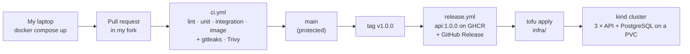

# Example · `capstone/README.md`

**This is an example of the file you write in your fork as `capstone/README.md`. It's for a made-up fork that claims Minimum plus two of the three Target items. Use it to see the shape and how much detail each part needs.**

- **Don't copy it as it is.** Your commands, links, numbers and sentences must come from your own fork. The links below use `<you>` and made-up numbers, so they open nothing.
- **The boxes that start with 🛈** explain the example. They are not part of it: leave them out of your file.
- **The rules are in the [capstone brief](README.md)** (section 6 for the headings). The steps are in [What to do, step by step](what-to-do.md).

Everything below the line is the example file.

---

# Capstone · `<you>/turiba-devops-labs`

The course todo app, from a commit to a running cluster: Compose on my laptop, CI on every pull request, a release from a tag, and Helm on a kind cluster that OpenTofu builds.

## Run it from zero

Tested on 27 Nov 2026 in a new folder with no kind clusters, on Windows 11 with WSL (Ubuntu) and Docker Desktop. It took 9 minutes, most of it image downloads.

**You need:** Docker, kind, kubectl, Helm and OpenTofu (the course setup from S1, S7, S9 and S10).

```bash
# 1 · Get the code
git clone https://github.com/<you>/turiba-devops-labs.git
cd turiba-devops-labs

# 2 · The whole app on this laptop, with Compose
cp .env.example .env                # the practice values are fine for a local run
docker compose up -d
docker compose ps                   # db, api and web are running
# open http://localhost:8080 and add a todo

# 3 · The cluster, from code: the kind cluster, the Namespace, the Secret and my chart
cd infra
tofu init
tofu apply                          # type yes; about 3 minutes
kubectl -n course get pods          # 3 api + 1 db, all 1/1 Running

# 4 · Use the app on the cluster (a second terminal for the port-forward)
kubectl -n course port-forward service/api 8081:80
curl -s -X POST -H 'Content-Type: application/json' -d '{"title":"hello"}' localhost:8081/api/todos
curl -s localhost:8081/api/todos

# 5 · Clean up
tofu destroy                        # in infra/; type yes
cd .. && docker compose down
```

OpenTofu makes the database password itself (`random_password`), so there is no Secret command. A rebuild with `tofu destroy` and then `tofu apply` took 4 minutes.

> 🛈 **Without `infra/` (Minimum only),** step 3 is the cluster, the Namespace, the Secret and the chart by hand, as in Mission 9. The Secret command has a placeholder, never your real password:
>
> ```bash
> kind create cluster
> kubectl create namespace course
> kubectl -n course create secret generic db-secret --from-literal=password='<choose a password>'
> helm install course-app charts/course-app -n course
> ```
>
> Clean-up is then `kind delete cluster`. Write the date you tested it, and test it word for word in a new folder.

## Architecture



Every change starts on a branch and reaches `main` only through a pull request, and only when the required checks are green. A tag `v1.x.y` on `main` starts `release.yml`, which builds the API image for `amd64` and `arm64`, pushes it to GHCR and creates the GitHub Release. The Helm chart in `charts/course-app/` names that exact image tag. `tofu apply` in `infra/` builds the kind cluster, creates the Namespace and the database Secret, and installs the chart. On the cluster, three API Pods sit behind one Service, and PostgreSQL keeps its data on a PVC.

> 🛈 **Your own words here.** The diagram can look much like this one, because everyone builds the same system. Write the sentences yourself: at the exam you explain this flow out loud.

## What is where

| Path | What it is |
|------|------------|
| `api/Dockerfile` | Multi-stage build of the API; runs as the user `node` (Lab 2) |
| `compose.yaml`, `.env.example` | The app on my laptop: `db`, `api` and `web` (Lab 4) |
| `web/nginx.conf` | The front end's proxy to the API (Lab 4) |
| `.github/workflows/ci.yml` | CI on every PR and on `main`: `lint`, `unit`, `integration`, `image` (with the smoke test and the Trivy scan), `gitleaks` |
| `.github/workflows/release.yml` | On a `v*` tag: the multi-arch image on GHCR and the GitHub Release (Lab 6) |
| `.github/dependabot.yml` | Weekly update PRs for `npm`, `github-actions` and `docker` |
| `k8s/` | Plain manifests from Missions 7–8, kept for the mission checks. The chart replaced them |
| `charts/course-app/` | The Helm chart: API, PostgreSQL, Services, ConfigMap, PVC (Mission 9) |
| `infra/` | OpenTofu: the kind cluster, the Namespace, the Secret and the chart (Mission 10) |
| `lab1/` … `lab10/` | My mission write-ups |

**Course files I used:** `charts/course-app/templates/db-deployment.yaml` started from the Mission 8 reference file `lab08-run-the-whole-app/reference/db.yaml`. I changed the labels and added the resources.

> 🛈 **Say which course reference or fallback files you used** (brief, rule 4). If you used none, write "None".

## Level and evidence

I claim **Target without T3**: Minimum (M1–M7), plus T1 and T2. T3 is under `## Known issues`.

| Item | Evidence |
|------|----------|
| M1 · Containers | [api/Dockerfile](https://github.com/<you>/turiba-devops-labs/blob/main/api/Dockerfile) · [compose.yaml](https://github.com/<you>/turiba-devops-labs/blob/main/compose.yaml) |
| M2 · Version control | [ruleset on `main`](https://github.com/<you>/turiba-devops-labs/rules/12345678) · [all closed PRs](https://github.com/<you>/turiba-devops-labs/pulls?q=is%3Apr+is%3Aclosed) |
| M3 · CI | [CI run on the last commit of `main`](https://github.com/<you>/turiba-devops-labs/actions/runs/19876543210) · [ci.yml](https://github.com/<you>/turiba-devops-labs/blob/main/.github/workflows/ci.yml) |
| M4 · Release 1.0.0 | [Release v1.0.0](https://github.com/<you>/turiba-devops-labs/releases/tag/v1.0.0) · [the image on GHCR](https://github.com/<you>/turiba-devops-labs/pkgs/container/turiba-devops-labs%2Fapi) · [the release run](https://github.com/<you>/turiba-devops-labs/actions/runs/19876612345) |
| M5 · Kubernetes with Helm | [charts/course-app/values.yaml, `tag: "1.0.0"`](https://github.com/<you>/turiba-devops-labs/blob/main/charts/course-app/values.yaml#L4) · [PR #41: the chart runs 1.0.0](https://github.com/<you>/turiba-devops-labs/pull/41) · upgrade and rollback: [lab9/README.md](https://github.com/<you>/turiba-devops-labs/blob/main/lab9/README.md) |
| M6 · No secrets in Git | [gitleaks run over the whole history](https://github.com/<you>/turiba-devops-labs/actions/runs/19877001234) (started by hand with `workflow_dispatch`) |
| M7 · This file | `## Run it from zero` tested in a new folder on 27 Nov |
| T1 · Infrastructure as code | [infra/](https://github.com/<you>/turiba-devops-labs/tree/main/infra) · rebuild time in `## Run it from zero` |
| T2 · gitleaks | [ci.yml, job `gitleaks`](https://github.com/<you>/turiba-devops-labs/blob/main/.github/workflows/ci.yml#L88) · required in the [ruleset](https://github.com/<you>/turiba-devops-labs/rules/12345678) · [PR #43](https://github.com/<you>/turiba-devops-labs/pull/43) |
| T2 · Trivy | [ci.yml, the scan step](https://github.com/<you>/turiba-devops-labs/blob/main/.github/workflows/ci.yml#L71) · [a run where it passed](https://github.com/<you>/turiba-devops-labs/actions/runs/19876543210) |
| T2 · Dependabot | [dependabot.yml](https://github.com/<you>/turiba-devops-labs/blob/main/.github/dependabot.yml) · [PR #45 by Dependabot, merged](https://github.com/<you>/turiba-devops-labs/pull/45) · [PR #46 by Dependabot, closed with a reason](https://github.com/<you>/turiba-devops-labs/pull/46) |
| T2 · SHA pins | [ci.yml](https://github.com/<you>/turiba-devops-labs/blob/main/.github/workflows/ci.yml) and [release.yml](https://github.com/<you>/turiba-devops-labs/blob/main/.github/workflows/release.yml): every action outside `actions/…` is pinned to a commit SHA, with the version in a comment · [PR #44](https://github.com/<you>/turiba-devops-labs/pull/44) |

> 🛈 **One row per item you claim, and every link must open.** Open each one in a private browser window, because the grader isn't logged in as you. [What to do, section 4](what-to-do.md#4--how-to-get-the-evidence-links) shows where each link comes from.

## When it breaks

The three faults I think are most likely on my cluster, and the command that shows each one:

| Fault | What you see | The command that shows the cause |
|-------|--------------|----------------------------------|
| The image tag in `values.yaml` doesn't exist on GHCR (a typo, or the release failed) | A new API Pod in `ErrImagePull` or `ImagePullBackOff` while the old ones keep running; `helm upgrade` still says `deployed` | `kubectl -n course describe pod -l app=api` → the Events at the end say `Failed to pull image` and `not found` |
| *(your second fault)* | | |
| *(your third fault)* | | |

> 🛈 **Pick faults that could really happen to *your* system,** for example from the break-fix parts of Missions 7–10, and test each command once. The example gives only one row on purpose: the other two are yours.

## Known issues

- **T3 is not done.** I installed kube-prometheus-stack and logged in to Grafana, but I didn't finish the dashboard in time: it has two of the four panels, and I didn't export it or commit it. I don't claim T3.
- **The `web` front end runs only in Compose,** not on the cluster. The brief makes it optional.

> 🛈 **An honest gap costs less than a hidden one.** A claimed item that doesn't work loses its points *and* points in Documentation. Listed here, it loses nothing in Documentation. Nothing to report? Write "None known", and mean it.

## AI use

I used an AI chat assistant to explain two error messages (a Helm template error and the Trivy output for an old `openssl`) and to check my Mermaid syntax. I wrote the workflows, the chart changes and this file myself, and I ran every command in `## Run it from zero` myself.

> 🛈 **2–5 lines, honestly** (the course rules from S1). At the exam you explain every line of your fork, including anything an AI wrote.
