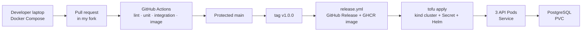

# Capstone · `sachidumaleesha/turiba-devops-labs`

The course todo application from a commit to a running cluster: Docker Compose runs the full application locally, GitHub Actions tests and publishes the API, and OpenTofu creates a kind cluster and installs the Helm release.

## Run it from zero

I tested these steps on 27 November 2026 in a fresh clone on Windows 11 with WSL Ubuntu and Docker Desktop. I started with no running Compose containers and no kind clusters. The Compose application, Kubernetes deployment, persistent database, Helm upgrade and rollback, and an OpenTofu destroy/rebuild all passed.

**Prerequisites:** Git, Docker Desktop with WSL integration, kind, kubectl, Helm and OpenTofu.

```bash
# 1. Clone the repository
git clone https://github.com/sachidumaleesha/turiba-devops-labs.git
cd turiba-devops-labs

# 2. Run the complete application locally with Compose
cp .env.example .env
printf 'DB_PASSWORD=%s\n' '<choose-a-local-password>' > .env
docker compose up -d --build
docker compose ps

# Open http://localhost:8080, or check it from the terminal
curl --fail http://localhost:8080/
curl --fail http://localhost:8080/api/todos

# Stop the local stack before starting the cluster
docker compose down

# 3. Create the kind cluster, Namespace, generated Secret and Helm release
cd infra
tofu init
tofu apply

# OpenTofu prints: kube_context = "kind-course"
kubectl -n course get pods
kubectl -n course get deploy api \
  -o jsonpath='{.spec.template.spec.containers[0].image}'; echo
```

The image command must print:

```text
ghcr.io/sachidumaleesha/turiba-devops-labs/api:1.0.0
```

OpenTofu generates the database password with `random_password` and creates `course/db-secret`, so there is no manual Secret command and no password is stored in Git.

In a second terminal, expose the API:

```bash
kubectl -n course port-forward service/api 8081:80
```

Back in the first terminal, test the API and persistent database:

```bash
curl --fail -X POST \
  -H 'Content-Type: application/json' \
  -d '{"title":"survives database pod replacement"}' \
  http://localhost:8081/api/todos

curl --fail http://localhost:8081/api/todos
kubectl -n course delete pod -l app=db
kubectl -n course wait --for=condition=Ready pod -l app=db --timeout=120s
curl --fail http://localhost:8081/api/todos
```

The same todo must appear after the replacement database Pod becomes ready.

Test the Helm lifecycle from `infra/`:

```bash
helm upgrade course-app ../charts/course-app -n course --set api.replicas=2
kubectl -n course rollout status deployment/api --timeout=120s
kubectl -n course get deployment api

helm rollback course-app 1 -n course
kubectl -n course rollout status deployment/api --timeout=120s
kubectl -n course get deployment api
helm -n course history course-app

tofu plan       # No changes
tofu destroy
tofu apply      # Rebuild everything once more
kubectl -n course get pods
tofu destroy    # Final cleanup
```

On this laptop, WSL's Docker credential helper initially blocked the first public `kindest/node` pull. Pulling the provider's pinned image once from Windows PowerShell fixed it; the following `tofu apply` succeeded:

```powershell
docker pull kindest/node:v1.37.0@sha256:a1ed56cfb0e7b93589bdf97c8cd566405a265939e3620fc4f5de89adff580ae5
```

## Architecture



Every repository change reaches protected `main` through a pull request after the required checks pass. A `v1.x.y` tag starts `release.yml`, which builds the API image for `linux/amd64` and `linux/arm64`, publishes it to GHCR and creates the GitHub Release. The Helm chart references that exact release tag rather than `latest`. OpenTofu creates the kind cluster, Namespace, generated database Secret and Helm release; PostgreSQL stores its data on a PVC.

## What is where

| Path | Purpose |
|------|---------|
| `api/Dockerfile` | Multi-stage API image with a pinned base image, non-root `node` user and health check |
| `compose.yaml`, `.env.example` | Local `db`, `api` and `web` stack; the real `.env` is ignored |
| `web/` | nginx front end and reverse proxy used by Compose |
| `.github/workflows/ci.yml` | Required `lint`, `unit`, `integration` and `image` jobs, including the image smoke test |
| `.github/workflows/release.yml` | Builds the multi-platform release image and GitHub Release for `v*` tags |
| `k8s/` | Plain Kubernetes manifests retained for Missions 7–8 and their checks |
| `charts/course-app/` | Helm chart for three API replicas and PostgreSQL with probes, resources, ConfigMap, Secret reference and PVC |
| `infra/` | OpenTofu configuration for the kind cluster, Namespace, generated Secret and Helm release |
| `lab1/` … `lab10/` | My lab write-ups and evidence |
| `capstone/README.md` | This tested runbook and capstone evidence |

I used the standard course application and assignment materials. My Mission 7–10 write-ups record that I used no fallback image, no fallback Mission 7/8 files, and no fallback Helm chart.

## Level and evidence

I currently claim **Target without T3**: Minimum (M1–M7), T1 (Infrastructure as code) and T2 (Security gates). T3 is listed honestly under `## Known issues` and is not claimed.

| Item | Evidence |
|------|----------|
| M1 · Containers and local development | [`api/Dockerfile`](https://github.com/sachidumaleesha/turiba-devops-labs/blob/main/api/Dockerfile) · [`compose.yaml`](https://github.com/sachidumaleesha/turiba-devops-labs/blob/main/compose.yaml) · [Compose PR #7](https://github.com/sachidumaleesha/turiba-devops-labs/pull/7) · fresh-clone test on 27 Nov 2026 |
| M2 · Version control | [active `protect-main` ruleset](https://github.com/sachidumaleesha/turiba-devops-labs/rules/25098939) · [merged pull requests](https://github.com/sachidumaleesha/turiba-devops-labs/pulls?q=is%3Apr+is%3Amerged) |
| M3 · CI | [green CI run on the tagged `main` commit](https://github.com/sachidumaleesha/turiba-devops-labs/actions/runs/45980616569) · [`ci.yml`](https://github.com/sachidumaleesha/turiba-devops-labs/blob/main/.github/workflows/ci.yml) · [smoke-test PR #13](https://github.com/sachidumaleesha/turiba-devops-labs/pull/13) |
| M4 · Release 1.0.0 | [Release `v1.0.0`](https://github.com/sachidumaleesha/turiba-devops-labs/releases/tag/v1.0.0) · [release workflow run](https://github.com/sachidumaleesha/turiba-devops-labs/actions/runs/45981005905) · [public GHCR package](https://github.com/sachidumaleesha/turiba-devops-labs/pkgs/container/turiba-devops-labs%2Fapi) |
| M5 · Kubernetes with Helm | [`values.yaml` using `1.0.0`](https://github.com/sachidumaleesha/turiba-devops-labs/blob/main/charts/course-app/values.yaml) · [PR #40](https://github.com/sachidumaleesha/turiba-devops-labs/pull/40) · [`lab9/README.md`](https://github.com/sachidumaleesha/turiba-devops-labs/blob/main/lab9/README.md) · fresh install, persistence, upgrade and rollback tested on 27 Nov 2026 |
| M6 · No secrets in Git | [ignored local secrets and state](https://github.com/sachidumaleesha/turiba-devops-labs/blob/main/.gitignore) · [`infra/.gitignore`](https://github.com/sachidumaleesha/turiba-devops-labs/blob/main/infra/.gitignore) · [exact-fingerprint `.gitleaksignore`](https://github.com/sachidumaleesha/turiba-devops-labs/blob/main/.gitleaksignore) · full-history scan of 80 commits passed locally on 27 Nov 2026 |
| M7 · Documentation | This file, including the fresh-clone runbook tested on 27 Nov 2026 |
| T1 · Infrastructure as code | [`infra/`](https://github.com/sachidumaleesha/turiba-devops-labs/tree/main/infra) · [cluster PR #33](https://github.com/sachidumaleesha/turiba-devops-labs/pull/33) · [application PR #34](https://github.com/sachidumaleesha/turiba-devops-labs/pull/34) · [`lab10/README.md`](https://github.com/sachidumaleesha/turiba-devops-labs/blob/main/lab10/README.md) · `destroy → apply` rebuild passed on 27 Nov 2026 |
| T2 · gitleaks | [`ci.yml`, job `gitleaks`](https://github.com/sachidumaleesha/turiba-devops-labs/blob/main/.github/workflows/ci.yml) · [required in the `protect-main` ruleset](https://github.com/sachidumaleesha/turiba-devops-labs/rules/25098939) · [PR #42](https://github.com/sachidumaleesha/turiba-devops-labs/pull/42) · [green `main` run](https://github.com/sachidumaleesha/turiba-devops-labs/actions/runs/45986407382) |
| T2 · Trivy | [`ci.yml`, scan before push](https://github.com/sachidumaleesha/turiba-devops-labs/blob/main/.github/workflows/ci.yml) · [PR #43](https://github.com/sachidumaleesha/turiba-devops-labs/pull/43) · [green `main` run](https://github.com/sachidumaleesha/turiba-devops-labs/actions/runs/45987469783) |
| T2 · Dependabot | [`.github/dependabot.yml`](https://github.com/sachidumaleesha/turiba-devops-labs/blob/main/.github/dependabot.yml) · [configuration PR #44](https://github.com/sachidumaleesha/turiba-devops-labs/pull/44) · [Dependabot PR #45 closed with the reason](https://github.com/sachidumaleesha/turiba-devops-labs/pull/45) |
| T2 · SHA pins | [`ci.yml`](https://github.com/sachidumaleesha/turiba-devops-labs/blob/main/.github/workflows/ci.yml) and [`release.yml`](https://github.com/sachidumaleesha/turiba-devops-labs/blob/main/.github/workflows/release.yml) · [PR #49](https://github.com/sachidumaleesha/turiba-devops-labs/pull/49) · [green `main` run](https://github.com/sachidumaleesha/turiba-devops-labs/actions/runs/46043383966) |

## When it breaks

| Likely fault | What I expect to see | Command that shows the cause |
|--------------|----------------------|------------------------------|
| The image tag does not exist or the GHCR package is inaccessible | API Pods enter `ErrImagePull` or `ImagePullBackOff` | `kubectl -n course describe pod -l app=api` and read the Events section |
| The API cannot connect to PostgreSQL because the Service, ConfigMap or Secret is wrong | API Pods are not ready, restart, or log database connection failures | `kubectl -n course logs deployment/api --all-pods=true` and `kubectl -n course get configmap app-config -o yaml` |
| The database PVC cannot bind or mount | The database Pod remains `Pending` or reports a mount error | `kubectl -n course describe pvc db-data` and `kubectl -n course describe pod -l app=db` |

For a general first look I use `kubectl -n course get pods`, then `kubectl -n course describe pod <pod>` for events and `kubectl -n course logs <pod>` for application output.

## Known issues

- **T3 is not implemented yet.** kube-prometheus-stack, `observability/dashboard.json` and the Grafana screenshot are not present.
- On this Windows laptop, WSL's Docker credential helper could not perform the first kind image pull. Pulling the exact image once through Windows Docker made the subsequent OpenTofu build and rebuild pass.
- The web front end runs only under Compose. The capstone makes the front end optional on Kubernetes; the cluster intentionally runs the API and PostgreSQL only.

## AI use

I used OpenAI Codex to audit the fork against the capstone brief, help restore retained mission files, verify CI and release evidence, run the fresh-clone Compose/OpenTofu tests, and draft this write-up from the observed results. I reviewed the commands and outputs, and I will rehearse and explain the repository flow myself for the exam.
