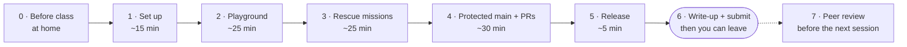

# Lab 3 · Branch, review, release

**From "upload files" to a protected `main`, reviewed pull requests and your first release, plus the Git skills to undo almost anything**

DevOps (ELE1013M) · Turiba University · Session 3 · theory first (about 65 min), then this lab at your own pace · individual work, plus a peer review after the deadline
Theory: Session 3 slides "Git & GitHub collaboration" (BATIS) · Background reading: Agarwal, *Modern DevOps Practices* 2e, ch. 2 (BATIS); *Pro Git*, ch. 2–3 (git-scm.com/book, free) · GitHub Docs: *About pull requests*, *About rulesets*

| | |
|-|-|
| **You will** | Push without a password; see how Git stores commits and branches; merge, resolve a conflict and undo mistakes safely; protect `main`; take two changes through pull requests; publish release `v0.1.0`; review a classmate's work |
| **You hand in** | The URL of your fork on Evaluentis: `https://github.com/<you>/turiba-devops-labs`. The grader finds your pull requests, tag, release and write-up by itself |
| **Passed when** | Every gate in the pass checklist (Part 6) passes. A script checks the facts in your fork; an LLM reads your answers and write-ups against the rubric |
| **Deadline** | **22:00 on the day of the session** for Parts 1–6. A snapshot of your fork is taken at 22:05. Part 7, the peer review: before the next session |



---

## How the lab works

Theory comes first, as a fast tour. Then you work through this guide **at your own pace**. Ask questions at any time. **When you have submitted, you can leave.** Some of you will be done in 90 minutes; others need the whole evening. Both are fine.

| Part | Typical time | Theory slides |
|------|-------------:|--------------:|
| 0 · Before class | at home, 10 min | 10 |
| 1 · Set up Git properly | 15 min | 9, 10, 21 |
| 2 · Playground: commits, branches, merges, a conflict | 25 min | 6–8, 11–16 |
| 3 · Rescue missions | 25 min | 17–20 |
| 4 · Protected `main` and your first two pull requests | 30 min | 22–26 |
| 5 · Release `v0.1.0` | 5 min | 28–29 |
| 6 · Write-up as PR #3, submit | 10 min | — |
| 7 · Peer review | later, 20 min | 25 |

- Do the parts **in order**. Part 4 needs the SSH setup from Part 1, and Part 6 needs everything before it.
- Stuck on one step for more than 10 minutes? Check the troubleshooting table at the end, then raise your hand.
- Not finished when the room closes? Push what works, then finish at home before 22:00.

---

## How to read this guide

- Type the commands. Don't copy and paste them. The entry test showed that knowing a command and typing it from memory are different skills.
- `<you>` means your GitHub username in **lowercase**. `<reviewer>` is the classmate who reviews your work: the review ring is shown in class and posted on BATIS. Remove the angle brackets.
- Commands are written for **bash**: on Windows, use the **Ubuntu (WSL)** terminal, as in Labs 1 and 2. Avoid Git Bash: it has its own Git config and SSH keys, separate from WSL.
- ✅ **Checkpoint** boxes tell you what you should see. If you see something else, check the troubleshooting table before asking.
- 📝 **README** marks a result you need in `lab3/README.md` (you create it in step 1.4). Write it down when you get it, not at 21:55.

> ⚠️ **Two rules for your fork in this lab**
> 1. **Add files by name:** `git add CHANGELOG.md`. Never `git add .` or `git commit -a` before Part 6: your notes in `lab3/README.md` must stay out of PR #1 and PR #2.
> 2. **The rescue missions (Part 3) happen in `~/git-rescue`**, not in your fork. Commands like `git reset --hard` belong there.

---

## Part 0 · Before class (at home, 10 min)

1. **Lab 2 is on GitHub**, pushed or uploaded. If you uploaded it in the browser, that's fine: step 1.3 brings it to your laptop.
2. **Git 2.23 or newer** (Ubuntu 24.04 has 2.43):

   ```bash
   git --version
   ```

3. **Five settings, once per machine** (slide 10):

   ```bash
   git config --global user.name "Your Name"
   git config --global user.email "you@example.com"      # the e-mail on your GitHub account (or its noreply address)
   git config --global init.defaultBranch main
   git config --global core.editor "nano"                # or "code --wait" for VS Code
   git config --global pull.rebase false
   git config --global --list
   ```

✅ **Checkpoint:** `--list` shows `user.name`, `user.email`, `init.defaultbranch=main`, `core.editor` and `pull.rebase=false`.

---

## Part 1 · Set up Git properly (about 15 min)

### 1.1 An SSH key for GitHub (slide 21)

```bash
ls ~/.ssh/id_ed25519.pub 2>/dev/null || ssh-keygen -t ed25519 -C "you@example.com"
cat ~/.ssh/id_ed25519.pub
```

`ssh-keygen` asks three questions. Press **Enter** for the file name. A passphrase is recommended; if you set one, see the troubleshooting table for `ssh-agent`.

Copy the **whole line** that `cat` prints (it starts with `ssh-ed25519`). On GitHub: your avatar → **Settings → SSH and GPG keys → New SSH key**. Title: `laptop WSL`. Key type: **Authentication key**. Paste. **Add SSH key**.

Never paste `~/.ssh/id_ed25519` (without `.pub`). That is the private key, and it never leaves your laptop.

```bash
ssh -T git@github.com
```

The first time, SSH shows GitHub's fingerprint and asks `Are you sure you want to continue connecting (yes/no)?`. Check that it says `SHA256:+DiY3wvvV6TuJJhbpZisF/zLDA0zPMSvHdkr4UvCOqU` (GitHub's ED25519 key, listed in GitHub Docs), then type `yes`.

✅ **Checkpoint:** `Hi <you>! You've successfully authenticated, but GitHub does not provide shell access.` The command ends with exit code 1. That's normal: GitHub just won't give you a shell.

**Port 22 blocked?** If `ssh -T` hangs and times out, the network blocks SSH's port. Use port 443 instead:

```bash
cat >> ~/.ssh/config <<'EOF'
Host github.com
  Hostname ssh.github.com
  Port 443
  User git
EOF
ssh -T git@github.com
```

### 1.2 Point your clone at SSH, add the course repo (slide 9)

```bash
cd ~/turiba-devops-labs                 # your clone from Lab 1; change the path if it is somewhere else
git remote -v
git remote set-url origin git@github.com:<you>/turiba-devops-labs.git
git remote add upstream https://github.com/mleitass/turiba-devops-labs.git
git remote -v
```

✅ **Checkpoint:** `origin` is `git@github.com:<you>/…` (your fork, SSH) and `upstream` is `https://github.com/mleitass/…` (the course repo).

### 1.3 Get in sync

```bash
git status
git pull                                # anything you uploaded in the browser in Lab 1 or 2
git fetch upstream
git merge upstream/main                 # Lab 3 material from the course repo
git push                                # no password prompt any more
ls lab03-branch-review-release
```

If `git merge` opens the editor, it is asking for a merge commit message: your `main` has your own lab commits, and the course repo has new ones. The default message is fine. In nano: **Ctrl+O**, **Enter**, **Ctrl+X**.

✅ **Checkpoint:** `git push` asks for no password. `git status` says `Your branch is up to date with 'origin/main'`. `ls` shows `README.md`, `rescue.sh` and `write-up-template.md`, and `CHANGELOG.md` and `.github/pull_request_template.md` now exist.

### 1.4 Start your write-up

```bash
mkdir -p lab3
cp lab03-branch-review-release/write-up-template.md lab3/README.md
code lab3/README.md                     # or: nano lab3/README.md
```

`lab3/README.md` stays **untracked** until Part 6. That is on purpose: an untracked file stays with you when you switch branches, and nothing in Parts 2–5 touches it. Keep the headings as they are: the grader looks for them by name.

📝 **README, Part 1:** the output of `ssh -T git@github.com` and of `git remote -v`.

✅ **Checkpoint Part 1:** you can push without a password, and `git status` lists `lab3/` as untracked.

---

## Part 2 · Playground (about 25 min)

A practice repo **outside your fork**. Nothing here is submitted except the notes you copy into your README.

### 2.1 A new repo, and what Git doesn't see (slides 6, 12)

```bash
mkdir ~/git-playground && cd ~/git-playground
git init
git status                              # On branch main · No commits yet
printf '#!/bin/sh\necho "deploying version 1"\n' > deploy.sh
mkdir config
git status
```

✅ **Checkpoint:** `deploy.sh` is listed as untracked, but `config/` is not listed at all. Git tracks files, not folders. Give the folder a file:

```bash
touch config/.gitkeep
git status                              # now config/ appears
```

### 2.2 Three commits (slide 11)

```bash
git add deploy.sh config/.gitkeep
git commit -m "feat: add deploy script"

printf 'REPLICAS=1\n' > config/app.env
git add config/app.env
git commit -m "feat: add app config"

echo 'echo "done"' >> deploy.sh
git diff                                # working tree vs index: one + line
git add deploy.sh
git diff --staged                       # index vs last commit: the same line, now staged
git commit -m "feat: print done after deploy"

git log --oneline
git show HEAD
```

✅ **Checkpoint:** `git log --oneline` lists three commits, newest first, each with a 7-character hash.

### 2.3 Look inside `.git` (slides 7–8)

```bash
cat .git/HEAD                           # ref: refs/heads/main
cat .git/refs/heads/main                # one 40-character hash
git cat-file -t HEAD                    # commit
git cat-file -p HEAD                    # tree, parent, author, committer, message
git cat-file -p 'HEAD^{tree}'           # the project folder: deploy.sh, config
git cat-file -p HEAD:deploy.sh          # the file's content, read from the object store
```

📝 **README, Part 2:** the hash in `.git/refs/heads/main`, and the first line of `git cat-file -p HEAD` (`tree …`).

✅ **Checkpoint:** the hash in `refs/heads/main` starts with the same 7 characters as the top line of `git log --oneline`. The branch is just a file holding that hash.

### 2.4 Fast-forward (slide 14)

```bash
git switch -c feature/healthcheck
echo 'echo "health: ok"' >> deploy.sh
git add deploy.sh
git commit -m "feat: add health message"
git switch main
git merge feature/healthcheck
```

✅ **Checkpoint:** Git prints `Fast-forward`. No new commit was made: `main` simply moved to the branch's commit.

### 2.5 Three-way merge (slide 14)

```bash
git switch -c feature/logging
echo 'LOG_LEVEL=info' >> config/app.env
git add config/app.env
git commit -m "feat: add log level"

git switch main
echo "# Playground" > README.md
git add README.md
git commit -m "docs: add README"

git merge feature/logging               # the editor opens with "Merge branch 'feature/logging'": save and close
git log --oneline --graph --all
```

✅ **Checkpoint:** `Merge made by the 'ort' strategy.` The graph shows the two lines of work joining in a merge commit.

### 2.6 A conflict (slide 16)

Two branches change the **same line** of `config/app.env`:

```bash
git switch -c feature/scale-up
printf 'REPLICAS=3\nLOG_LEVEL=info\n' > config/app.env
git add config/app.env
git commit -m "feat: scale to 3 replicas"

git switch main
printf 'REPLICAS=2\nLOG_LEVEL=info\n' > config/app.env
git add config/app.env
git commit -m "feat: scale to 2 replicas"

git merge feature/scale-up
```

✅ **Checkpoint:** `CONFLICT (content): Merge conflict in config/app.env`.

```bash
git status                              # config/app.env under "Unmerged paths"
cat config/app.env                      # the conflict block
```

📝 **README:** copy the conflict block.

Now **decide**: 2 or 3 replicas? Open `config/app.env`, keep the line you choose, and delete all three marker lines (`<<<<<<<`, `=======`, `>>>>>>>`). Then:

```bash
git diff --check                        # prints nothing when no markers are left
git add config/app.env
git commit                              # the editor suggests "Merge branch 'feature/scale-up'": save and close
git log --oneline --graph --all
```

📝 **README:** which value you kept and why (one sentence), and the final `git log --oneline --graph --all`.

✅ **Checkpoint Part 2:** you can point at the fast-forward, the three-way merge and the conflict merge in your graph.

---

## Part 3 · Rescue missions (about 25 min)

Eight small repos, each with one problem. You fix them with the undo commands from slides 17–19.

### 3.0 Create the missions

```bash
cd ~/turiba-devops-labs
bash lab03-branch-review-release/rescue.sh setup <you>
ls ~/git-rescue
```

The script creates `~/git-rescue/m1` … `m8` and copies itself to `~/git-rescue/rescue.sh`. From now on:

| Command | Does |
|---------|------|
| `cat ~/git-rescue/mN/MISSION.txt` | What is wrong, and the goal |
| `bash ~/git-rescue/rescue.sh check N` | Prints `PASS mN <code>`, or a hint |
| `bash ~/git-rescue/rescue.sh status` | Checks all eight |
| `bash ~/git-rescue/rescue.sh reset N` | Throws mission N away and creates it again |

**One rule:** don't delete `.git` and start again. That "fix" works for nothing in real life, and the check notices.

The `PASS` code is made from your GitHub username, and the grader recomputes it. Use your own username in `setup`.

### 3.1 Worked example: mission 1

```bash
cd ~/git-rescue/m1
cat MISSION.txt
git status                              # modified: deploy.sh, not staged
git diff                                # the broken lines: a typo, --scale api=0, sleep 99999
git restore deploy.sh                   # back to the last committed version
git status                              # nothing to commit, working tree clean
bash ~/git-rescue/rescue.sh check 1
```

✅ **Checkpoint:** `PASS m1 ` followed by an 8-character code.

Written up, that is:

> ### m1 (worked example)
>
> - PASS line: `PASS m1 2bcb01d6` (yours has a different code)
> - Symptom: `deploy.sh` was changed and broken; nothing staged or committed
> - Command: `git restore deploy.sh`
> - Why this command, and not a more dangerous one: it resets only this one file to the last commit. `git reset --hard` would also throw away every other uncommitted change in the repo, and deleting the folder would lose the history too. Careful: the broken edit is gone for good, because it was never committed (slide 17).

### 3.2 Now you: missions 2–6

Solve **at least four of missions 2–6**. Read each `MISSION.txt` first, then start with the hint in the right column.

| # | What you see | Start with | Slide |
|--:|--------------|------------|------:|
| 2 | `.env` with a password is staged together with a real change in `app.js` | `git status`: what is under "Changes to be committed"? | 17, 12 |
| 3 | The last commit is called `fxi typo` and is missing `CONTRIBUTING.md`. Not pushed | `git log --oneline`, `git status` | 17 |
| 4 | Two commits on `main` belong on a branch `feature/cache`. Not pushed | `git log --oneline --graph --all` | 17 |
| 5 | `feat: set replicas to 0` is pushed, and the teammate in `~/git-rescue/m5-teammate` has it | `git log --oneline` in both folders. Which command *adds* a commit? | 18 |
| 6 | After `git reset --hard HEAD~3`, three commits are gone | `git reflog` | 19 |
| 7 | *Stretch:* you committed on a detached HEAD after checking out tag `v1.0.0` | `git status` | 8 |
| 8 | *Stretch:* one of 20 commits broke `test.sh` | `git bisect` (slide 35) | 35 |

Messed one up? `bash ~/git-rescue/rescue.sh reset N` and try again.

📝 **README, Part 3:** for each mission you solved, the `PASS` line, then symptom → command → why this command and not a more dangerous one.

✅ **Checkpoint Part 3:** `bash ~/git-rescue/rescue.sh status` shows `PASS` for at least four of m2–m6.

---

## Part 4 · Protected `main` and your first two pull requests (about 30 min)

Back to your fork:

```bash
cd ~/turiba-devops-labs
git switch main
git status                              # up to date with 'origin/main'; lab3/ untracked
```

### 4.1 Protect `main` with a ruleset (slide 26)

On GitHub, in **your fork**: **Settings → Rules → Rulesets → New ruleset → New branch ruleset**.

| Field | Set it to |
|-------|-----------|
| Ruleset name | `protect-main` |
| Enforcement status | **Active** |
| Bypass list | leave empty |
| Target branches | **Add target → Include default branch** |
| Restrict deletions | ✔ |
| Require a pull request before merging | ✔ · Required approvals: **0** · Allowed merge methods: **Merge** and **Squash** (untick Rebase) |
| Block force pushes | ✔ |

Click **Create**. Optional: **Settings → General → Pull Requests → Automatically delete head branches**.

*Why 0 approvals:* you work alone, and you can't approve your own PR. The rule still forces every change through a PR. *Why Merge as well:* course updates come in through a PR merged with a merge commit (the box after 4.7).

### 4.2 Prove it: push straight to `main` (slide 26)

```bash
git commit --allow-empty -m "test: try to push straight to main"
git push
```

✅ **Checkpoint:** the push is refused:

```text
remote: error: GH013: Repository rule violations found for refs/heads/main.
remote: - Changes must be made through a pull request.
 ! [remote rejected] main -> main (push declined due to repository rule violations)
```

📝 **README, Part 4:** copy the rejection.

The test commit is still on your local `main`, and it isn't pushed, so undo it (slide 17):

```bash
git reset --soft HEAD~1
git status                              # up to date with 'origin/main' again
```

### 4.3 PR #1: ignore editor, OS and test files (slides 12, 23)

```bash
git switch -c chore/gitignore-extras
```

Add these lines at the end of `.gitignore`:

```gitignore

# Editors and operating systems
.DS_Store
.vscode/*
!.vscode/extensions.json

# Test output
coverage/
```

Add one line at the **end** of `CHANGELOG.md`, under `### Added`:

```markdown
- `.gitignore` rules for editor, OS and test-coverage files
```

```bash
git status                              # .gitignore and CHANGELOG.md modified; lab3/ untracked
git diff
git add .gitignore CHANGELOG.md         # by name: lab3/ stays out
git diff --staged
git commit -m "chore: ignore editor, OS and coverage files"
git push -u origin HEAD
```

`git push` prints a link: `Create a pull request for 'chore/gitignore-extras' on GitHub by visiting: …`. Open it, or click **Compare & pull request** on your fork's page.

> ⚠️ **Check the base repository.** In a fork, GitHub suggests `mleitass/turiba-devops-labs` as the base. Change it to **`<you>/turiba-devops-labs`**, base **`main`**. If a PR ends up in the course repo by mistake, close it and open it again in your fork.

- **Title:** the commit message, `chore: ignore editor, OS and coverage files`
- **Description:** fill in the template. *What*: the three ignore rules. *Why*: these files differ per person and don't belong in the repo (slide 12). *How tested*: for example, `touch .DS_Store && git status` shows nothing new.
- Open **Files changed** and review your own diff.
- **Create pull request.** **Don't merge it yet.**

> **Why not `.gitattributes`?** Run `cat .gitattributes`. The course repo already has `* text=auto eol=lf`, so every file is stored with LF line endings. That's why `lab2-broken:2` (CRLF in a shell script) can't happen in this repo. `git check-attr eol -- lab03-branch-review-release/rescue.sh` prints `eol: lf`.

### 4.4 PR #2: document `/healthz`, starting from `main` again (slides 13, 24)

```bash
git switch main                         # PR #2 must not contain PR #1's commit
git switch -c docs/api-healthz
```

In `api/README.md`, find the **Endpoints** table and add this row right under the `GET /` row:

```markdown
| `GET /healthz` | Health check: `{"status":"ok"}` while the process runs. Doesn't touch the database (Lab 2) |
```

In `CHANGELOG.md`, add a *different* line at the **same place**, the end of the `### Added` list:

```markdown
- `GET /healthz` documented in `api/README.md`
```

```bash
git add api/README.md CHANGELOG.md
git commit -m "docs: document the /healthz endpoint"
git push -u origin HEAD
```

Open PR #2 the same way: **base repository `<you>/turiba-devops-labs`**, base `main`, template filled in, own diff reviewed. **Don't merge it yet either.**

✅ **Checkpoint:** your fork's **Pull requests** tab shows two open PRs. Neither is in the course repo.

### 4.5 Merge PR #1 and watch PR #2 (slide 15)

On PR #1: **Squash and merge** → **Confirm squash and merge** → **Delete branch**.

Now open PR #2 and reload the page. It says **This branch has conflicts that must be resolved**: both PRs added a line at the same place in `CHANGELOG.md`, and Git can't know which one you want first.

### 4.6 Resolve the conflict on your laptop (slide 16)

```bash
git switch main
git pull                                # main now has PR #1's squash commit
git switch docs/api-healthz
git merge main
```

✅ **Checkpoint:** `CONFLICT (content): Merge conflict in CHANGELOG.md`.

Open `CHANGELOG.md`. The end looks like this:

```text
<<<<<<< HEAD
- `GET /healthz` documented in `api/README.md`
=======
- `.gitignore` rules for editor, OS and test-coverage files
>>>>>>> main
```

Both lines describe real changes, so **keep both** and delete the three marker lines. The order doesn't matter.

```bash
git diff --check                        # no output: no markers left
git add CHANGELOG.md
git commit                              # message: "Merge branch 'main' into docs/api-healthz". Save and close
git push
```

✅ **Checkpoint:** on GitHub, PR #2 no longer shows a conflict, and **Files changed** shows only your README row and one changelog line. **Squash and merge** → **Confirm** → **Delete branch**.

### 4.7 Clean up (slides 15, 24)

```bash
git switch main
git pull
git log --oneline -4                    # two squash commits ending in (#1) and (#2)
git branch -D chore/gitignore-extras docs/api-healthz
git fetch --prune                       # forget the deleted branches on GitHub
git branch -a
```

Why `-D` and not `-d`? After a squash merge, the branch's own commits aren't in `main`, so `git branch -d` says "not fully merged". You checked on GitHub that both PRs are merged, so `-D` is safe.

📝 **README, Part 4:** the links to PR #1 and PR #2.

✅ **Checkpoint Part 4:** `main` on GitHub got its two new commits only through PRs. The numbers in `(#…)` are your PR numbers; they may differ from 1 and 2.

> **Getting course updates from now on**
>
> `main` is protected, so updates from the course repo also come in through a PR. The **Sync fork** button may refuse now. Do this instead:
>
> ```bash
> git switch main && git pull
> git fetch upstream
> git switch -c chore/sync-upstream
> git merge upstream/main                 # save the default merge message if the editor opens
> git push -u origin HEAD
> ```
>
> Open the PR in **your fork**, then merge it with **Create a merge commit**, not squash. A merge commit keeps the course repo's commits as they are, so the next sync doesn't conflict. Then `git switch main && git pull && git branch -D chore/sync-upstream`.

---

## Part 5 · Release `v0.1.0` (about 5 min, slides 28–29)

```bash
git switch main && git pull
git tag -a v0.1.0 -m "v0.1.0: containerized API, protected main"
git show v0.1.0 --no-patch               # tagger, date and message, then the commit
git push origin v0.1.0                  # a plain git push does not send tags
git ls-remote --tags origin
```

On GitHub, in your fork: **Releases** (right-hand column) → **Draft a new release** → **Choose a tag: v0.1.0** → **Generate release notes** → **Publish release**.

✅ **Checkpoint:** `git ls-remote` lists `refs/tags/v0.1.0`. The release page lists your two PRs under *What's Changed*.

📝 **README, Part 5:** the release URL, and one sentence: why `0.1.0` and not `1.0.0`?

---

## Part 6 · Write-up as PR #3, submit (about 10 min)

Finish `lab3/README.md`: every section filled in, and the four answers at the end. Then:

```bash
git switch main && git pull
git switch -c docs/lab3-results
git add lab3/README.md
git status                              # only lab3/README.md is staged
git commit -m "docs: add Lab 3 results"
git push -u origin HEAD
```

Open PR #3 in **your fork**: title `docs: add Lab 3 results`, template filled in, and in the description: `@<reviewer> please review`. **Leave PR #3 open.** Your reviewer comments on it in Part 7.

**Submit on Evaluentis** → *Lab 3* assignment: the URL of your fork, `https://github.com/<you>/turiba-devops-labs`. **Deadline: 22:00 on the day of the session.** The snapshot is taken at 22:05; pushes after that count only for Part 7.

**Submitted? You can leave.**

**Pass checklist.** These gates are exactly what the grader checks (rubric gates G1–G13):

| ✔ | Gate | Check |
|---|------|-------|
| ☐ | G1 | The submitted URL is your public fork of `mleitass/turiba-devops-labs` |
| ☐ | G2 | `git push` works without a password: the `ssh -T` output (or `gh auth status`), with your username, is in the README |
| ☐ | G3 | The ruleset is active on `main`, and the `GH013` rejection is in the README |
| ☐ | G4 | Two PRs are merged into **your fork's** `main` before the deadline |
| ☐ | G5 | One PR contains the resolved conflict; both changelog lines are on `main`; no conflict markers anywhere |
| ☐ | G6 | `.gitignore` on `main` ignores `.DS_Store`, `.vscode/` (except `extensions.json`) and `coverage/` |
| ☐ | G7 | The annotated tag `v0.1.0` is on `main`, and the GitHub Release is published |
| ☐ | G8 | PR #3 with `lab3/README.md` is open, with all headings filled and your reviewer mentioned |
| ☐ | G9 | At least four valid `PASS` lines for missions 2–6 in the README |
| ☐ | G10 | At least three of the four answers are correct |
| ☐ | G11 | No password or token anywhere in the repo, in any branch or commit |
| ☐ | G12 | *Before the next session:* you answered your reviewer's comments and merged PR #3 (passes automatically if no review arrives) |
| ☐ | G13 | *Before the next session:* you reviewed your assigned classmate's PR #3: two comments on the diff, one of them a suggestion |

The quality of your explanations, PR descriptions, commit messages and review is not a gate. It shapes the feedback you get.

---

## Part 7 · Peer review (before the next session, about 20 min, slide 25)

The review window opens **after the 22:00 deadline**. Don't read a classmate's answers before you have submitted your own.

### 7.1 As a reviewer

1. Open your classmate's fork → **Pull requests** → `docs: add Lab 3 results`.
2. **Files changed.** Hover over a line in `lab3/README.md` and click the blue **+**.
3. Write a comment that points at something specific and says why. Click **Start a review**.
4. Leave a second comment. In one of your comments, click the **Add a suggestion** icon (a file with ±) and edit the line to what you would write, for example a clearer explanation for a rescue mission.
5. **Review changes** (or **Finish your review**) → choose **Comment**, **Approve** or **Request changes** → **Submit review**.

**Look for:** every section filled in · at least four `PASS` lines · explanations that say *why*, not only *what* · answers that make sense · no tokens or passwords · Conventional Commit messages.

**Write like this:** "m5: you say revert is 'safer'. Safer than what? Name what `reset --hard` + force push would do to the teammate." **Not like this:** "LGTM", "nice", "wrong".

### 7.2 As an author

1. Reply to every comment: "fixed in `a1b2c3d`", or why you don't agree.
2. A good suggestion: **Commit suggestion**. Otherwise change the file on your laptop on `docs/lab3-results`, commit and push. The PR updates by itself.
3. **Resolve conversation** on each thread you have answered.
4. **Squash and merge** → **Delete branch**. Then on your laptop: `git switch main && git pull && git branch -D docs/lab3-results`.

No review by the evening before the next session? Merge PR #3 anyway and tell the lecturer. G12 passes when no review arrived.

---

## Clean up (after you get your result)

```bash
rm -rf ~/git-playground ~/git-rescue
```

Keep your fork, the ruleset and the tag: S4 continues from here.

---

## Troubleshooting

| Symptom | Likely cause | Fix |
|---------|--------------|-----|
| `Permission denied (publickey)` | The key isn't on GitHub, or you are in a different terminal (Git Bash vs WSL) | `cat ~/.ssh/id_ed25519.pub` in WSL, compare with GitHub → Settings → SSH keys, add it again |
| `ssh -T` hangs, then `Connection timed out` | The network blocks port 22 | The port 443 config in step 1.1 |
| `ssh -T` says "successfully authenticated" but exits with 1 | That is success | GitHub gives no shell, hence the exit code |
| `Enter passphrase for key` on every push | A passphrase without `ssh-agent` | `eval "$(ssh-agent -s)"` then `ssh-add`, once per terminal |
| `git push` still asks for a username and password | `origin` is still HTTPS | `git remote set-url origin git@github.com:<you>/turiba-devops-labs.git` (step 1.2) |
| `error: remote upstream already exists` | You added it before | `git remote set-url upstream https://github.com/mleitass/turiba-devops-labs.git` |
| `The following untracked working tree files would be overwritten by merge: lab1/…` | You uploaded the files in the browser and also have them locally | `mkdir ~/lab-backup && mv lab1 ~/lab-backup/`, then `git pull`; compare the two copies |
| `fatal: Need to specify how to reconcile divergent branches` | `pull.rebase` isn't set | `git config --global pull.rebase false`, then pull again |
| An editor full of `#` lines opened | Git wants a commit or merge message | nano: **Ctrl+O**, **Enter**, **Ctrl+X**. vim: `Esc`, then `:wq` |
| The output stops with `:` at the bottom | The pager (`less`) | Press `q` |
| `ls lab03-branch-review-release`: no such file | Your fork doesn't have the Lab 3 material yet | Step 1.3: `git fetch upstream && git merge upstream/main` |
| `rescue.sh: run setup first` | `setup` was never run, or `RESCUE_ROOT` changed | `bash lab03-branch-review-release/rescue.sh setup <you>` from your fork |
| `fatal: not a git repository` | Wrong folder | `cd ~/git-rescue/mN` (missions) or `cd ~/turiba-devops-labs` (fork) |
| A mission is in a state you can't fix | It happens | `bash ~/git-rescue/rescue.sh reset N` |
| `GH013` when you didn't expect it | You are on `main` | Move the commit to a branch: `git switch -c <branch>`, then `git branch -f main origin/main`, then push the branch |
| The PR opened in `mleitass/turiba-devops-labs` | The base repository default | Close it there; open it again with base repository `<you>/turiba-devops-labs` |
| PR #2 also shows PR #1's changes | You created `docs/api-healthz` while on `chore/gitignore-extras` | Close PR #2; `git switch main`, create the branch again, redo the two edits |
| PR #2 shows no conflict | You merged PR #1 *before* creating `docs/api-healthz`, so PR #2 already started from the new `main` | G5 needs a resolved conflict. Make two new branches from the same `main` (`docs/changelog-a`, `docs/changelog-b`), each adding a different line at the end of `CHANGELOG.md`; open both PRs, merge one, then resolve the other as in 4.6 |
| `error: The branch '…' is not fully merged` | Squash merge (step 4.7) | Check on GitHub that the PR is merged, then `git branch -D` |
| `git push origin v0.1.0` → `src refspec v0.1.0 does not match any` | The tag wasn't created | `git tag -l`; create it with `git tag -a v0.1.0 -m "…"` |
| The tag isn't on GitHub | A plain `git push` doesn't send tags | `git push origin v0.1.0` |
| *Sync fork* says the branch is protected | The ruleset from 4.1 | The "Getting course updates" box after 4.7 |
| `lab3/README.md` ended up in PR #1 or #2 | `git add .` or `git commit -a` | Not fatal. Leave it, and make sure PR #3 has the final version |

---

## Stretch tasks (for fast finishers)

| Task | What you learn |
|------|----------------|
| Missions 7 and 8 | Detached HEAD, `git bisect` (slides 8, 35) |
| A `commit-msg` hook in `~/git-playground` that rejects messages without `feat\|fix\|docs\|chore:` (`.git/hooks/commit-msg`, `chmod +x`) | Slide 11; S5 runs the same check on the server, where nobody can skip it |
| Tag your Lab 2 image to match the release: `docker tag course-api:lab2 ghcr.io/<you>/course-api:0.1.0 && docker push ghcr.io/<you>/course-api:0.1.0` | Slide 29: one version everywhere; S6 automates it |
| Sign your commits with your SSH key: `git config --global gpg.format ssh`, `git config --global user.signingkey ~/.ssh/id_ed25519.pub`, `git config --global commit.gpgsign true`; add the key on GitHub again as a **Signing key** | The *Verified* badge; supply-chain trust in S13 |
| "Poor man's GitHub": `git init --bare /tmp/shared.git`, clone it twice, push from one, pull in the other | A remote is just another repository (slide 5) |
| learngitbranching.js.org, the *Advanced* section | Rebase and relative refs |

---

## Command summary

| Goal | Command |
|------|---------|
| Who am I, where am I | `git config --global --list` · `git status` · `git remote -v` |
| SSH | `ssh-keygen -t ed25519 -C "…"` · `ssh -T git@github.com` |
| Remotes | `git remote set-url origin git@github.com:<you>/…` · `git remote add upstream <url>` · `git fetch upstream` |
| Look | `git diff` · `git diff --staged` · `git log --oneline --graph --all` · `git show <ref>` |
| Inside Git | `cat .git/HEAD` · `git cat-file -t/-p <ref>` |
| Commit | `git add <file>` · `git commit -m "type: …"` |
| Branch | `git switch -c <b>` · `git switch <b>` · `git branch -a` · `git branch -D <b>` · `git fetch --prune` |
| Merge | `git merge <b>` · `git merge --abort` · `git diff --check` |
| Undo, local | `git restore <f>` · `git restore --staged <f>` · `git commit --amend` · `git reset --soft HEAD~1` |
| Undo, pushed | `git revert <sha>` · then `git push` |
| Get lost commits back | `git reflog` · `git reset --hard HEAD@{1}` · `git branch rescue <sha>` |
| Push a branch for a PR | `git push -u origin HEAD` |
| Release | `git tag -a v0.1.0 -m "…"` · `git push origin v0.1.0` · `git ls-remote --tags origin` |
| Rescue missions | `bash ~/git-rescue/rescue.sh check N` · `status` · `reset N` |
