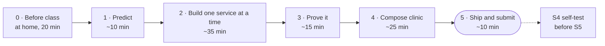

# Lab 4 · Multi-service app with Compose

**From one container to a real application: a web front, the API and PostgreSQL, started with one command, plus the skills to find out why a stack doesn't work**

DevOps (ELE1013M) · Turiba University · Session 4 · theory first, then about 80 minutes of this lab at your own pace · individual work
Theory: Session 4 slides "Application architecture & multi-service apps with Docker Compose" (BATIS) · Docker Docs: *Networking in Compose*, *Control startup order in Compose*, *Volumes* · The `postgres` image on Docker Hub

| | |
|-|-|
| **You will** | Run three services with one command; connect them by name, behind one published door; keep the data when containers go; back it up and restore it; diagnose broken stacks in the Compose clinic |
| **You hand in** | The URL of your fork on Evaluentis: `https://github.com/<you>/turiba-devops-labs`. The grader finds your PR, `compose.yaml`, write-up and clinic fixes by itself |
| **Passed when** | The gates G1–G12 in the pass checklist (80 points), plus the quality of your write-up (20 points). A script checks your fork and runs your stack from a fresh clone; an LLM reads your write-up against the rubric |
| **Deadline** | **Tue 20 Oct 2026, 22:00** (Riga). A snapshot of your fork is taken at 22:05. Then the S4 self-test, before S5 |



---

## How the lab works

Theory comes first. Then you work through this guide **at your own pace**. Ask questions at any time. The core takes about 95 minutes and the room gives you about 80, so many of you will finish at home. That's planned: the deadline is the evening before S5.

| Part | Typical time | Theory slides |
|------|-------------:|--------------:|
| 0 · Before class | at home, 20 min | 2, 1b |
| 1 · Predict | 10 min | 5–7, 22–26a |
| 2 · Build one service at a time | 35 min | 24, 25, 26, 30, 34–37, 45–46 |
| 3 · Prove it | 15 min | 28–31, 38 |
| 4 · Compose clinic | 25 min | 26a, all of B–E |
| 5 · Ship and submit | 10 min | 46, S3 |

- Do the parts **in order**. Each part builds on the one before.
- **Hints are free.** Every step has three, and opening them costs nothing. Stuck for more than 10 minutes? Open the next hint, check the troubleshooting table at the end, then raise your hand.
- **Commit and push after every step.** Work that reaches GitHub can't be lost, and the grader reads only GitHub. Not finished when the room closes? Push what works, and finish at home before Tue 22:00.

---

## How to read this guide

- Type the commands. Don't copy and paste them: typing them is how you learn them.
- `<you>` means your GitHub username in **lowercase**. Remove the angle brackets.
- Commands are written for **bash**: on Windows, use the **Ubuntu (WSL)** terminal, as in Labs 1–3. `check.sh` and `clinic.sh` refuse to run in Git Bash or PowerShell.
- ✅ **Checkpoint** boxes tell you what you should see. If you see something else, open the hints or check the troubleshooting table.
- 📝 **README** marks a result you need in `lab4/README.md` (you create it in step 1.1). Write it down when you get it, not at 21:55.
- 🤔 **Explain it:** one question after each step, with the answer collapsed. Answer it in your head before you open it. If you were wrong, reread the slide. This box is not graded.
- **Hints, three levels, collapsed:** 🔎 **Look** (which command shows the symptom) → 💡 **Think** (the concept, as a question, with the slide) → 🛠 **Fix** (the change, and why the tempting wrong fix is wrong). Try first. Open one level at a time. Hints are free. The Compose clinic in Part 4 has the same three levels.

> ⚠️ **Three rules for your fork in this lab**
> 1. **Every change happens on the branch `feat/compose`**, never on `main`. It reaches `main` through one pull request in **your fork** (Part 5).
> 2. **Add files by name:** `git add compose.yaml`. Never `git add .`: your `.env` and database dumps must never reach Git.
> 3. **Commit and push after every step**, with a Conventional Commit message (`feat: …`, `chore: …`, `docs: …`).

---

## Part 0 · Before class (at home, 20 min)

Problems found at home don't cost you lab time in class.

### 0.1 The Lab 3 minimum

Didn't finish Lab 3? For Lab 4 you need only this from it: your fork cloned in Ubuntu (WSL) at `~/turiba-devops-labs`, the `upstream` remote, and `git push` working without a password (Lab 3 Part 1). A ruleset on `main` is recommended, not required. Make sure Rancher Desktop or Docker Desktop is running.

```bash
cd ~/turiba-devops-labs
git remote -v
```

✅ **Checkpoint:** `origin` is `git@github.com:<you>/turiba-devops-labs.git` (your fork) and `upstream` is `https://github.com/mleitass/turiba-devops-labs.git` (the course repo). Something missing? Do Lab 3 steps 1.1 and 1.2.

### 0.2 Get the Lab 4 material (the sync PR)

The Lab 4 material arrives the way every course update does from Lab 3 on: through a pull request in your fork.

```bash
git switch main && git pull
git fetch upstream
git switch -c chore/sync-upstream
git merge upstream/main
git push -u origin HEAD
```

If `git merge` opens the editor, the default merge message is fine. In nano: **Ctrl+O**, **Enter**, **Ctrl+X**.

Open the link that `git push` prints, or **Compare & pull request** on your fork's page.

> ⚠️ **Check the base repository.** In a fork, GitHub suggests `mleitass/turiba-devops-labs` as the base. In the **base repository** dropdown, choose **`<you>/turiba-devops-labs`**, base **`main`**. If a PR ends up in the course repo by mistake, close it there and open it again in your fork.

Merge it with **Create a merge commit** (not squash), then:

```bash
git switch main && git pull
git branch -D chore/sync-upstream
ls lab04-multi-service-compose
```

If GitHub says *There isn't anything to compare*, your fork already has the material: skip the PR and run the three commands above.

✅ **Checkpoint:** `ls` shows `README.md`, `check.sh`, `clinic.sh`, `compose.start.yaml`, `reference`, `tools` and `write-up-template.md`. A new folder `web/` is at the root of your fork.

### 0.3 Pull the images

The room shares one Docker Hub pull limit. Pull at home:

```bash
docker pull postgres:17-alpine
docker pull nginx:1.30-alpine
docker pull ghcr.io/mleitass/lab4-clinic-api:1
```

The third image is the course API with the Lab 2 work already done. The Compose clinic uses it, so a broken Lab 2 never blocks Part 4. It comes from GitHub's registry and doesn't count against the Docker Hub limit. Planning the Adminer stretch task? Also `docker pull adminer:6`.

### 0.4 Preflight

```bash
bash lab04-multi-service-compose/check.sh preflight
```

`check.sh` is your self-check. It shows what the grader will see, before the grader sees it:

| Command | Checks | When |
|---------|--------|------|
| `bash lab04-multi-service-compose/check.sh preflight` | Docker and Compose, your remotes, the sync, your Lab 2 `api/`, free ports, the images | Now |
| `… check.sh stack` | Gates G3–G8 and G11 on your working copy, and whether the grader can run your `compose.yaml` | Step 2.5 |
| `… check.sh writeup` | G2: the six headings, no blanks left, P1–P6, A1–A4, a clinic folder for each mission you describe | Part 5 |
| `… check.sh clinic` | G10: your exported clinic fixes, re-run the way the grader does it | After Part 4 |
| `… check.sh fresh` | G1 (part), G2–G9: clones your fork's `main` from GitHub and runs the grader's run test | Step 5.6 |
| `… check.sh all` | `stack`, `writeup`, `clinic` and `fresh` together | Before you submit |

✅ **Checkpoint:** only ✔ and ⚠ lines, the line `origin is your fork · GitHub user: <you>`, and `All checks passed.` at the end. Every ✘ line says how to fix it. A ⚠ is a warning: read it, but it doesn't block you.

**Lab 2 fallback.** If `preflight` says that `api/Dockerfile` doesn't build, or that `api/server.js` has no `/healthz` route, use the reference files. It costs no points in Lab 4:

```bash
cp lab04-multi-service-compose/reference/Dockerfile lab04-multi-service-compose/reference/.dockerignore api/
```

For `/healthz`, add the two snippets from `lab04-multi-service-compose/reference/healthz.md` to `api/server.js`. Run `preflight` again. In step 1.1 you commit these files on your branch and set `Reference files used (Lab 2 fallback): yes` at the top of `lab4/README.md`.

---

## Part 1 · Predict (10 min, slides 5–7, 22–26a)

Before you write any YAML, you write down what you expect. Part 3 tests every prediction on your own stack.

### 1.1 Branch and write-up

```bash
git switch main && git pull && git switch -c feat/compose
mkdir -p lab4 && cp lab04-multi-service-compose/write-up-template.md lab4/README.md
code lab4/README.md                     # or: nano lab4/README.md
```

You commit `lab4/README.md` at the end of Part 1, after Part 3, and in step 5.3, so your notes reach GitHub as you go. Keep the headings as they are: the grader finds the sections by name.

Used the Lab 2 fallback in 0.4? Commit it now, on the branch: `git add api/Dockerfile api/.dockerignore api/server.js`, then `git commit -m "fix: use the Lab 2 reference files"` and `git push -u origin HEAD`.

### 1.2 The diagram

Section 1 of the template has a Mermaid skeleton: browser → `web` → `api` → `db`, and the volume. The two boxes are the two networks: `web` sits in `front`, `db` in `back`. Fill in every `____`: the published port, the name and port on each arrow, the networks `api` is on, and the volume name. Then answer the question under the diagram: which arrow crosses from your laptop into Docker?

GitHub draws the diagram when you view the file there. In VS Code, the Markdown preview may show the code only. That's fine.

### 1.3 Six predictions

Fill in the **I predicted** column in section 2 of the template: a letter and a one-line reason. Leave the other columns for Part 3. Predictions are **not graded for being right**: a wrong prediction that you explain in Part 3 earns full marks.

| # | Prediction | Options |
|--:|------------|---------|
| P1 | From inside `web`, `getent hosts db` prints… | a) an IP address · b) nothing · c) `127.0.0.1` |
| P2 | On your laptop, `curl -sv telnet://localhost:5432` (or `nc -zv localhost 5432`)… | a) connects to PostgreSQL · b) is refused · c) times out |
| P3 | After `docker compose down` and `up`, your todo is… | a) still there · b) gone |
| P4 | After `docker compose down -v`, then `docker compose up -d --wait db` (only the database, no `api`)… | a) the todo is still there · b) the todo is gone, but the table is still there · c) the table is gone too |
| P5 | With `db` stopped: `docker compose ps` shows `api` as… and `/api/todos` answers… | a) healthy · 500 · b) unhealthy · 500 · c) exited · 502 |
| P6 | If `app.js` called `http://api:5000/api/todos`, the browser would… | a) get the todos · b) fail: the name isn't found · c) fail: CORS |

📝 **README:** section 1 (the diagram) and the **I predicted** column of section 2.

Commit and push your predictions before you write any YAML. The commit shows when you made them:

```bash
git add lab4/README.md
git commit -m "docs: start the Lab 4 write-up"
git push -u origin HEAD
```

The first push of the branch needs `-u origin HEAD`. After that, `git push` is enough.

✅ **Checkpoint Part 1:** you are on the branch `feat/compose`, every **I predicted** cell has a letter and a reason, and the branch is on GitHub.

---

## Part 2 · Build one service at a time (35 min)

You build the course app's `compose.yaml` in three steps: `db`, then `api`, then `web`. After each step you start what you have and check it, before you add the next service.

```bash
cp lab04-multi-service-compose/compose.start.yaml compose.yaml
code compose.yaml
```

The starter is the file from slide 34 with blanks. The `db` block is active. The `api` and `web` blocks are commented out: you uncomment them in steps 2.3 and 2.4 (select the lines, then **Ctrl+/** in VS Code), so you don't have to retype the indentation. Every blank is `____`, with a comment that asks the question. The slide named in the comment has the answer. The data path, the health-check timings, `restart:` and `name: course-app` are given: they are facts to look up, not concepts.

### 2.1 `.env`: the password stays out of Git (3 min, slide 46)

```bash
cat > .env.example <<'EOF'
# Copy to .env (cp .env.example .env) and put a real password there. .env is never committed.
DB_PASSWORD=change-me
EOF
cp .env.example .env
nano .env                               # replace change-me with a password of your own
git status
```

✅ **Checkpoint:** `git status` lists `.env.example` under *Untracked files* (with `compose.yaml`). `.env` is not listed: the course `.gitignore` ignores it.

> 🤔 **Explain it:** who reads `.env`: Compose or the container? Does `DB_PASSWORD` reach the container by itself?

<details><summary>Answer</summary>

Compose reads `.env` from the folder of `compose.yaml`, to fill in `${…}` in the file. Nothing reaches a container by itself: only what `compose.yaml` passes on, as `environment:` does with `${DB_PASSWORD…}` (slide 46).

</details>

<details><summary>🔎 Hint 1 · Look</summary>

`ls -a`: are `.env` and `.env.example` both next to `compose.yaml`, in the root of your fork? `git status`: is `.env` listed under *Untracked files*?

</details>

<details><summary>💡 Hint 2 · Think</summary>

Which of the two files is the template that everyone gets from Git, and which one holds your real password? Which one does Compose read? (slide 46) Checkpoint: config.

</details>

<details><summary>🛠 Hint 3 · Fix</summary>

`.env.example` holds `DB_PASSWORD=change-me` and is committed. `.env` is your copy with a real password, and the course `.gitignore` ignores it (`.env` and `.env.*`, except `!.env.example`). If `.env` shows up in `git status`, you are in another folder or the `.gitignore` was changed. Never `git add -f .env`: a password in the history stays there for ever (G11).

</details>

No commit yet: `.env.example` goes into the commit of step 2.2.

### 2.2 `db` (10 min, slides 30, 37)

Fill in the `db` blanks: the variable in `${____:?…}`, the volume name (in `db` and again at the bottom of the file; the checkpoints below use `pgdata`), and the host in the health check. Then:

```bash
docker compose up -d db
docker compose ps                       # straight away: you may catch (health: starting)
docker compose up -d --wait db          # returns only once the health check passes
docker compose ps
docker volume ls
```

✅ **Checkpoint:** after `--wait`, `docker compose ps` shows `db` as `Up … (healthy)`. `docker volume ls` lists `course-app_pgdata`: Compose puts the project name in front.

> 🤔 **Explain it:** why is `localhost` right in the health check, when it's wrong everywhere else today?

<details><summary>Answer</summary>

The health check runs **inside** the `db` container, and PostgreSQL listens in that same container. Everywhere else the caller is another container, where `localhost` is the caller itself (slides 24, 37).

</details>

<details><summary>🔎 Hint 1 · Look</summary>

Read the first error line of `docker compose up -d db`, then `docker compose ps` (STATUS) and `docker compose logs db` (the last lines). `docker compose config` prints the file the way Compose understands it: is any `____` left?

</details>

<details><summary>💡 Hint 2 · Think</summary>

`required variable … is missing a value`: which name does `.env` use? (slide 46) `(unhealthy)`: where does the health check run, and which machine is `localhost` there? (slide 37) A volume error: is the name declared at the bottom too? (slide 30) Checkpoint: config, or data.

</details>

<details><summary>🛠 Hint 3 · Fix</summary>

`${DB_PASSWORD:?set DB_PASSWORD in .env}`, `- pgdata:/var/lib/postgresql/data` with `pgdata:` under the top-level `volumes:`, and `"-h", "localhost"`. Then `docker compose up -d --wait db` again. Tempting: deleting the health check so that `--wait` returns at once. Then `api` has nothing to wait for in step 2.3.

</details>

```bash
git add compose.yaml .env.example
git commit -m "feat: add db service with a named volume"
git push
```

### 2.3 `api` (10 min, slides 24, 27, 37)

Uncomment the `api` block (from `# api:` to its `restart:` line) and check that `api:` lines up with `db:`. Fill in its blanks: `DB_HOST`, the `depends_on` condition, the two networks, and the password variable. Then:

```bash
docker compose up -d --build --wait api
docker compose logs api
docker compose exec api getent hosts db
docker compose exec api wget -qO- localhost:5000/api/todos
```

`--wait` can take about 30 seconds: your Lab 2 `HEALTHCHECK` runs every 30 seconds.

✅ **Checkpoint:** the log says `Database ready`. `getent` prints an address and `db`. `wget` prints `[]`: an empty list, straight from PostgreSQL.

> 🤔 **Explain it:** in the same container, `localhost:5000` works, but `localhost:5432` wouldn't. Why?

<details><summary>Answer</summary>

Inside `api`, `localhost` is the `api` container itself. The API listens on 5000 in this container. PostgreSQL listens on 5432 in another container, `db`, which has its own network stack (slides 23, 24).

</details>

<details><summary>🔎 Hint 1 · Look</summary>

`docker compose logs api`: what's the last line? `connect ECONNREFUSED 127.0.0.1:5432` and `getaddrinfo ENOTFOUND` point to different blanks. `--wait` says `unhealthy`? See the troubleshooting table (`/healthz`).

</details>

<details><summary>💡 Hint 2 · Think</summary>

Inside `api`, `localhost` is `api` itself. Which name does Docker's DNS answer for the database? (slide 24) Is `api` on the network where `db` lives? (slide 27) Checkpoint: name, or port.

</details>

<details><summary>🛠 Hint 3 · Fix</summary>

`DB_HOST: db` and `networks: [front, back]`, with `condition: service_healthy`. Then `docker compose up -d --build --wait api` again: Compose recreates only what changed. Tempting: publishing `db`'s port and pointing `DB_HOST` at the laptop. That opens a door into the database for everyone who can reach your laptop.

</details>

```bash
git add compose.yaml
git commit -m "feat: add api service"
git push
```

### 2.4 `web` (10 min, slides 25, 26, 35)

Uncomment the `web` block and fill in its `ports` line. Then open `web/nginx.conf` and fill in the `proxy_pass` line: which service name and which container port does nginx forward `/api/` to?

```bash
docker compose up -d --build --wait
```

Open <http://localhost:8080> in your browser and add a todo in the page. Then add one from the terminal:

```bash
curl -s -X POST localhost:8080/api/todos -H 'Content-Type: application/json' -d '{"title":"<you>: first"}'
```

**Reload the page.** Then:

```bash
docker compose ps
docker compose exec web getent hosts db
```

✅ **Checkpoint:** after the reload, the page lists both todos. In `docker compose ps`, only `web` has a published mapping with an arrow (`0.0.0.0:8080->80/tcp`). `5000/tcp` and `5432/tcp`, without an arrow, are only `EXPOSE`d. `getent` from `web` prints nothing.

> 🤔 **Explain it:** `app.js` calls `/api/todos`, not `http://api:5000/...`. Why does that work, and why would the other fail? And: `ps` shows `5432/tcp` for `db`. Can your laptop reach it?

<details><summary>Answer</summary>

`app.js` runs in your browser, on your laptop, outside Docker. `/api/todos` goes to the same origin, `localhost:8080`, and nginx in `web` forwards `/api/` to `api:5000`. Your laptop can't resolve the name `api`: only containers on the same network can (slide 26). And no: `5432/tcp` without an arrow only documents the port (`EXPOSE`). Nothing is published (slide 25).

</details>

<details><summary>🔎 Hint 1 · Look</summary>

`docker compose ps -a`: is `web` `Up`, or `Restarting`/`Exited`? `docker compose logs web`: is there `host not found in upstream`? `curl -i localhost:8080/api/todos`: which status line comes back?

</details>

<details><summary>💡 Hint 2 · Think</summary>

In `HOST:CONTAINER`, which number is the door on your laptop, and which is where nginx listens? (slide 25) nginx runs inside `web`: which name and which port reach the API from there? (slides 24, 35) Checkpoint: port, or name.

</details>

<details><summary>🛠 Hint 3 · Fix</summary>

`- "8080:80"` and `proxy_pass http://api:5000;`. Then `docker compose up -d --build --wait`: `nginx.conf` is copied into the image, so a change needs `--build`. Tempting: `proxy_pass http://localhost:5000;`. Inside `web`, `localhost` is nginx itself.

</details>

```bash
git add compose.yaml web/nginx.conf
git commit -m "feat: add web proxy and frontend"
git push
```

### 2.5 Check (2 min)

```bash
docker compose config -q
bash lab04-multi-service-compose/check.sh stack
```

✅ **Checkpoint:** `config -q` prints nothing. `check.sh stack` shows ✔ for G3–G8 and G11, ✔ `shape: the grader can run this compose.yaml`, and `All checks passed.`

<details><summary>🔎 Hint 1 · Look</summary>

Each ✘ line names the gate and what was found. `docker compose config` (without `-q`) prints the file the way Compose reads it.

</details>

<details><summary>💡 Hint 2 · Think</summary>

`check.sh` reads `compose.yaml` alone, the way the grader does. Does your stack depend on something only your laptop has: a `compose.override.yaml`, or a variable exported in your shell? (slide 46)

</details>

<details><summary>🛠 Hint 3 · Fix</summary>

Fix what the ✘ line names, then run `check.sh stack` again. `the grader would not run this compose.yaml` means something outside the Lab 4 shape is in `compose.yaml`: the troubleshooting table lists what. Don't change anything in `lab04-multi-service-compose/tools/`: the grader uses its own copy.

</details>

✅ **Checkpoint Part 2:** three services run, the page works on <http://localhost:8080>, and `git log --oneline` on your branch shows one commit per step.

---

## Part 3 · Prove it (15 min, slides 28–31, 38)

Now you test your predictions on your own stack. For each prediction, fill in the rest of its row in section 2 of the write-up: **what I saw** (the command, and the one output line that decides it) · **match?** · **if not: why**. A wrong prediction that you explain well earns full marks.

> ⚠️ **Run these in the Ubuntu (WSL) terminal.** In Windows PowerShell 5.1, `>` writes UTF-16 and `<` doesn't exist, so the backup and the restore in step 3.3 break (slide 31).

### 3.1 Names (P1, P6)

```bash
docker compose exec web getent hosts api
docker compose exec web getent hosts db
```

✅ **Checkpoint:** the first prints an address and `api`. The second prints nothing. P6 follows from P1 by reasoning: your browser is on your laptop, which is not on any Docker network.

> 🤔 **Explain it:** `web` resolves `api`, but not `db`. Which line in `compose.yaml` makes that difference?

<details><summary>Answer</summary>

The `networks:` lines. Docker's DNS answers only for services on a network you share. `web` is on `front`, `db` is on `back`, and only `api` is on both (slides 24, 27).

</details>

<details><summary>🔎 Hint 1 · Look</summary>

`getent hosts api` prints an address and the name. `getent hosts db` prints nothing (and exits with code 2). `docker compose config`: which networks does each service list?

</details>

<details><summary>💡 Hint 2 · Think</summary>

Which networks is `web` on, and which is `db` on? Who needs to talk to whom? (slides 24, 27) Checkpoint: name.

</details>

<details><summary>🛠 Hint 3 · Fix</summary>

Nothing to fix if the output is as in the checkpoint: that's the boundary working. If `web` resolves `db`, `web` is on `back` (or `db` on `front`): put the networks back as in the starter. Then `docker compose up -d --wait`.

</details>

### 3.2 Ports (P2)

```bash
nc -zv -w 3 localhost 5432
curl -sv -m 3 telnet://localhost:5432   # the same test, if nc is missing
```

✅ **Checkpoint:** `Connection refused`, or `Couldn't connect to server`. Nothing on your laptop listens on 5432.

> 🤔 **Explain it:** `api` reaches `db` on 5432 every second. Why can't your laptop?

<details><summary>Answer</summary>

`api` talks to `db` on the `back` network, inside Docker. Your laptop could reach `db` only through a published port, and `db` has no `ports:` (slide 25).

</details>

<details><summary>🔎 Hint 1 · Look</summary>

Read the end of the `nc` line: `succeeded`, `refused` or `timed out`. `docker compose ps`: which PORTS have an arrow?

</details>

<details><summary>💡 Hint 2 · Think</summary>

Which ports are doors from your laptop into Docker? What does `5432/tcp` without an arrow mean? (slide 25) Checkpoint: port.

</details>

<details><summary>🛠 Hint 3 · Fix</summary>

`refused` is the expected result. If it `succeeded`, either your `db` has `ports:` (remove them: only `web` gets a door), or PostgreSQL is installed on your laptop (`sudo ss -ltnp | grep 5432` shows which program). Then you reached a different database: write that into P2's "why".

</details>

### 3.3 Data: down, up, backup and restore (P3, P4)

First, does a todo survive `down` and `up`?

```bash
curl -s -X POST localhost:8080/api/todos -H 'Content-Type: application/json' -d '{"title":"<you>: survive me"}'
docker compose down
docker compose up -d --wait
curl -s localhost:8080/api/todos
```

That decides P3. Now a backup. A dump holds real data, so first make sure it can never reach Git:

```bash
cat >> .gitignore <<'EOF'

# Lab 4: database dumps never go into Git
backup/
EOF
git check-ignore -v backup/todo.sql
git add .gitignore
git commit -m "chore: keep database dumps out of Git"
git push
```

✅ **Checkpoint:** `git check-ignore -v` prints the `.gitignore` line number, `backup/`, and `backup/todo.sql`. The file doesn't exist yet, but Git already ignores it.

Back up, cause the disaster, restore:

```bash
mkdir -p backup
docker compose exec -T db pg_dump -U todo -d todo > backup/todo.sql
grep 'survive me' backup/todo.sql
docker compose down -v
docker compose up -d --wait db
docker compose exec db psql -U todo -d todo -c 'select count(*) from todos'
docker compose exec -T db psql -U todo -d todo < backup/todo.sql
docker compose up -d --wait
curl -s localhost:8080/api/todos
```

✅ **Checkpoint:** `grep` finds your todo in the dump. After `down -v`, the count query fails with `relation "todos" does not exist`: that decides P4. The restore prints `SET`, `CREATE TABLE`, `COPY …` and more. The last `curl` shows your todos again.

**The order matters:** the restore runs after `up -d --wait db` and **before** `api` starts.

> 🤔 **Explain it:** why must the restore run before `api` starts?

<details><summary>Answer</summary>

Look at what the API does when it starts: `ensureSchema()` in `api/db.js`. Then look at the first statements in `backup/todo.sql`: what does the dump try to create? Put the two together, in your own words, in section 3 of the write-up (slide 31).

</details>

<details><summary>🔎 Hint 1 · Look</summary>

`ls -l backup/todo.sql`: is it empty? `head -n 20 backup/todo.sql`: SQL, or an error message? Does the count query print `does not exist`, or a number?

</details>

<details><summary>💡 Hint 2 · Think</summary>

Which command deleted the volume, and which services are running when you restore? (slides 30, 31) Checkpoint: data.

</details>

<details><summary>🛠 Hint 3 · Fix</summary>

An empty dump: `pg_dump` failed. Run it without `> backup/todo.sql` to see the error (often `-T` is missing, or `db` wasn't running). `relation "todos" already exists` during the restore: `api` started first. Do it again in this order: `down -v`, `up -d --wait db`, restore, `up -d --wait`. Tempting: restoring into the full stack and ignoring the errors. Then you don't know whether your data came back.

</details>

📝 **README, section 3:** paste the whole terminal output of the backup block, from `mkdir -p backup` to the last `curl`, commands included. Then the line "Why the restore must run before `api` starts".

### 3.4 Running, healthy, working (P5, slide 38)

```bash
docker compose stop db
docker compose ps
curl -i localhost:8080/api/todos
docker compose up -d --wait db
curl -i localhost:8080/api/todos
docker compose ps api
```

✅ **Checkpoint:** with `db` stopped, `ps` shows `api` as `Up … (healthy)`, and `curl -i` starts with `HTTP/1.1 500`. That decides P5. After `up -d --wait db`, the answer is `HTTP/1.1 200` again, and `docker compose ps api` shows the same uptime as before: the API was never restarted.

> 🤔 **Explain it:** why `docker compose up -d --wait db` here, and not `docker compose start`?

<details><summary>Answer</summary>

`start` returns as soon as the container runs, before PostgreSQL accepts connections, so the next `curl` races it and may still get a 500. `up -d --wait` returns only once the health check passes (slides 37, 38).

</details>

<details><summary>🔎 Hint 1 · Look</summary>

`docker compose ps`: the STATUS of `api` and of `db`. `curl -i`: the first line is the status code.

</details>

<details><summary>💡 Hint 2 · Think</summary>

What does `api`'s health check test: the process, or the database? Does Compose restart `api` when `db` stops? (slides 37, 38) Checkpoint: app.

</details>

<details><summary>🛠 Hint 3 · Fix</summary>

If the second `curl` still says 500, `db` wasn't ready yet: wait a moment and run it again, and use `up -d --wait db` next time. Tempting: `docker compose restart api`. It hides what you are here to see: the API recovers by itself.

</details>

📝 **README, section 2:** every row P1–P6 is now complete.

Commit and push your notes:

```bash
git add lab4/README.md
git commit -m "docs: add the predictions and the backup to the write-up"
git push
```

✅ **Checkpoint Part 3:** the predictions table and the backup section are filled in and pushed, and your stack is running with your todos.

---

## Part 4 · Compose clinic (25 min, slide 26a, all of B–E)

Eight small stacks, each with one fault. Each one has the shape you just built, so you can compare it with your own `compose.yaml`.

### 4.1 Create the missions

```bash
bash lab04-multi-service-compose/clinic.sh setup
```

The script creates `~/compose-clinic/c1` … `c8` and copies itself to `~/compose-clinic/clinic.sh`. It takes about a minute. From now on:

| Command | Does |
|---------|------|
| `cat ~/compose-clinic/cN/MISSION.txt` | What's wrong, the goal, and which files you may change |
| `cd ~/compose-clinic/cN`, then the usual `docker compose …` | Investigate and fix. Project `clinic-cN`, port `81NN` (c2 also uses 3000) |
| `bash ~/compose-clinic/clinic.sh check N` | Starts the stack from scratch, tests what it **does**, stops it, then prints `✔ cN passes · hints used: K`, or what fails |
| `bash ~/compose-clinic/clinic.sh hint N` | The next hint level: 🔎, then 💡, then 🛠. Free; note the count in your write-up |
| `bash ~/compose-clinic/clinic.sh reset N` | Mission N as it was at setup. No other mission is touched |
| `bash ~/compose-clinic/clinic.sh down N` | Stops mission N |
| `bash ~/compose-clinic/clinic.sh status` | All eight: passed or not, and hints used |
| `bash ~/compose-clinic/clinic.sh export` | From your fork's root: copies the fixed files of every passing mission to `lab4/clinic/cN/` |
| `bash ~/compose-clinic/clinic.sh clean` | Removes every clinic container, network and volume, and `~/compose-clinic` |

Running `setup` again refuses, because your fixes would be lost. `setup --force` starts all eight from scratch.

### 4.2 The one rule

**Fix the fault without removing the feature.** Removing the database, publishing `db`, hard-coding a password or switching off authentication doesn't count, and the check notices.

### 4.3 Worked example: c1

```bash
cd ~/compose-clinic/c1
cat MISSION.txt
docker compose up -d --wait
curl -i localhost:8101/api/todos
docker compose logs api
```

✅ **Checkpoint:** `curl -i` starts with `HTTP/1.1 500`. The API log has a line with `connect ECONNREFUSED 127.0.0.1:5432`. It may also show `::1:5432` before it: that's the IPv6 address of `localhost`, and it means the same.

The API tried port 5432 on `127.0.0.1`: its own `localhost`. Open `compose.yaml` in this folder (`code compose.yaml` or `nano compose.yaml`) and change `DB_HOST: localhost` to `DB_HOST: db`. Then:

```bash
docker compose up -d --wait
curl -i localhost:8101/api/todos
bash ~/compose-clinic/clinic.sh check 1
```

✅ **Checkpoint:** `HTTP/1.1 200`, then `✔ c1 passes · hints used: 0`.

Written up, that is (already in your template):

> ### c1 (worked example)
> - Error line (copied): `connect ECONNREFUSED 127.0.0.1:5432`
> - Checkpoint: port, inside `api`
> - Fix: `DB_HOST: db`
> - Why this fix, and not the tempting one: inside `api`, `localhost` is `api` itself, and nothing listens on 5432 there. Docker's DNS answers `db` with the database container's address. Publishing `db`'s port would "work" by opening a door into the database.
> - Hints used: 0

### 4.4 Now you: c2–c7

Solve **at least four of c2–c7**. For each mission:

```bash
cd ~/compose-clinic/c2                  # the mission you work on
cat MISSION.txt
docker compose up -d
docker compose ps -a
docker compose logs
```

Read the output, find the checkpoint where the request stops (slide 26a: name, path, port, app, config or data), and change the file. Stuck? `bash ~/compose-clinic/clinic.sh hint 2` gives the next level. Then:

```bash
bash ~/compose-clinic/clinic.sh check 2
```

| # | What you see | Start with | Slides |
|--:|--------------|------------|-------:|
| c2 | Nothing answers on `localhost:8102` | `docker compose ps`: read PORTS (laptop side → container side). Then `curl -v localhost:8102` and `curl -v localhost:3000` | 25 |
| c3 | `web` exits or restarts; its log says `host not found in upstream "api"` | `docker compose logs web`, then `docker compose config`: compare the networks of `web`, `api` and `db` | 24, 26a, 27 |
| c4 | The page loads, but the list stays empty | Open <http://localhost:8104>, press **F12** → Console and Network. Which URL does the page call? | 26 |
| c5 | Todos disappear after `down` and `up` | Add a todo, then `down` and `up -d`. `docker volume ls` before and after | 28–30 |
| c6 | `migrate` fails on every first start, so `api` never starts | `docker compose ps -a` and `docker compose logs migrate`. Was `db` accepting connections yet? | 37 |
| c7 | `db` stops right after it starts, and Compose prints a warning | `docker compose up -d`: read the `WARN` line. Then `docker compose logs db` | 34, 46 |
| c8 | *Stretch:* the password was rotated, and the API can't log in | `docker compose logs api` and `docker compose logs db`: which login fails? | 30 |

Messed one up? `bash ~/compose-clinic/clinic.sh reset N` and start that mission again.

📝 **README, section 4:** for each mission you solved, copy the `cN` block of the template and fill it in: the error line copied from the output, the checkpoint (name, path, port, app, config or data), the fix, why this fix and not the tempting one, and the hints you used. Then delete the `cN` block itself.

### 4.5 Pass, and export your fixes

```bash
bash ~/compose-clinic/clinic.sh status
cd ~/turiba-devops-labs
bash ~/compose-clinic/clinic.sh export
git status
```

✅ **Checkpoint:** `status` says at least `4 of c2–c7 passed`. `export` prints `✔ cN → lab4/clinic/cN/` for each of them. `git status` lists `lab4/clinic/` as untracked.

The grader rebuilds each mission and runs the same check on the files in `lab4/clinic/`, so **a fix counts only when it's exported and committed**. `export` skips a mission whose files changed after its check passed: run `check N` again, then `export` again. c8 is stretch: its fix is a command, not a file, so it appears in your write-up only.

---

## Part 5 · Ship and submit (10 min, slide 46, S3)

### 5.1 Finish the write-up, and check

Finish `lab4/README.md`: every blank filled, your GitHub user at the top, and the four answers. In **Run in one command**, the first line is the clone with your own user name instead of `<you>`. The two blank lines are `cp .env.example .env` and `docker compose up -d --wait`: that is everything a stranger needs to start your app on `http://localhost:8080`. Then:

```bash
bash lab04-multi-service-compose/check.sh stack
bash lab04-multi-service-compose/check.sh writeup
```

✅ **Checkpoint:** both end with `All checks passed.` Fix every ✘ and run them again.

### 5.2 One line in the CHANGELOG

Open `CHANGELOG.md`. Add one line at the **end of the `### Added` list** under `[Unreleased]`: directly under the last line, with no blank line in between. Write it for users: what can they do now? For example:

```markdown
- `docker compose up` starts the web front, the API and PostgreSQL with one command
```

A CHANGELOG is for users (Lab 3 lesson): no user ever sees a branch or a merge conflict.

```bash
tail -n 3 CHANGELOG.md
git diff CHANGELOG.md
```

✅ **Checkpoint:** `tail` shows your line directly under the one before it. `git diff` shows exactly one `+` line.

### 5.3 Commit by name, push

```bash
git add compose.yaml .env.example web/nginx.conf .gitignore CHANGELOG.md lab4/README.md lab4/clinic
git status
git commit -m "docs: add the Lab 4 write-up, clinic fixes and CHANGELOG line"
git push
```

✅ **Checkpoint:** `git status` shows `CHANGELOG.md`, `lab4/README.md` and `lab4/clinic/…` under *Changes to be committed*. `.env` and `backup/` never appear.

### 5.4 Open the PR in your fork

Open the link that `git push` printed, or **Compare & pull request** on your fork's page.

> ⚠️ **Check the base repository.** GitHub suggests `mleitass/turiba-devops-labs`. Change it to **`<you>/turiba-devops-labs`**, base **`main`**. A PR in the course repo doesn't count for G1. Close it there and open it again in your fork.

- **Title:** `feat: run the course app with Docker Compose`
- **Description:** the template. *What:* the three services. *Why:* one command starts the whole app. *How tested:* paste the summary of `check.sh stack`, and name one experiment from Part 3 with its result, for example the restore.
- Open **Files changed** and review your own diff: no `.env`, no `backup/`.

### 5.5 Merge, then pull

On the PR: **Merge pull request** → **Create a merge commit** (not squash) → **Confirm** → **Delete branch**. A merge commit keeps your one-commit-per-step history on `main`, and the grader reads it. Then:

```bash
git switch main && git pull
git log --oneline --graph -8
```

✅ **Checkpoint:** the top line is `Merge pull request #… from <you>/feat/compose`, with your step commits below it.

### 5.6 The grader's run test: `check.sh fresh`

```bash
bash lab04-multi-service-compose/check.sh fresh
```

`fresh` clones `main` of **your fork from GitHub** into a temporary folder and runs the same test as the grader: `cp .env.example .env`, `docker compose up` with your `compose.yaml` alone, a todo through port 8080, `down`, `up`, and the todo must still be there. It needs port 8080, so it stops the container that holds it: your own `web` (the ⚠ line says so; `api`, `db` and the data stay). If another container holds 8080, it prints the `docker rm -f` line to run instead.

✅ **Checkpoint:** ✔ for G1 (part), G2–G8 and G9, then `All checks passed.` A ✘? Fix it on a new branch (`git switch -c fix/compose`), then PR, merge and `fresh` again.

Start your whole stack again. S5 starts from it:

```bash
docker compose up -d --wait
```

### 5.7 Submit

**Submit on Evaluentis** → *Lab 4* assignment: the URL of your fork, `https://github.com/<you>/turiba-devops-labs`. **Deadline: Tue 20 Oct 2026, 22:00.** The snapshot is taken at 22:05.

Then do the **S4 self-test** on Evaluentis before S5. It isn't graded, and it tells the lecturer what to go over at the start of S5.

---

## Pass checklist

These gates are exactly what the grader checks (rubric G1–G12, 80 points). `check.sh all` shows what the grader will see, except the answers (G12), the secret scan (G11) and G1's checks that the fork is public and the PR was merged before the deadline.

| ✔ | Gate | Check | Points |
|---|------|-------|-------:|
| ☐ | G1 | Your public fork; `compose.yaml` reached `main` through a PR merged **in your fork** before the deadline | 5 |
| ☐ | G2 | `lab4/README.md` has the six headings, and no placeholders are left | 5 |
| ☐ | G3 | Three services from the right sources: `web` built from `./web`, `api` from `./api`, `db` from `postgres:17…`; `docker compose config` works on a fresh clone | 6 |
| ☐ | G4 | Only `web` publishes a port, 8080 → 80 | 6 |
| ☐ | G5 | Service names: `DB_HOST` is `db`, and `proxy_pass` is `http://api:5000;` | 6 |
| ☐ | G6 | `db` keeps its data on a named volume at `/var/lib/postgresql/data` | 6 |
| ☐ | G7 | `db` has a health check; `api` waits with `condition: service_healthy` | 6 |
| ☐ | G8 | The password comes from `.env` through `${DB_PASSWORD…}`; `.env.example` is committed and `.env` is not | 5 |
| ☐ | G9 | Fresh-clone run test: `up` → a todo through 8080 → `down` + `up` → the todo is still there | 12 |
| ☐ | G10 | Compose clinic: at least four of c2–c7, with the fixed files committed in `lab4/clinic/` | 12 |
| ☐ | G11 | No secrets or dumps anywhere in the Git history: no `.env`, `*.sql` or `*.dump` ever committed | 3 |
| ☐ | G12 | At least three of the four answers are correct | 8 |

The other **20 points** are for quality: your clinic explanations name the checkpoint and the why (Q1, 5); the predictions are tested and the backup is restored (Q2, 5); the diagram matches the file (Q3, 4); the PR says how it was tested, and the CHANGELOG line is for users (Q4, 3); Conventional Commit messages, about one per step (Q5, 3).

---

## Optional buddy review (no points, read-only)

Send your fork URL to a classmate. They read your `lab4/README.md` and `compose.yaml` **on GitHub**, compare your diagram with the file, and open an **issue** in your fork: one thing that matches, and one thing that doesn't or that confused them.

Nobody clones or runs anyone else's code. Building a repo runs its Dockerfile, and no check on a laptop makes that safe. Nothing is graded, and nobody depends on anyone else.

---

## Clean up (after you get your result)

```bash
bash ~/compose-clinic/clinic.sh clean
```

Keep your fork and the `course-app` stack, with its volume: S5 starts from it.

---

## Troubleshooting

| Symptom | Likely cause | Fix |
|---------|--------------|-----|
| `required variable DB_PASSWORD is missing a value` | No `.env` (a fresh clone, or the wrong folder) | `cp .env.example .env` next to `compose.yaml`, then a real password in `.env` |
| `Bind for 0.0.0.0:8080 failed: port is already allocated` | A Lab 1 or Lab 2 container is still running | `docker ps`, then `docker rm -f <name>` |
| `api` stays `(health: starting)`, then becomes `unhealthy`; `--wait` fails | No `/healthz` in `server.js` (Lab 2 step 2.4) | `lab04-multi-service-compose/reference/healthz.md` (step 0.4) |
| `password authentication failed for user "todo"` | `.env` was changed after the volume was created (slide 30) | Change it back, or `ALTER USER` (clinic c8), or `docker compose down -v` if the data doesn't matter |
| `host not found in upstream "api"`, and `web` exits | `web` and `api` share no network, or `api` isn't defined yet | Hints of step 2.4; clinic c3 |
| `502 Bad Gateway` after rebuilding `api` | nginx still has the old address | `depends_on: api: restart: true` (in the starter), or `docker compose restart web` |
| `nc localhost 5432` connects | PostgreSQL is installed on your laptop | That's a different database. Write it into P2's "why" |
| `yaml: line N: …` after uncommenting | Not all lines of the block were uncommented, or the indentation moved | Select the whole block, Ctrl+/ again; `api:` and `web:` line up with `db:`; spaces, not tabs |
| `the attribute version is obsolete` | An old example was copied in | Delete the `version:` line |
| `docker-compose: command not found` | Compose v1 syntax | `docker compose`, with a space |
| The data is gone even with a volume | `postgres:18` with the PostgreSQL 17 path (slide 30 notes) | Keep `postgres:17-alpine` |
| The restore prints `relation "todos" already exists` | `api` started before the restore | Step 3.3 order: `down -v`, `up -d --wait db`, restore, then `up -d --wait` |
| `the input device is not a TTY` during the dump or restore | `-T` is missing | `docker compose exec -T db …` |
| `backup/todo.sql` has strange characters, or the restore fails in PowerShell | PowerShell 5.1 writes UTF-16 with `>` | Run it in the Ubuntu (WSL) terminal |
| `✘ Use the Ubuntu (WSL) terminal, not Git Bash or PowerShell.` | Wrong terminal | Open Ubuntu, then `cd ~/turiba-devops-labs` |
| `Run this from the root of your fork: cd ~/turiba-devops-labs` | You are in another folder, for example inside `lab04-multi-service-compose/` | `cd ~/turiba-devops-labs`, then run the command again |
| `check.sh`: `the grader would not run this compose.yaml` | Something outside the Lab 4 shape is in the fork: stretch work in `compose.yaml` (Adminer, a secret, watch), an `api/Dockerfile` base image outside the allowlist, extra lines in `.env.example`, or a tracked symlink | Move stretch work to `compose.override.yaml` (see Stretch). Copy `lab04-multi-service-compose/reference/Dockerfile` to `api/`. Keep only `DB_PASSWORD=…` in `.env.example`. Remove symlinks from Git |
| `check.sh`: `compose.yaml contains include` (or `extends`, `env_file`, `label_file`, `secrets`, `configs`), a YAML tag (`!` directly followed by a character, such as `!reset`), a line starting with `%`, or a backslash | These can make Compose read files outside the repo, so `compose.yaml` must not contain them **anywhere, not even in a comment** | Remove them from `compose.yaml`. Overrides such as `!reset` and `!override` belong in `compose.override.yaml` |
| `check.sh fresh`: `compose.yaml is not on main of your fork` | The PR isn't merged, or it was opened in the course repo | Merge it in **your fork** (step 5.5) |
| `check.sh fresh`: `port 8080 is used by the container <name>` | An old container that Compose didn't start | `docker rm -f <name>`, then `fresh` again |
| `check.sh fresh`: `port 8080 is used by a program outside Docker` | Another program on your laptop listens on 8080 | Stop it, then `fresh` again |
| `check.sh`: `unexpected problem in …` | A bug in the check, not in your work | Tell the lecturer, with that line. The lecturer may ask you to run the same command with `LAB4_DEBUG=1` in front, which prints the details |
| `clinic.sh setup`: `… already exists` | You ran `setup` before | One mission again: `reset N`. All of them again (your fixes are lost): `bash lab04-multi-service-compose/clinic.sh setup --force` |
| `clinic.sh export`: `cN changed after it passed` | You edited the mission after its check passed | `bash ~/compose-clinic/clinic.sh check N`, then `export` again |
| `clinic.sh check`: `Run setup first` | `setup` was never run, or it ran in another WSL user | `bash lab04-multi-service-compose/clinic.sh setup` from your fork |
| `docker pull ghcr.io/mleitass/lab4-clinic-api:1`: `denied` | A typo in the name, or the image isn't public yet | Check the name; if it's right, tell the lecturer |

---

## Stretch (for fast finishers)

**All stretch work goes into `compose.override.yaml`**, next to `compose.yaml`. Compose merges it automatically on your laptop (slide 40). The grader and `check.sh` run `compose.yaml` alone, so stretch work can't break a gate. Override tags such as `!reset` and `!override` are fine there, and only there.

| Task | What you learn |
|------|----------------|
| Clinic c8: rotate the database password without losing data | Slide 30: `POSTGRES_PASSWORD` is read only when the volume is empty |
| `docker compose watch` for `api` and `web` | Slide 40: the dev loop |
| Adminer in the `tools` profile (`adminer:6`) | Slide 39: optional tools; the server name inside Docker is `db` |
| `internal: true` on the `back` network; show that `db` can't reach the internet | Slide 27 |
| The database password as a Compose secret, read by `postgres` through `POSTGRES_PASSWORD_FILE` | Slide 47 |
| `docker compose up -d --scale api=3`, and show in the logs that nginx spreads the requests | Slide 41 |
| A `/readyz` endpoint that checks the database, used as the API's health check; explain the trade-off | Slide 38 |
| A `compose.override.yaml` for development and a `compose.prod.yaml` | Slide 40 |

---

## Command summary

| Goal | Command |
|------|---------|
| Self-check | `bash lab04-multi-service-compose/check.sh preflight` · `stack` · `writeup` · `clinic` · `fresh` · `all` |
| Start, wait until healthy | `docker compose up -d --wait` · `… --wait db` (one service) · `… --build` (after a Dockerfile or `nginx.conf` change) |
| Look | `docker compose ps` · `ps -a` · `logs <service>` · `config` · `config -q` |
| Inside a container | `docker compose exec <service> getent hosts <name>` · `… wget -qO- localhost:5000/api/todos` |
| Ports from the laptop | `nc -zv -w 3 localhost <port>` · `curl -i localhost:8080/api/todos` |
| Stop | `docker compose stop <service>` · `down` (the volume stays) · `down -v` (the volume goes too) |
| Volumes | `docker volume ls` |
| Back up, restore | `docker compose exec -T db pg_dump -U todo -d todo > backup/todo.sql` · `docker compose exec -T db psql -U todo -d todo < backup/todo.sql` |
| Is it ignored? | `git check-ignore -v <path>` |
| Clinic | `bash ~/compose-clinic/clinic.sh check N` · `hint N` · `reset N` · `down N` · `status` · `export` · `clean` |
| Commit a step | `git add <file> …` · `git commit -m "feat: …"` · `git push` |
