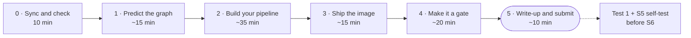

# Lab 5 · Your first CI pipeline

**From tonight, a robot checks every change in your fork before you can merge it: lint, unit tests, an integration test against a real database, and an image build that publishes to GHCR from `main`**

DevOps (ELE1013M) · Turiba University · Session 5 · theory first, then this lab at your own pace · individual work
Theory: Session 5 slides "Continuous Integration I: your first pipeline with GitHub Actions" (BATIS) · GitHub Docs: *Workflow syntax*, *About service containers*, *Available rules for rulesets*

| | |
|-|-|
| **You will** | Predict and read a job graph; build a four-job pipeline from a starter; publish your API image to GHCR, tagged with the commit SHA; turn the pipeline into a merge gate; watch a red check block your own PR, then fix it test-first |
| **You hand in** | The URL of your fork on Evaluentis: `https://github.com/<you>/turiba-devops-labs`. The grader finds your runs, PRs, ruleset and image by itself |
| **Passed when** | The gates G1–G8 in the pass checklist (80 points), plus the quality of your write-up and PRs (20 points). A script reads your fork through the GitHub API and pulls your image without logging in. Nothing of yours runs on the grader's machine. An LLM reads your predictions and answers against the rubric |
| **Deadline** | **Wed 21 Oct 2026, 22:00** (Riga). A snapshot of your fork is taken at 22:05. Then **Test 1** and the S5 self-test, before S6 |



---

## How the lab works

Theory comes first. Then you work through this guide **at your own pace**. Ask questions at any time. The core takes about 105 minutes. Not finished when the room closes? Push what you have and finish at home before 22:00.

| Part | Typical time | Theory slides |
|------|-------------:|--------------:|
| 0 · Sync and check | 10 min (at home if you can) | 8 |
| 1 · Predict the graph | 15 min | 10–10e, 13–15 |
| 2 · Build your pipeline | 35 min | 7–9, 16–21 |
| 3 · Ship the image | 15 min | 23–24 |
| 4 · Make it a gate | 20 min | 16a–16c, 22–22a |
| 5 · Write-up and submit | 10 min | — |

- Do the parts **in order**. Each part builds on the one before.
- **Hints are free.** Every blank and step has three, and opening them costs nothing. Stuck for more than 10 minutes? Open the next hint, check the troubleshooting table at the end, then raise your hand.
- **Commit and push after every step.** The grader reads only GitHub.
- **A pipeline run takes about a minute.** Use the wait: read the log, fill in your write-up.

---

## How to read this guide

- `<you>` means your GitHub username. In image names it must be in **lowercase** (`ghcr.io/<you>/…`). Elsewhere, write it as GitHub shows it.
- Commands are written for **bash**: on Windows, use the **Ubuntu (WSL)** terminal in `~/turiba-devops-labs`, as in Labs 3 and 4.
- ✅ **Checkpoint** boxes tell you what you should see.
- 📝 **README** marks something you write into `lab5/README.md` (you create it in step 1.1). Write it when you get it. **Commit `lab5/README.md` with your next commit, on whatever branch you're on.** The commands below include it. An uncommitted write-up makes `git switch` refuse to change branches.
- 🔮 **Predict** marks a prediction. Write it down **before** you click. A wrong prediction that you explain earns full marks; a "prediction" written afterwards teaches you nothing.
- 🤔 **Explain it:** one question, with the answer collapsed. Answer it in your head first. Not graded.
- **Hints, three levels, collapsed:** 🔎 **Look** (where to look) → 💡 **Think** (the concept, with the slide) → 🛠 **Fix** (the answer). Open one level at a time.

> ⚠️ **Four rules for your fork in this lab**
> 1. **Every change reaches `main` through a pull request in your fork.** Your Lab 3 ruleset enforces it.
> 2. **Check the base repository of every PR.** GitHub suggests the course repo. Choose **`<you>/turiba-devops-labs`**. A PR in the course repo runs nothing and counts for nothing.
> 3. **Never put a password or token in a file.** The database password lives in a repository secret.
> 4. **Don't rename the jobs** `lint`, `unit`, `integration` and `image`. In Part 4 they become required checks, by name.

---

## Part 0 · Sync and check (10 min, at home if you can, slide 8)

### 0.1 What you need from earlier labs

- **Lab 3:** your fork cloned in Ubuntu (WSL) at `~/turiba-devops-labs`, the `upstream` remote, `git push` over **SSH**, and the `protect-main` ruleset.
- **Lab 2:** `api/Dockerfile`. If yours is missing or doesn't build, step 0.4 has the fallback.
- **Lab 4** isn't needed, except as a comparison in answer A3.

```bash
cd ~/turiba-devops-labs
git remote -v
```

✅ **Checkpoint:** `origin` is `git@github.com:<you>/turiba-devops-labs.git`. If it starts with `https://`, switch it now (Lab 3, step 1.2): pushing a workflow file over HTTPS with a token fails with `refusing to allow a Personal Access Token to create or update workflow`.

### 0.2 Get the Lab 5 material (the sync PR)

The same way as in Lab 4:

```bash
git switch main && git pull
git fetch upstream
git switch -c chore/sync-upstream
git merge upstream/main
git push -u origin HEAD
```

If `git merge` opens the editor, the default merge message is fine. In nano: **Ctrl+O**, **Enter**, **Ctrl+X**.

Open the link that `git push` prints, or **Compare & pull request** on your fork's page. ⚠️ **Base repository: `<you>/turiba-devops-labs`, base `main`.** Merge it with **Create a merge commit**, then:

```bash
git switch main && git pull
git branch -D chore/sync-upstream
ls lab05-ci-pipeline .github/workflows
```

If GitHub says *There isn't anything to compare*, your fork already has the material: skip the PR and run the three commands above.

✅ **Checkpoint:** `lab05-ci-pipeline` lists `README.md`, `ci.start.yml`, `eslint.config.js`, `todos.integration.test.js`, `db.integration.test.js`, `itest.sh`, `ghcr-check.sh`, `reference` and `write-up-template.md`. `.github/workflows` lists `lab05-graph.yml`.

### 0.3 The Actions tab

Open `https://github.com/<you>/turiba-devops-labs/actions`.

✅ **Checkpoint:** on the left, under **All workflows**, you see **lab05 graph**. If GitHub shows a banner *Workflows aren't being run on this forked repository*, click **I understand my workflows, go ahead and enable them**.

### 0.4 Check your GHCR setup, and the Lab 2 fallback

```bash
bash lab05-ci-pipeline/ghcr-check.sh
```

It asks for a GitHub token (classic) with `read:packages` and hides what you paste. Your Lab 1 token works if it hasn't expired. If it has: Lab 1, step 4.1, a new classic token with `write:packages`. The script **changes nothing**. It only reads and reports.

✅ **Checkpoint:** the summary says `No problems found.` or `0 problem(s), … warning(s)`. Warnings are fine: read them. A warning about capital letters in your username is normal. It tells you how to write your image name.

**Lab 2 fallback.** If section 7 of the report says `api/Dockerfile` is missing, or your `docker build api` fails, use the reference file. It costs no points:

```bash
cp lab05-ci-pipeline/reference/Dockerfile lab05-ci-pipeline/reference/.dockerignore api/
```

You commit them in step 2.1 and set `Reference files used (Lab 2 fallback): yes` at the top of `lab5/README.md`.

---

## Part 1 · Predict the graph (15 min, slides 10–10e, 13–15)

### 1.1 Branch and write-up

All your work until Part 3 happens on one branch:

```bash
git switch main && git pull
git switch -c ci/pipeline
mkdir -p lab5
cp lab05-ci-pipeline/write-up-template.md lab5/README.md
```

Fill in your GitHub user name at the top and in the badge line.

### 1.2 🔮 Predict before you run

Open `.github/workflows/lab05-graph.yml` and read only the `needs:` lines. Then, in `lab5/README.md`, section **1 · Graph predictions**:

- 📝 Draw the graph: boxes for the five jobs, arrows for `needs`.
- 📝 **P1:** which jobs start together?
- 📝 **P2:** will `graph-package` find `build.txt`? (Look at what `graph-test` does that `graph-package` doesn't.)

```bash
git add lab5/README.md
git commit -m "docs: predict the lab05 graph"
git push -u origin HEAD
```

### 1.3 Run it

**Actions → lab05 graph → Run workflow**, branch `main`, **Make one job fail on purpose: `none`** → **Run workflow**. Refresh after a few seconds and open the run.

✅ **Checkpoint:** all five jobs green in about 30 seconds. 📝 Fill in the "What the run showed" column for P1 and P2. Open `graph-test` and `graph-package`: the lines `version from graph-build: …` and `build.txt: not here: jobs don't share files` decide P2.

> ⚠️ GitHub draws the lines between jobs bundled together, and a line can seem to start at the wrong box. When the picture and the file disagree, the file is right (slide 10c).

### 1.4 🔮 Predict the failure, then run it

📝 **P3:** with `break = build`, `graph-build` fails on purpose. Which jobs will run, which will fail, which will be skipped? Write it down, then run **lab05 graph** again with **`build`**.

✅ **Checkpoint:** the run is red. 📝 Fill in what P3 showed. Two runs of **lab05 graph** are now on `main`, one for each value: that's gate G2.

> 🤔 **Explain it:** `graph-report` needs `graph-build`, and `graph-build` failed. Why did `graph-report` still run?

<details><summary>Answer</summary>

It has `if: always()`. Without a condition, a job runs only when everything it needs succeeded: a failure or a skip is passed down the graph. `always()` replaces that rule: run whatever happened before (slide 15).

</details>

```bash
git add lab5/README.md
git commit -m "docs: record the lab05 graph runs"
git push
```

---

## Part 2 · Build your pipeline (35 min, slides 7–9, 16–21)

Each step is a commit on `ci/pipeline`.

### 2.1 ESLint and the test scripts (slides 17, 18)

One command installs ESLint into `api/` and sets three npm scripts. It runs in a container, so you don't need Node.js on your laptop. It copies back only `package.json` and `package-lock.json`, and gives them back to you (`chown`): without that last line they would belong to `root`.

```bash
cp lab05-ci-pipeline/eslint.config.js api/
docker run --rm -v "$PWD/api:/host" -w /work node:24-alpine sh -c '
  cp /host/package.json /host/package-lock.json . &&
  npm install --no-audit --no-fund --save-dev --save-exact eslint@10.12.0 @eslint/js@10.0.1 globals@17.13.0 &&
  npm pkg set "scripts.lint=eslint ." "scripts.test=jest --testPathIgnorePatterns=integration" "scripts.test:integration=jest --runInBand --testPathPatterns=integration" &&
  cp package.json package-lock.json /host/ &&
  chown "$(stat -c %u:%g /host)" /host/package.json /host/package-lock.json'
```

A notice *New major version of npm available* may appear. Ignore it. Now run lint and the unit tests the same way CI will:

```bash
docker run --rm -v "$PWD/api:/src:ro" -w /app node:24-alpine sh -c 'cp -r /src/. . && npm ci --no-audit --no-fund --loglevel=error && npm run lint && npm test'
```

✅ **Checkpoint:** `npm run lint` prints no problems, and `npm test` ends with `Tests: 5 passed, 5 total`. `git status` shows `api/eslint.config.js` (new), `api/package.json` and `api/package-lock.json` (changed).

<details><summary>🔎 Hint 1 · Look</summary>

Read the lint output: file, line, rule name at the end of each line. `git diff api/package.json`: are the three scripts and three devDependencies there?

</details>

<details><summary>💡 Hint 2 · Think</summary>

ESLint's `recommended` rules find likely bugs, not style (slide 18). Each finding is a real question about your code: is this variable meant to be used? Is this name defined?

</details>

<details><summary>🛠 Hint 3 · Fix</summary>

- `'server' is assigned a value but never used`: the Lab 2 SIGTERM handler is missing. Add the two snippets from `lab04-multi-service-compose/reference/healthz.md` to `api/server.js`.
- Any other finding: fix the code. **Don't** add `// eslint-disable` or change `eslint.config.js` to make it quiet. The grader's quality points check that findings were fixed, not silenced.

</details>

📝 Section 2 of the README: your lint findings (file, line, rule) and how you fixed each one. No findings? Write that.

```bash
git add api/eslint.config.js api/package.json api/package-lock.json lab5/README.md
git commit -m "build: add ESLint and split the test scripts"
```

Using the Lab 2 fallback or changing `api/server.js`? Add those files to the same commit.

### 2.2 The integration test (slides 17, 21)

```bash
cp lab05-ci-pipeline/todos.integration.test.js api/test/
```

Don't change it. Optional: run it on your laptop, the way CI will. It starts a throwaway PostgreSQL and the API from source, and leaves nothing behind (about 15 s):

```bash
bash lab05-ci-pipeline/itest.sh
```

✅ **Checkpoint (optional run):** `Tests: 5 passed, 5 total`.

```bash
git add api/test/todos.integration.test.js lab5/README.md
git commit -m "test: add the API integration test"
```

### 2.3 The secret (slide 23)

Your fork → **Settings → Secrets and variables → Actions → New repository secret**.

- **Name:** `DB_PASSWORD`
- **Secret:** a long random value. Make one with `openssl rand -base64 24` and paste it. You never need it again: CI's database lives for one minute.

✅ **Checkpoint:** the list of repository secrets shows `DB_PASSWORD`. GitHub never shows the value again. That's correct.

### 2.4 The workflow: fill in the blanks (slides 7–10, 15, 17–24)

```bash
mkdir -p .github/workflows
cp lab05-ci-pipeline/ci.start.yml .github/workflows/ci.yml
```

Open `.github/workflows/ci.yml`. Read it top to bottom once. Then fill in the 11 blanks, B1–B11. Each `____` has a comment with its slide.

📝 🔮 **Before B5:** `localhost` or `db`? Write your prediction and why in section 2 of the README, then fill it in.

When you're done, this must print **nothing**:

```bash
grep -n '____' .github/workflows/ci.yml
```

A forgotten blank in B8–B11 makes GitHub reject the whole file. A forgotten blank in B1–B7 is worse: the file is accepted and something quietly fails or never runs.

<details><summary>B1 · <code>on.push.branches</code>: hints</summary>

<details><summary>🔎 Look</summary>Slide 9: which event tests a merge into <code>main</code>, and which tests the PR?</details>
<details><summary>💡 Think</summary>The <code>push</code> run publishes the image. Which branch should publish?</details>
<details><summary>🛠 Fix</summary><code>branches: [main]</code></details>

</details>

<details><summary>B2 · the lint step: hints</summary>

<details><summary>🔎 Look</summary><code>cat api/package.json</code>: the scripts section.</details>
<details><summary>💡 Think</summary>Which script did step 2.1 add for ESLint? <code>npm run &lt;script&gt;</code> runs a script by name.</details>
<details><summary>🛠 Fix</summary><code>npm run lint</code></details>

</details>

<details><summary>B3 · the unit step: hints</summary>

<details><summary>🔎 Look</summary>The <code>test</code> script in <code>api/package.json</code>: what does it leave out?</details>
<details><summary>💡 Think</summary>Small tests need no database (slide 17). <code>test</code> is special: <code>npm test</code> works without <code>run</code>.</details>
<details><summary>🛠 Fix</summary><code>npm test</code></details>

</details>

<details><summary>B4 · <code>services.db.image</code>: hints</summary>

<details><summary>🔎 Look</summary>Your <code>compose.yaml</code> from Lab 4, service <code>db</code>, or <code>lab05-ci-pipeline/itest.sh</code>.</details>
<details><summary>💡 Think</summary>Test against the same database you run (slide 19).</details>
<details><summary>🛠 Fix</summary><code>image: postgres:17-alpine</code></details>

</details>

<details><summary>B5 · <code>DB_HOST</code>: hints</summary>

<details><summary>🔎 Look</summary>Is there a <code>container:</code> key in the <code>integration</code> job? Where do its steps run?</details>
<details><summary>💡 Think</summary>Slide 20: the steps run on the runner VM itself, and the service publishes port 5432 to it. On the VM, "this machine" is…</details>
<details><summary>🛠 Fix</summary><code>DB_HOST: localhost</code>. With <code>db</code>, the API log says <code>getaddrinfo ENOTFOUND db</code>: the name <code>db</code> exists only for containers on the service's network.</details>

</details>

<details><summary>B6 · the two secrets: hints</summary>

<details><summary>🔎 Look</summary>Step 2.3: what did you call the secret?</details>
<details><summary>💡 Think</summary><code>${{ secrets.NAME }}</code> reads a repository secret. A name that doesn't exist gives an empty string, not an error (slide 23).</details>
<details><summary>🛠 Fix</summary><code>${{ secrets.DB_PASSWORD }}</code>, in both places: PostgreSQL and the API must use the same password.</details>

</details>

<details><summary>B7 · the wait URL: hints</summary>

<details><summary>🔎 Look</summary>Slide 21, the row "Wait on <code>/api/todos</code>, not <code>/</code>".</details>
<details><summary>💡 Think</summary>Which path answers 200 only when the API can really read from the database: "working", not just "running"?</details>
<details><summary>🛠 Fix</summary><code>"$API_URL/api/todos"</code></details>

</details>

<details><summary>B8 · the two "On failure" steps: hints</summary>

<details><summary>🔎 Look</summary>Slide 15: the status functions.</details>
<details><summary>💡 Think</summary>These steps should run only when an earlier step in the job failed. A normal step would be skipped then.</details>
<details><summary>🛠 Fix</summary><code>if: failure()</code>, twice.</details>

</details>

<details><summary>B9 · <code>image.needs</code>: hints</summary>

<details><summary>🔎 Look</summary>Slide 25: the pipeline graph. Slide 10: <code>needs</code> with a list.</details>
<details><summary>💡 Think</summary>The image should be built only when all three checks passed. Without <code>needs</code>, <code>image</code> starts at once, in parallel.</details>
<details><summary>🛠 Fix</summary><code>needs: [lint, unit, integration]</code></details>

</details>

<details><summary>B10 · <code>packages</code> permission: hints</summary>

<details><summary>🔎 Look</summary>Slide 23: the job-level <code>permissions</code> block.</details>
<details><summary>💡 Think</summary>This job pushes an image to GHCR. Reading isn't enough.</details>
<details><summary>🛠 Fix</summary><code>packages: write</code>. With <code>read</code>, the push on <code>main</code> fails with <code>denied</code>.</details>

</details>

<details><summary>B11 · the tag: hints</summary>

<details><summary>🔎 Look</summary>Slide 24: "Why the commit SHA as the tag".</details>
<details><summary>💡 Think</summary>The <code>github</code> context has the commit this run builds.</details>
<details><summary>🛠 Fix</summary><code>tags: ${{ env.IMAGE }}:${{ github.sha }}</code></details>

</details>

```bash
git add .github/workflows/ci.yml lab5/README.md
git commit -m "ci: add the lint, test and image pipeline"
git push
```

### 2.5 The PR, and fix until green (slides 16–16c)

Open the PR from `ci/pipeline`. ⚠️ **Base repository: `<you>/turiba-devops-labs`, base `main`.** Title: `ci: add the CI pipeline`. In the description, say what the pipeline checks. 📝 Copy the PR's URL into section 2.

✅ **Checkpoint:** at the bottom of the PR, four checks appear: `ci / lint`, `ci / unit`, `ci / integration`, `ci / image`. After about a minute all four are green. **Don't merge yet.**

Something red? Read it the way slides 16–16c show:

1. **Details** next to the red check, or the run in the Actions tab.
2. Which job is red? Which ones were skipped *because of it*?
3. In the red job, the **first** step with a red cross. Read its log **upward** from `Process completed with exit code …`.
4. For `integration`, also open **On failure: the API log**: the API's own error is there.
5. Fix it on your laptop, commit the fix together with `lab5/README.md`, push. The PR runs again by itself.

📝 Section 2 of the README: your first red run (job, step, error line) and what you changed. If everything was green at once, write that.

> 🤔 **Explain it:** `integration` runs `node server.js … &`. Why the `&`, and how does the next step know the API is ready?

<details><summary>Answer</summary>

`&` starts the API in the background, so the step finishes and the job goes on; the API keeps running until the job ends (slide 21). The next step doesn't trust a sleep: `curl --retry` asks `/api/todos` until it answers 200, which is only possible once the database is reachable and the table exists: "working", not "running".

</details>

---

## Part 3 · Ship the image (15 min, slides 23–24)

### 3.1 🔮 Did the PR run push an image?

📝 Section 2: predict first. Then open the `image` job of your PR run and look at the step **Log in to GHCR (main only)** and the `push` value in **Build, and push from main only**.

Now commit your write-up to the PR, so `git switch main` works in the next step:

```bash
git add lab5/README.md
git commit -m "docs: record the pipeline in the write-up"
git push
```

✅ **Checkpoint:** `git status` says *nothing to commit, working tree clean*. The PR runs once more. Wait until all four are green again.

### 3.2 Merge, and watch `main`

On the PR: **Merge pull request** → **Create a merge commit** → **Confirm** → **Delete branch**. Then:

```bash
git switch main && git pull
```

The merge is a `push` to `main`, so `ci` runs again: the same four jobs, but now `image` builds **amd64 and arm64** and pushes. It takes about a minute and a half. Start reading Part 4 while it runs.

✅ **Checkpoint:** the run on `main` (Actions → **ci**, event *push*) is green. In the `image` job, the last step pushed `ghcr.io/<you>/turiba-devops-labs/api:<a 40-character SHA>`. 📝 Copy that image name into section 2.

### 3.3 Can anyone pull it?

```bash
bash lab05-ci-pipeline/ghcr-check.sh
```

✅ **Checkpoint:** section 4 of the report lists `turiba-devops-labs/api`, **connected** to your fork, and **pull without login: yes**. In S7, kind pulls exactly this image without logging in. If it says private: Package settings → Danger Zone → **Change visibility → Public** (the same as Lab 1).

> 🤔 **Explain it:** why does CI push to a new package, `turiba-devops-labs/api`, and not to your Lab 2 `course-api`?

<details><summary>Answer</summary>

A package that the workflow creates itself is connected to your fork, so the run's `GITHUB_TOKEN` may push to it. `course-api` was pushed from your laptop: it isn't connected (its Package settings show "Manage Actions access"), and the push could be refused with `denied: permission_denied: write_package`. `course-api` stays your Lab 2 hand-in. Don't touch it.

</details>

### 3.4 The badge

The badge line at the top of `lab5/README.md` already points at your `ci` workflow. It turns green when `main` is green. Nothing to do if you filled in `<you>` in step 1.1.

---

## Part 4 · Make it a gate (20 min, slides 22–22a, 16a–16c)

### 4.1 Require the four checks (slide 22)

Your fork → **Settings → Rules → Rulesets → `protect-main`**:

1. Tick **Require status checks to pass**.
2. ⚠️ **GitHub ticks "Require branches to be up to date before merging" for you.** Click **Show additional settings** if you don't see it, and **untick it**. Lab 6 turns it on. Tonight it must be off, and the grader checks it.
3. **Add checks**, and pick `lint`, `unit`, `integration` and `image` from the suggestions, each with the source **GitHub Actions**. Don't type names by hand: the box accepts any name ("Add … Any source"), and a typo becomes a check that waits for ever.
4. Leave the bypass list empty. **Save changes**.

✅ **Checkpoint:** the ruleset shows the four checks, each with **GitHub Actions**, and "Require branches to be up to date" unticked.

<details><summary>🔎 Hint 1 · Look</summary>

No suggestions appear when you type `l`? The box suggests only checks that ran successfully in the last 7 days.

</details>

<details><summary>💡 Hint 2 · Think</summary>

Your PR in Part 2 and the run on `main` in Part 3 produced the four check names. If they didn't run green, they can't be suggested.

</details>

<details><summary>🛠 Hint 3 · Fix</summary>

Finish Part 3 first: a green `ci` run on `main`. Then add the checks again.

</details>

### 4.2 Red: the test first (slides 16a–16c, 22a)

There's a bug in the API: `DELETE /api/todos/abc` answers **500** instead of **404**. You write the test before the fix.

```bash
git switch main && git pull
git switch -c fix/delete-bad-id
```

Add this at the **end** of `api/test/todos.integration.test.js`:

```js
test('DELETE with an id that is not a number answers 404', async () => {
  expect((await call('DELETE', '/api/todos/abc')).status).toBe(404);
});
```

```bash
git add api/test/todos.integration.test.js lab5/README.md
git commit -m "test: DELETE /api/todos/abc must answer 404"
git push -u origin HEAD
```

Open the PR in your fork (⚠️ base repository!). Title: `fix: answer 404 for a DELETE with a non-numeric id`.

✅ **Checkpoint:** `integration` turns red after about 30 s, and `image` is skipped. The test log says `Expected: 404` and `Received: 500`. **On failure: the API log** says `DELETE /api/todos/abc failed: invalid input syntax for type integer: "abc"`. The merge box says *Some checks were not successful*, every check is marked **Required**, and **Merge pull request** is greyed out.

📝 Section 3: the PR URL, the failed test lines, the cause line from the API log, and the merge-box text, all copied.

> ⚠️ `gh pr merge` suggests `--admin` when a check blocks the merge. Don't. The red check is the gate doing its job.

### 4.3 Green: the fix

Open `api/server.js` and find the DELETE route. Add one line at the **top** of it:

```js
app.delete('/api/todos/:id', async (req, res) => {
  if (!/^\d+$/.test(req.params.id)) return res.status(404).json({ error: 'todo not found' });
  // … the existing lines stay as they are
```

```bash
git add api/server.js lab5/README.md
git commit -m "fix: answer 404 for a DELETE with a non-numeric id"
git push
```

✅ **Checkpoint:** all four checks green on the PR. The merge box turns green. **Merge pull request** → **Create a merge commit** → **Delete branch**. Then `git switch main && git pull`. This PR, red first and green last, is gate G6.

📝 Section 3, last question: which commit did the red check test, your branch alone or your branch merged with `main`? Slide 9 has the answer, and the run's summary page shows the commit.

> 🤔 **Explain it:** the red PR ran `lint`, `unit` and `integration` in parallel, and only `integration` failed. Why was `image` skipped?

<details><summary>Answer</summary>

`image` needs all three. One of them failed, and without an `if:` a job runs only when everything it needs succeeded, so `image` didn't run (slide 15). The merge was blocked by the red `integration` check.

</details>

---

## Part 5 · Write-up and submit (10 min)

### 5.1 Finish the write-up

In `lab5/README.md`: every `____` replaced, your user name at the top and in the badge, and the four answers below.

| # | Question |
|--:|----------|
| A1 | Your `break: build` run: which jobs ran, which failed, which were skipped? Why did `graph-report` still run? Quote the job list from your run |
| A2 | `graph-test` found `build.txt` and `graph-package` didn't. Why? Name the step that would make `graph-package` find it |
| A3 | Your integration job uses `DB_HOST: localhost`, and your Lab 4 `compose.yaml` says `db`. Why are both right? What would it be if the job ran in a container (`container: node:24-alpine`)? |
| A4 | Your red PR: which required check failed, which commit did that run test, and what stopped the merge? Why did the `image` job run on your Part 2 PR but not push? |

```bash
grep -n '____\|<you>' lab5/README.md
```

✅ **Checkpoint:** `grep` prints nothing.

### 5.2 A PR for the write-up

```bash
git switch -c docs/lab5
git add lab5/README.md
git commit -m "docs: finish the Lab 5 write-up"
git push -u origin HEAD
```

Open the PR in your fork. `ci` runs on it like on every PR. When all four are green, merge it with a merge commit, then `git switch main && git pull`.

✅ **Checkpoint:** the merge starts one more `ci` run on `main`. **Wait until it's green** (about a minute and a half) before you submit: gate G4 reads the latest run on `main` and the image it pushed.

### 5.3 Check, then submit

Go through the pass checklist below. Then **Submit on Evaluentis** → *Lab 5* assignment: `https://github.com/<you>/turiba-devops-labs`. **Deadline: Wed 21 Oct 2026, 22:00.** The snapshot is taken at 22:05.

Then **Test 1** (graded, at home, time-limited, S1–S5) and the **S5 self-test** (not graded), both on Evaluentis, before S6.

---

## Pass checklist

These gates are exactly what the grader checks (80 points). The grader reads your fork through the GitHub API and pulls your image without logging in.

| ✔ | Gate | Check | Points |
|---|------|-------|-------:|
| ☐ | G1 | Your public fork; the Lab 5 sync PR from the course repo is merged | 5 |
| ☐ | G2 | `lab05 graph` ran on `main` twice: `break: none` (all green) and `break: build` (`graph-build` failed, `graph-test` and `graph-package` skipped, `graph-report` succeeded). Your drawing and predictions P1–P3 are in the README | 8 |
| ☐ | G3 | `.github/workflows/ci.yml` on `main`: `push` to `main` plus `pull_request`; jobs `lint`, `unit`, `integration`, `image` with no job-level `if:`; `contents: read` at the top and `packages: write` only on `image`; a PostgreSQL service with `--health-cmd`; `runs-on: ubuntu-24.04`; no password in the file | 14 |
| ☐ | G4 | The latest `ci` run on `main` (event *push*) is green, and `ghcr.io/<you>/turiba-devops-labs/api:<that run's SHA>` exists, can be pulled without logging in, and has `amd64` and `arm64` | 14 |
| ☐ | G5 | `protect-main` requires `lint`, `unit`, `integration` and `image` (source GitHub Actions), "up to date" **off**, the PR rule still on, enforcement **active** | 10 |
| ☐ | G6 | **Red, then green:** a merged PR whose earlier commit had a failed required check (after you added the checks), whose last commit is green on all four, merged after that green run | 16 |
| ☐ | G7 | At least three of the four answers are correct | 8 |
| ☐ | G8 | No password or token anywhere in the repository; `DB_PASSWORD` used only through `secrets.` | 5 |

The other **20 points** are for quality: predictions written before the runs and explained when wrong (Q1, 6); lint findings fixed, not silenced (Q2, 5); the red PR documented in section 3, and PR descriptions that say what was checked (Q3, 5); Conventional Commit messages, about one per step, with the test before the fix (Q4, 4).

---

## Optional buddy review (no points, read-only)

Send your fork URL to a classmate. They open your **Actions** tab and your Part 4 PR **on GitHub**, read your `ci.yml`, and open an **issue** in your fork: one thing that's clear, and one thing that confused them. Nobody clones or runs anyone else's code.

---

## Troubleshooting

| Symptom | Likely cause | Fix |
|---------|--------------|-----|
| No checks appear on the PR | The PR is in the course repo, or Actions is off in your fork | Close it and open it in **your fork** (base repository!); step 0.3 |
| `refusing to allow a Personal Access Token to create or update workflow` on `git push` | `origin` uses HTTPS with a token | Switch `origin` to SSH (Lab 3, step 1.2) |
| The run fails at once, no jobs start, and GitHub says the workflow file is invalid | A blank B8–B11 is still `____`, or the indentation moved | `grep -n '____' .github/workflows/ci.yml`; spaces, not tabs; compare the indentation with `ci.start.yml` |
| No run at all after the merge to `main` | B1 isn't `main` | B1 hints |
| `lint`: `'server' is assigned a value but never used` | The Lab 2 SIGTERM handler is missing | Step 2.1, Hint 3 |
| `Permission denied` on `api/package.json` or `api/package-lock.json` (editing, `git switch`, `git pull`) | The install command ran without its `chown` line, so the files belong to `root` | `sudo chown $USER: api/package.json api/package-lock.json` |
| `npm ci` fails: `package.json and package-lock.json … are not in sync` | Only one of the two files was committed | `git add api/package.json api/package-lock.json`, commit, push |
| `npm error Missing script: "…"` | B2 or B3 names a script that doesn't exist, or step 2.1's command didn't run | `cat api/package.json`; run step 2.1 again |
| `Option "testPathPattern" was replaced by "--testPathPatterns"` | An old Jest 29 flag from a tutorial | Use the scripts from step 2.1 exactly |
| "Initialize containers" fails; the log says `superuser password is not specified` | The `DB_PASSWORD` secret is missing, or B6 has another name | Step 2.3; B6 |
| `curl: (7) Failed to connect to localhost port 5000` thirty times, then exit code 7 | The API crashed at start | Open **On failure: the API log** |
| `curl: (22) The requested URL returned error: 500` thirty times, then exit code 22 | The API runs but can't serve `/api/todos` | **On failure: the API log**. `getaddrinfo ENOTFOUND db` there means B5 |
| `integration` red with `Expected: 404 / Received: 500` | That's Part 4, step 4.2: correct! | Step 4.3 |
| `denied: permission_denied: write_package` on `main` | B10 is `read`, or you pushed this name from your laptop first | B10. Never `docker push` the CI image name by hand; run `ghcr-check.sh` |
| `repository name must be lowercase` | Capital letters in the image name | Keep the given `IMAGE=…${GITHUB_REPOSITORY,,}…` line exactly |
| `image` builds on the PR but nothing is on GHCR | Correct: PRs only build. The push happens on `main` | Part 3 |
| The ruleset's **Add checks** suggests nothing | The checks haven't run green in the last 7 days | Step 4.1 hints |
| The PR says `Expected — Waiting for status to be reported` | A job was renamed, or a required check name has a typo | Job names stay `lint`, `unit`, `integration`, `image`; in the ruleset, pick names from the suggestions |
| G5: "up to date" is on | GitHub ticks it by default | Step 4.1, point 2 |
| `ghcr-check.sh`: `This is a fine-grained token` | GitHub Packages only accepts classic tokens | A new **classic** token with `write:packages` (Lab 1, step 4.1) |
| A *New major version of npm available* notice | npm advertising itself | Ignore it |

---

## Stretch (for fast finishers)

Stretch work must not break a gate. **Keep the four job names, add no job-level `if:` to them, and don't put a matrix on `unit`**: a matrix renames its checks to `unit (22)` and `unit (24)`, and the required check `unit` would wait for ever. Put new work in new jobs or new steps.

| Task | What you learn |
|------|----------------|
| `db.integration.test.js` (in `lab05-ci-pipeline/`): a data-layer test without HTTP. Copy it to `api/test/` | Slide 17: one more medium test, closer to the code |
| On failure, upload `server.log` as an artifact instead of printing it | Slide 14 |
| A job summary (`$GITHUB_STEP_SUMMARY`) in `image` with the pushed image name | GitHub Docs: *Workflow commands*, "Adding a job summary" |
| `PATCH /api/todos/abc` has the same 500 bug: test first, then fix it, in one more red-then-green PR | Part 4 again |
| A new job `unit-matrix` that runs the unit tests on Node.js 22 and 24 | GitHub Docs: *Running variations of jobs in a workflow*. One matrix job becomes several jobs in your graph (slide 10) |

---

## Command summary

| Goal | Command |
|------|---------|
| Check your GHCR setup | `bash lab05-ci-pipeline/ghcr-check.sh` |
| Lint and unit tests, like CI | `docker run --rm -v "$PWD/api:/src:ro" -w /app node:24-alpine sh -c 'cp -r /src/. . && npm ci --no-audit --no-fund --loglevel=error && npm run lint && npm test'` |
| Integration test, like CI | `bash lab05-ci-pipeline/itest.sh` |
| Any blank left? | `grep -n '____' .github/workflows/ci.yml` |
| Start a branch | `git switch main && git pull && git switch -c <type>/<name>` |
| Commit a step | `git add <file> …` · `git commit -m "ci: …"` · `git push` |
| Run the graph workflow | Actions → **lab05 graph** → Run workflow |
| Read a red run | Details → the red job → the first red step → read upward → **On failure: the API log** |
