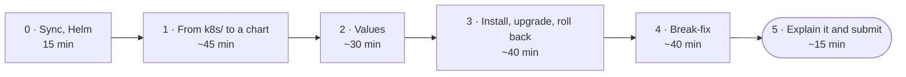

# Lab 9 · Mission: package it with Helm

**Turn your Mission 8 `k8s/` into a Helm chart, with values for the image and the number of API Pods. Install it on a fresh cluster, upgrade it, break it on purpose and roll it back. Then find three faults that a teammate brought into your chart. This brief says what must be true in your fork. Finding out how is the mission.**

DevOps (ELE1013M) · Turiba University · Session 9 · **self-study, after Test 2** · individual work
Theory: the Session 9 slides "Package it: Helm" (BATIS). Read them first, about 35 min

| | |
|-|-|
| **You will** | Move your seven Mission 8 files into a chart `charts/course-app/`, take the API image and replica count from `values.yaml`, then `helm install`, `helm upgrade`, `helm rollback` and `helm uninstall`, and debug three faults |
| **You hand in** | The URL of your fork on Evaluentis: `https://github.com/<you>/turiba-devops-labs` |
| **Passed when** | The gates G1–G6 (80 points), plus the quality of your write-up, PRs and commits (20 points). The grader starts a **fresh** kind cluster, makes the Namespace `course` and the Secret `db-secret` itself, runs **one** `helm install` from your `main`, saves a todo, replaces the database Pod and reads the todo back. Then it runs `helm upgrade --set api.replicas=2` and `helm rollback course-app 1`. An LLM reads your write-up |
| **Deadline** | **Wed 18 Nov 2026, 20:00** (Riga). A snapshot of your fork is taken at 20:05 |



---

## After the test, on your own

> 📖 **Read first:** the Session 9 slides (about 35 minutes).
>
> **When you're stuck, work through this order:**
> 1. the hints in this brief, one level at a time: 🔎 **Look** → 💡 **Think** → 🛠 **Fix**;
> 2. the **Troubleshooting** table at the end;
> 3. the Session 9 slides;
> 4. after 20 minutes: a post in BATIS with the command you ran, its **exact** output, and what you expected.
>
> Helping each other is welcome: explain, debug together on a call, share links. Copying someone's files is not.

## How this mission works

As in Missions 6–8, this brief tells you what must be true when you're done, and where to learn how. You learn by reading the docs, trying, reading the error, and trying again.

| Part | Typical time |
|------|-------------:|
| 0 · Sync, Helm | 15 min |
| 1 · From k8s/ to a chart | 45 min |
| 2 · Values | 30 min |
| 3 · Install, upgrade, roll back | 40 min |
| 4 · Break-fix | 40 min |
| 5 · Explain it and submit | 15 min |

- Do the parts **in order**. Each one needs the one before it.
- **Hints are free:** 🔎 **Look** → 💡 **Think** → 🛠 **Fix**. Open one level at a time.
- **`bash lab09-package-it/check.sh`** does what the grader does: `helm lint`, `helm template`, then a throwaway cluster, the Namespace and the Secret, `helm install`, a todo, a new database Pod, the todo again, `helm upgrade` and `helm rollback`. Run it whenever you like.
- **📝** marks something you write into `lab9/README.md`. **🔮** marks a prediction: write it **before** you look.
- **Always say the namespace:** `helm … -n course` and `kubectl -n course …`.
- Commands are written for **bash**: on Windows, use the **Ubuntu (WSL)** terminal in `~/turiba-devops-labs`.

### Helm in six lines

- A **chart** is a folder: `Chart.yaml` (its name and version), `values.yaml` (the settings) and `templates/` (Kubernetes YAML with `{{ … }}` gaps).
- `helm template` fills the gaps with the values and prints plain YAML: what Helm would send to the cluster. It needs no cluster.
- `helm install course-app …` sends that YAML to the cluster and remembers it as **revision 1** of a **release** named `course-app`.
- `helm upgrade` makes the next revision. `helm rollback course-app 1` makes a **new** revision with the settings of revision 1. `helm history` lists them all.
- `helm uninstall` deletes everything the release made.
- Helm marks everything it makes as its own, and **never takes over an object it didn't make**. That's why the Namespace and the Secret stay outside the chart.

> ⚠️ **Six rules for this mission**
> 1. **Every change reaches `main` through a pull request in your fork**, never in the course repo.
> 2. **Use the exact names in the tables:** `charts/course-app`, the release `course-app`, the values `api.image.repository`, `api.image.tag` and `api.replicas`. The grader and `break.sh` find them by these names.
> 3. **The Namespace and the Secret stay outside the chart.** You make both with a command; the grader makes its own. The Secret is never a file in Git.
> 4. **`charts/course-app/templates/` holds the six files from Part 1** (a `NOTES.txt` or `_helpers.tpl` is fine too). Any other file costs G2 points. Other stretch work goes in `stretch/`.
> 5. **The API image is your own release, or a fallback.** Never `latest`.
> 6. **Delete your cluster when you stop for the day:** `kind delete cluster`. Your files are safe in Git.

---

## Finish line: the gates

| Gate | Points | What must be true at the snapshot |
|------|-------:|-----------------------------------|
| **G1** · The Lab 9 sync PR is merged | 5 | `lab09-package-it/` is on your `main`, unchanged |
| **G2** · charts/course-app on main: lint, the values, the objects | 25 | `Chart.yaml`, `values.yaml` and the six templates from Parts 1–2. `helm lint` passes. The three values reach the API Deployment. No Namespace or Secret in the chart. The objects Helm makes pass the Lab 8 checks (names, wiring, probes, resources). The API image is yours (or a fallback), pinned to a tag that exists |
| **G3** · helm install on a fresh cluster works, the data survives, upgrade and rollback work | 25 | On a new kind cluster with the Namespace and the Secret already there, **one** `helm install course-app charts/course-app -n course` succeeds. Both rollouts finish within 4 minutes, a todo is saved, and it survives a new database Pod. No container restarts over and over. `helm upgrade --set api.replicas=2` gives 2 ready API Pods, and `helm rollback course-app 1` gives 3 again |
| **G4** · Break-fix: a merged PR with the teammate's commit and your fixes | 15 | A merged PR into `main` contains the `break.sh` commit and your own later commits that change `charts/course-app/`. G2 passes on `main` afterwards |
| **G5** · No password or token in the repository | 5 | Checked by the grader over all branches and tags |
| **G6** · lab9/README.md: "Install, upgrade, rollback" and "What broke and how I found it" | 5 | Sections 2 and 3 of `lab9/README.md` show your install, the bad upgrade, the history and the rollback, with your own output, and name each of the three faults with the command that showed it |

The other **20 points** are for quality:

| Criterion | Points | What earns them |
|-----------|-------:|-----------------|
| Q1 | 8 | Your own output, copied, and your predictions, with any mismatch explained |
| Q2 | 6 | Your PR descriptions say what changed and how you checked it (`helm lint`, `helm template`, `helm upgrade`, `get pods`) |
| Q3 | 6 | Conventional Commit messages, one fix per commit in Part 4 |

---

## Learn from

| For | Read or watch | What to take from it |
|-----|---------------|----------------------|
| Everything | **The Session 9 slides** (BATIS) | The chart's shape, the commands, and real output for every error you can meet tonight |
| Part 0 | Helm docs: [Installing Helm](https://helm.sh/docs/intro/install/) | Background only. The course README's "Before Lab 9" has the exact commands |
| Part 1 | Helm docs: [Quickstart](https://helm.sh/docs/intro/quickstart/) and Chart Template Guide, [Getting Started](https://helm.sh/docs/chart_template_guide/getting_started/) | What is in a chart; `helm template` and `helm install` |
| Part 2 | Chart Template Guide: [Values Files](https://helm.sh/docs/chart_template_guide/values_files/) and [Built-in Objects](https://helm.sh/docs/chart_template_guide/builtin_objects/) | `.Values.<name>`, nested values, `--set` |
| Part 3 | Helm docs: [Using Helm](https://helm.sh/docs/intro/using_helm/), the sections on `helm upgrade`, `helm rollback` and `helm uninstall` | Releases and revisions |
| Part 3 | Command pages: [helm upgrade](https://helm.sh/docs/helm/helm_upgrade/), [helm rollback](https://helm.sh/docs/helm/helm_rollback/), [helm history](https://helm.sh/docs/helm/helm_history/) | The flags, when you need one |
| Video | DevOps Directive, [Complete Kubernetes Course](https://www.youtube.com/watch?v=2T86xAtR6Fo&t=10351s) (2024) | Only the chapter "Helm" (2:52:31–3:14:26, about 22 min) |

---

## Part 0 · Sync and Helm (15 min)

**1. Bring the Lab 9 material into your fork** through a pull request, the same way as in Labs 4–8:

```bash
git switch main && git pull
git fetch upstream
git switch -c chore/sync-upstream
git merge upstream/main
git push -u origin HEAD
```

Open the PR in **your fork**, merge it with **Create a merge commit**, then run `git switch main && git pull`.

**2. Install Helm 4:** the section "Before Lab 9" in the course README (the root `README.md` of your fork, after the sync). Then:

```bash
helm version     # version.BuildInfo{Version:"v4.3.2", …}
which helm       # /usr/local/bin/helm
```

**3. Your starting point is your Mission 8 `k8s/`:** seven files (the Namespace, the ConfigMap, the PVC, and a Deployment and a Service each for `db` and `api`).

- **Mission 8 doesn't work, or you never did it?** Copy the fallback and bring it in through a PR. It costs no points. Then write "Fallback Mission 8 files used: yes" at the top of your write-up.

  ```bash
  git switch main && git pull
  git switch -c chore/mission8-fallback
  mkdir -p k8s && cp lab09-package-it/reference/*.yaml k8s/
  git add k8s && git commit -m "chore(k8s): use the Mission 8 fallback files"
  git push -u origin HEAD          # then open the PR in your fork and merge it
  ```

- **No release `0.2.0` of your own?** Use the fallback image `ghcr.io/martinsturiba/turiba-devops-labs/api:0.2.0`, and write "Fallback image used: yes" at the top of your write-up. It costs no points either.

**4. Start your write-up:**

```bash
mkdir -p lab9 && cp lab09-package-it/write-up-template.md lab9/README.md
```

✅ **Checkpoint:** `helm version` says `v4.3.2`. `ls k8s` lists your seven files. `ls lab09-package-it` shows `break.sh`, `check.sh`, `check.py`, `reference/` and `write-up-template.md`.

---

## Part 1 · From k8s/ to a chart (45 min)

**What must be true:** `charts/course-app/` is a Helm chart that makes the six Mission 8 objects (everything except the Namespace), and `helm lint` passes.

**Move the files.** `git mv` keeps each file's history:

```bash
git switch main && git pull
git switch -c feat/helm-chart
mkdir -p charts/course-app/templates
git mv k8s/app-config.yaml k8s/db-pvc.yaml k8s/db-deployment.yaml k8s/db-service.yaml \
       k8s/api-deployment.yaml k8s/api-service.yaml charts/course-app/templates/
git rm k8s/00-namespace.yaml
```

Afterwards `k8s/` is gone: from now on, your manifests live in the chart.

| File | Must have |
|------|-----------|
| `charts/course-app/Chart.yaml` (new) | `apiVersion: v2`; `name: course-app` (the same as the folder); `version: 0.1.0`; `appVersion: "0.2.0"` (in quotes); a one-line `description` |
| `charts/course-app/templates/` | The six files you moved, each **without** its `namespace: course` line |

**Why no namespace?** `helm install … -n course` puts every object into `course`. The Namespace itself exists **before** the release, like the Secret: you make both with `kubectl`. If the chart tried to make them too, Helm would refuse, because it never takes over an object it didn't make (Troubleshooting: `invalid ownership metadata`).

**Then look at what Helm makes of it:**

```bash
helm lint charts/course-app
helm template course-app charts/course-app -n course | less        # q quits
```

<details><summary>🔎 Look</summary>

The Chart Template Guide's "Getting Started" page shows a chart's three parts and a minimal `Chart.yaml`. `helm template` prints the YAML that Helm would send to the cluster, file by file, each under a `# Source:` line.
</details>

<details><summary>💡 Think</summary>

- A template is plain Kubernetes YAML. Helm only fills in the `{{ … }}` parts, and your files have none yet, so `helm template` prints them back almost unchanged.
- `grep -n namespace charts/course-app/templates/*.yaml` must print nothing.
- `name:` in `Chart.yaml` is `course-app`, the same as the folder. `helm lint` doesn't check that, but `check.sh` and the grader do.
- `helm lint` printing `[INFO] Chart.yaml: icon is recommended` or `[INFO] values.yaml: file does not exist` is fine: `values.yaml` comes in Part 2. Only `[ERROR]` lines fail it.
</details>

<details><summary>🛠 Fix</summary>

`charts/course-app/Chart.yaml`:

```yaml
apiVersion: v2
name: course-app
description: The course todo app (API and PostgreSQL) on Kubernetes
type: application
version: 0.1.0
appVersion: "0.2.0"
```

Remove the namespace lines, then check:

```bash
sed -i '/^  namespace: course$/d' charts/course-app/templates/*.yaml
grep -n namespace charts/course-app/templates/*.yaml       # prints nothing
```
</details>

✅ **Checkpoint:**

- `helm lint charts/course-app` ends with `1 chart(s) linted, 0 chart(s) failed`.
- `helm template course-app charts/course-app -n course | grep -c '^kind:'` prints `6`.
- Commit (for example `refactor(k8s): move the manifests into a Helm chart`), push, and merge the PR in your fork.

---

## Part 2 · Values (30 min)

**What must be true:** the API image and the number of API Pods come from `values.yaml`, so one command can change them without anyone editing a template.

| File | Must have |
|------|-----------|
| `charts/course-app/values.yaml` (new) | `api.image.repository`, `api.image.tag` and `api.replicas`, nested exactly as below |
| `charts/course-app/templates/api-deployment.yaml` | `replicas:` from `.Values.api.replicas`; the `api` container's `image:` from `.Values.api.image.repository` and `.Values.api.image.tag` |

```yaml
api:
  image:
    repository: ghcr.io/<you>/turiba-devops-labs/api   # the fallback: ghcr.io/martinsturiba/turiba-devops-labs/api
    tag: "0.2.0"                                       # your release, in quotes. Never latest
  replicas: 3
```

Start from an up-to-date `main` on a new branch:

```bash
git switch main && git pull
git switch -c feat/chart-values
```

- The PostgreSQL image stays as it is in its template.
- Spell the template expressions **exactly** `.Values.api.image.repository`, `.Values.api.image.tag` and `.Values.api.replicas` (rule 2).

🔮 **Predict** (📝 section 1): you run `helm template … --set api.replicas=2`. Which lines of the output change, and which file decides what they say when you don't use `--set`?

```bash
helm lint charts/course-app
helm template course-app charts/course-app -n course --set api.replicas=2 | grep -E 'replicas:|image:'
```

<details><summary>🔎 Look</summary>

The Chart Template Guide's "Values Files" page: `{{ .Values.favorite.drink }}` reads a nested value, and `--set` overrides it on the command line.
</details>

<details><summary>💡 Think</summary>

- `{{ .Values.api.replicas }}` is replaced by the number in `values.yaml`, unless `--set api.replicas=…` gives another one. `--set` wins.
- Write the tag in quotes in `values.yaml`. Unquoted, a tag like `1.10` would turn into the number `1.1`.
- Build the image as **one** string in the template, with quotes around the whole thing: `"{{ … }}:{{ … }}"`.
</details>

<details><summary>🛠 Fix</summary>

In `charts/course-app/templates/api-deployment.yaml`, two lines change. Everything else stays as it was in Mission 8:

```yaml
spec:
  replicas: {{ .Values.api.replicas }}
  …
      containers:
        - name: api
          image: "{{ .Values.api.image.repository }}:{{ .Values.api.image.tag }}"
```

`charts/course-app/values.yaml` is the block above, with your own user name.

The `grep` then prints (with the fallback image):

```text
  replicas: 2
          image: postgres:17-alpine
          image: "ghcr.io/martinsturiba/turiba-devops-labs/api:0.2.0"
  replicas: 1
          image: postgres:17-alpine
```

The first `image:` is the `wait-for-db` init container. `replicas: 1` belongs to the database.
</details>

✅ **Checkpoint:**

- `helm lint` passes. With `--set api.replicas=2` the API Deployment says `replicas: 2`; without `--set`, it says `replicas: 3`.
- Commit (for example `feat(chart): take the API image and replicas from values`), push, and merge the PR.
- After the merge, `bash lab09-package-it/check.sh` (3–5 minutes) shows ✔ for G2 and G3: your chart is complete.

📝 Section 1: `helm lint`, the `grep` output, your prediction, and in your own words why the Namespace and the Secret are not in the chart.

---

## Part 3 · Install, upgrade, roll back (40 min)

**What must be true:** your release runs on a fresh cluster. You have seen an upgrade go wrong, fixed it with a rollback, and found out what `helm uninstall` does to your data.

**1. A fresh cluster, then the install.** Your cluster still has the Mission 8 objects, made by `kubectl apply`. Helm refuses to take them over (Troubleshooting: `invalid ownership metadata`), so start clean:

```bash
git switch main && git pull
kind delete cluster && kind create cluster
kubectl create namespace course
kubectl -n course create secret generic db-secret --from-literal=password='<a practice password>'
helm install course-app charts/course-app -n course
kubectl -n course rollout status deployment/api
helm list -n course
```

`helm install` answers like this:

```text
NAME: course-app
LAST DEPLOYED: Sun Nov 15 20:11:30 2026
NAMESPACE: course
STATUS: deployed
REVISION: 1
DESCRIPTION: Install complete
TEST SUITE: None
```

Save a todo through the port-forward, as in Lab 8:

```bash
kubectl -n course port-forward service/api 8080:80          # in a second terminal, leave it running
curl -s -X POST -H 'Content-Type: application/json' -d '{"title":"packaged by helm"}' localhost:8080/api/todos
```

**2. An upgrade that goes wrong.** You upgrade to an image tag that doesn't exist.

🔮 **Predict** (📝 section 2): will `helm upgrade` say that it failed? Will `GET /api/todos` still answer?

```bash
helm upgrade course-app charts/course-app -n course --set api.image.tag=does-not-exist
kubectl -n course get pods -l app=api          # wait about 30 s, then ask again
curl -s localhost:8080/api/todos
helm history course-app -n course
```

<details><summary>💡 Why? (open it after you've written your prediction)</summary>

`helm upgrade` reports `STATUS: deployed` as soon as the cluster has **accepted** the change. It doesn't wait to see whether the new Pods work. The new Pod is stuck in `ErrImagePull`/`ImagePullBackOff`, while the rolling update keeps the three old Pods serving. `--wait` makes Helm wait and report a failure instead (Stretch).
</details>

**3. Roll back.**

🔮 **Predict** (📝 section 2): `helm rollback course-app 1` goes back to revision 1. Which revision number will `helm history` show for it?

```bash
helm rollback course-app 1 -n course
kubectl -n course rollout status deployment/api
helm history course-app -n course
```

<details><summary>💡 Why?</summary>

A rollback never rewrites history. It makes a **new** revision with the settings of the old one, so revision 3 says `Rollback to 1`, and revisions 1 and 2 become `superseded`. The todo is still there: the PVC was never touched.

Why not simply `helm upgrade` again, without `--set`? Because an upgrade that gets no `--set` and no `-f` **reuses the values of the last revision**, so `does-not-exist` would come back. After `helm rollback course-app 1`, `helm get values course-app -n course` shows `USER-SUPPLIED VALUES: null`: the next plain upgrade uses `values.yaml` only.
</details>

**4. Uninstall and install again.**

🔮 **Predict** (📝 section 2): after `helm uninstall` and a new `helm install`, is your todo still there?

```bash
helm uninstall course-app -n course
kubectl -n course get pvc,secret                                  # db-data: Terminating
kubectl -n course wait --for=delete pvc/db-data --timeout=120s    # wait until it is really gone
helm install course-app charts/course-app -n course
kubectl -n course rollout status deployment/api
```

Don't skip the `wait`. A new install while the old `db-data` is still `Terminating` leaves the new database Pod without its PVC (Troubleshooting).

The port-forward stopped when its Pod went away. Start it again in the second terminal, then run `curl -s localhost:8080/api/todos`.

<details><summary>💡 Why?</summary>

`helm uninstall` deletes **everything the release made**, and the PVC `db-data` is part of the release, so the database's data goes with it. The Secret stays, because Helm didn't make it. In a real system you keep data outside the release, or tell Helm to keep the PVC (Stretch).
</details>

✅ **Checkpoint:**

- Before the uninstall, `helm history` showed three revisions, the last one `Rollback to 1` and `deployed`.
- After the new install, `kubectl -n course get pods` shows 4 Pods `1/1 Running`, and `helm list -n course` shows `course-app` at revision 1.
- There is nothing to commit in Part 3. Your output goes into the write-up.

📝 Section 2: the output and your three predictions.

---

## Part 4 · Break-fix (40 min)

A teammate "tidied up" your chart. `break.sh` brings their commit into your clone on a new branch:

```bash
git switch main && git pull
bash lab09-package-it/break.sh
git push -u origin HEAD
```

Open a PR into `main` in **your fork**. No check runs on the chart: this time **you** are the check.

🔮 **Predict** (📝 section 3): you upgrade your release with this branch. What goes wrong first?

**What must be true:** you upgrade with the branch (`helm upgrade course-app charts/course-app -n course`) and find **all three** faults. You fix each one **in its own commit** on the same branch, upgrade again, push, and merge when `helm upgrade` works, `kubectl -n course get deployment api` shows `3/3`, and `GET /api/todos` answers through the port-forward.

<details><summary>🔎 Look</summary>

Read every word that `helm upgrade` prints. When Helm stops, it names the file, the line and the object. `helm lint` and `helm template` show some problems without the cluster. When `helm upgrade` finally succeeds, check that the cluster matches what you meant: `kubectl -n course get deployment api`.
</details>

<details><summary>💡 Think</summary>

- The PR's **Files changed** tab shows every line the teammate touched: two files changed and one added.
- Helm works in steps: it renders the templates, compares them with what is in the cluster, then applies. A problem stops it at its step, so you meet the faults **one at a time**.
- `helm lint` passing means the templates render, not that the values are right. A value the template asks for that `values.yaml` doesn't have becomes an empty field, and nobody warns you.
- Helm never takes over an object it didn't make (Part 1, "Why no namespace?").
</details>

<details><summary>🛠 Fix</summary>

1. In `templates/api-deployment.yaml`, `.Values.api.image.repository` became `.Values.api.images.repository`. Every `helm` command stops before anything reaches the cluster: `Error: UPGRADE FAILED: course-app/templates/api-deployment.yaml:<line>:<column> … at <.Values.api.images.repository>: nil pointer evaluating interface {}.repository`. `values.yaml` has no `images`, so Helm has nothing to read `repository` from. Make it `image` again.
2. `templates/namespace.yaml` is new. `helm upgrade` fails with `Namespace "course" in namespace "" exists and cannot be imported into the current release: invalid ownership metadata`. You made the Namespace with `kubectl` in Part 3, so it isn't Helm's. Delete the file (`git rm`).
3. In `values.yaml`, `replicas` became `replicaCount`. `helm lint` passes and the upgrade says `deployed`, but `kubectl -n course get deployment api` shows `1/1`. `helm template … | grep replicas:` shows `replicas:` with nothing after it: the template asks for `api.replicas`, which no longer exists, so the field is empty and Kubernetes uses its default, 1. Make it `replicas` again.
</details>

✅ **Checkpoint:**

- The PR has the teammate's commit plus your three fix commits.
- After the merge, `helm upgrade course-app charts/course-app -n course` from `main` works, and `kubectl -n course get deployment api` shows `3/3`.
- `GET /api/todos` answers through the port-forward.
- `check.sh` shows ✔ for G4.

📝 Section 3, **"What broke and how I found it":** for each fault, what you saw, the command and the line of output that showed it, and your fix commit.

---

## Part 5 · Explain it and submit (15 min)

1. Finish `lab9/README.md`: every `____` replaced. Bring it in through a PR.
2. Run the self-check:

   ```bash
   bash lab09-package-it/check.sh
   ```

   - **What it does:** it runs `helm lint` and `helm template` on the chart from your `main`, then makes a second kind cluster, `lab9-check`, for 3–5 minutes. There it creates the Namespace and its own Secret, runs `helm install`, waits for the rollouts, saves a todo, replaces the database Pod and reads the todo back, then runs `helm upgrade --set api.replicas=2` and `helm rollback course-app 1`. Then it deletes that cluster. Your own cluster, your kubectl context and your Helm settings are left alone.
   - **Low on memory?** Run `kind delete cluster` for your own cluster first.
   - **The token:** it finds one by itself if `gh` is logged in. Otherwise it asks, and hides what you paste.
3. Submit `https://github.com/<you>/turiba-devops-labs` on Evaluentis before **Wed 18 Nov, 20:00**.

✅ **Checkpoint:** `check.sh` shows ✔ for G1, G2, G3, G4 and G6. G5 is checked by the grader only.

---

## Troubleshooting

| You see | Why | Fix |
|---------|-----|-----|
| `helm: command not found`, or `helm version` shows another version, or `which helm` shows `/mnt/c/…` | Helm isn't installed in Ubuntu, or Rancher Desktop's copy comes first | "Before Lab 9" in the course README, then open a new terminal |
| `Error: INSTALLATION FAILED: create: failed to create: namespaces "course" not found` | The Namespace doesn't exist yet. Helm doesn't make it | `kubectl create namespace course`, then the Secret, then `helm install` again |
| `… ConfigMap "app-config" in namespace "course" exists and cannot be imported into the current release: invalid ownership metadata …` | The Mission 8 objects from `kubectl apply` are still there. Helm never takes over objects it didn't make | A fresh cluster (Part 3, step 1) |
| The same message about `Namespace "course"` or `Secret "db-secret"` | Your chart contains the Namespace or the Secret | Remove that file from `templates/` (rule 3) |
| `nil pointer evaluating interface {}.<name>` | A template asks for a value under a name that `values.yaml` doesn't have. The error names the file and the line | Compare the two spellings, letter by letter |
| `helm template` shows `replicas:` with nothing after it, and the Deployment has 1 Pod | The template asks for a value that doesn't exist, so the field is empty | Same names in `values.yaml` and in the template |
| `helm template` shows an image that ends in `:` | The same, for the tag | Same names in `values.yaml` and in the template |
| `helm lint` fails on `Chart.yaml`, or `check.sh` says `Chart.yaml: name must be course-app` | `apiVersion` isn't `v2`, or `name:` isn't `course-app` | The table in Part 1 |
| `helm upgrade` says `deployed`, but new Pods show `ErrImagePull` or `ImagePullBackOff` | Helm reports what the cluster accepted, not whether the Pods work | `helm rollback course-app <revision> -n course`, then fix the tag |
| `Error: UPGRADE FAILED: resource Deployment/course/api not ready … context deadline exceeded` | You used `--wait`, and the Pods weren't ready in time. The revision is marked `failed` | `helm rollback course-app -n course` goes back to the last good revision. Then fix the cause |
| A plain `helm upgrade` (no `--set`) brings back an old `--set` value, such as the bad tag | An upgrade without `--set` or `-f` reuses the values of the last revision. `helm get values course-app -n course` shows them | `helm rollback course-app <good revision> -n course`, or `helm upgrade … --reset-values` to use `values.yaml` only |
| `Error: INSTALLATION FAILED: cannot reuse a name that is still in use` | The release `course-app` is already installed | `helm upgrade` instead. Or `helm uninstall course-app -n course` first |
| `Error: release: not found` (`helm status`, `history`, `rollback`) or `"course-app" has no deployed releases` (`helm upgrade`) | No `-n course`, so Helm looked in `default` | Add `-n course` |
| `Error: UPGRADE FAILED: another operation (install/upgrade/rollback) is in progress` | Another `helm` command on this release is still running, or one was stopped half-way | Wait a minute and try again. If it stays, `helm rollback course-app -n course` |
| `helm list` shows nothing | It looks only at the namespace `default` | `helm list -n course` (or `-A` for all namespaces) |
| `helm list -a` or `--all`: `unknown flag` | Helm 4 already lists releases in every status | `helm list -n course` |
| After `helm uninstall` and `helm install`, your todos are gone | The PVC belongs to the release and was deleted with it | Expected (Part 3, step 4) |
| After `helm uninstall` and a quick `helm install`, the `db` Pod stays `Pending` and the API Pods stay `Init:0/1`. `describe` names `persistentvolumeclaim "db-data"` | You installed while the old PVC was still `Terminating`. It finished deleting after the install | `helm upgrade course-app charts/course-app -n course` makes the PVC again. Next time: the `wait` in Part 3, step 4 |
| `port-forward`: `lost connection to pod`, or `curl` gets no answer | The Pod it was talking to was replaced | Start `port-forward` again |
| `CreateContainerConfigError`, `Init:0/1`, `relation "todos" does not exist`, `OOMKilled` … | The same objects as in Lab 8, so the same faults | The Lab 8 Troubleshooting table |
| `break.sh` says `✘ …` | It refuses rather than guess | Do what the line says. It changed nothing |
| `check.sh`: `kind could not create lab9-check` | Not enough memory, or Docker isn't running | Delete your own cluster first (`kind delete cluster`); start Rancher Desktop or Docker Desktop |
| `check.sh` was stopped half-way | — | `kind delete cluster --name lab9-check` |

---

## Stretch (for fast finishers)

Stretch work happens on a separate branch. Merge it only if `check.sh` still shows ✔ for G2 and G3. Add a section "Stretch" to the end of `lab9/README.md`. It gives no points and costs none.

| Goal | Proves |
|------|--------|
| Make fault 3 loud: `{{ required "api.replicas is missing" .Values.api.replicas }}`. Rename the value on a branch and run `helm template` | A missing value can stop Helm instead of rendering an empty field |
| Upgrade to `does-not-exist` again, this time with `--rollback-on-failure --timeout 60s`. Then read `helm history` | Helm 4's automatic rollback (Helm 3 called it `--atomic`) |
| Annotate the PVC with `helm.sh/resource-policy: keep`, then repeat Part 3, step 4 | Data that outlives the release |
| Add `templates/NOTES.txt` that prints the `port-forward` command after `helm install` | What a chart tells its users |

---

## Command summary

```bash
helm lint charts/course-app                                       # does the chart render, is Chart.yaml right
helm template course-app charts/course-app -n course              # what Helm would send to the cluster
kubectl create namespace course                                   # before the first install, never in the chart
kubectl -n course create secret generic db-secret --from-literal=password='…'
helm install course-app charts/course-app -n course               # revision 1
helm upgrade course-app charts/course-app -n course [--set …]     # the next revision
helm history course-app -n course                                 # every revision
helm rollback course-app <revision> -n course                     # a new revision with old settings
helm uninstall course-app -n course                               # deletes everything the release made
helm list -n course                                               # the releases in a namespace
bash lab09-package-it/break.sh                                    # Part 4
bash lab09-package-it/check.sh                                    # what the grader will see
```
