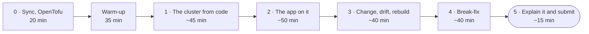

# Lab 10 · Mission: build it from code with OpenTofu

**Write the kind cluster, the Namespace, the database password and your Mission 9 chart as OpenTofu code in `infra/`. One `tofu apply` builds everything from nothing; one `tofu destroy` removes it. Change it, drift it by hand, rebuild it, then find three faults that a teammate brought into your code. This brief says what must be true in your fork. Finding out how is the mission.**

DevOps (ELE1013M) · Turiba University · Session 10 · **self-study, Wed 18 Nov (no class)** · individual work
Theory: this brief, the warm-up tutorial, and the docs in "Learn from"

| | |
|-|-|
| **You will** | Write `infra/` with four providers and five resources, run `tofu init`, `plan`, `apply` and `destroy`, read plans (`+`, `~`, `-/+`, `known after apply`), see drift, rebuild from zero, and debug three faults |
| **You hand in** | The URL of your fork on Evaluentis: `https://github.com/<you>/turiba-devops-labs` |
| **Passed when** | The gates G1–G6 (80 points), plus the quality of your write-up, PRs and commits (20 points). The grader copies `infra/` and `charts/course-app/` from your `main` into an empty folder, runs **one** `tofu apply` from nothing, checks the Pods and saves a todo, runs `tofu plan`, then `tofu destroy` and `tofu apply` again. An LLM reads your write-up |
| **Deadline** | **Sun 22 Nov 2026, 22:00** (Riga). A snapshot of your fork is taken at 22:05 |
| **Why it matters** | This is the capstone's target item **T1**, done. **Test 3 on Mon 23 Nov** covers IaC and Helm |



---

## On your own (no class on Wed 18 Nov)

> **When you're stuck, work through this order:**
> 1. the hints in this brief, one level at a time: 🔎 **Look** → 💡 **Think** → 🛠 **Fix**;
> 2. the **Troubleshooting** table at the end;
> 3. the docs in "Learn from";
> 4. after 20 minutes: a post in BATIS with the command you ran, its **exact** output, and what you expected.
>
> Helping each other is welcome: explain, debug together on a call, share links. Copying someone's files is not.

## How this mission works

As in Missions 6–9, this brief tells you what must be true when you're done, and where to learn how. You learn by reading the docs, trying, reading the error, and trying again.

| Part | Typical time |
|------|-------------:|
| 0 · Sync, OpenTofu, a clean slate | 20 min |
| Warm-up · HashiCorp's Docker tutorial (not graded) | 35 min |
| 1 · The cluster from code | 45 min |
| 2 · The app on it | 50 min |
| 3 · Change, drift, rebuild | 40 min |
| 4 · Break-fix | 40 min |
| 5 · Explain it and submit | 15 min |

- Do the parts **in order**. Each one needs the one before it.
- **Hints are free:** 🔎 **Look** → 💡 **Think** → 🛠 **Fix**. Open one level at a time.
- **`bash lab10-build-it/check.sh`** does what the grader does: it reads your `.tf` files, runs `tofu fmt`, `init`, `validate` and `plan`, then builds everything from zero on a throwaway cluster, checks it, and destroys it again. Run it whenever you like, with **your own cluster destroyed first** (`tofu destroy` in `infra/`): two kind clusters at once fail in WSL.
- **📝** marks something you write into `lab10/README.md`. **🔮** marks a prediction: write it **before** you look.
- **Run `tofu` inside `infra/`.** It reads every `.tf` file in the folder you're in.
- Commands are written for **bash**: on Windows, use the **Ubuntu (WSL)** terminal in `~/turiba-devops-labs`.

### OpenTofu in six lines

- **OpenTofu** (`tofu`) is the open-source fork of Terraform. The language and the commands are the same; tutorials that say `terraform` work with `tofu`.
- You **write** what should exist (`.tf` files). `tofu plan` compares that with what exists and prints what it **would** do. `tofu apply` does it.
- A **provider** is a plugin that knows one system: `kind` makes clusters, `kubernetes` makes Kubernetes objects, `helm` installs charts, `random` makes passwords. `tofu init` downloads them and writes their exact versions into the **lock file**, `.terraform.lock.hcl`.
- What OpenTofu made is remembered in the **state**, `terraform.tfstate`. It holds every value, **secrets too, in plain text**.
- A **reference** like `kubernetes_namespace_v1.course.metadata[0].name` connects two resources, and OpenTofu creates them in that order.
- `tofu destroy` deletes everything in the state, in reverse order.

> ⚠️ **Six rules for this mission**
> 1. **Every change reaches `main` through a pull request in your fork**, never in the course repo.
> 2. **Use the exact names in the tables:** `infra/`, the providers and versions, `kind_cluster.course`, `kubernetes_namespace_v1.course`, `random_password.db`, `kubernetes_secret_v1.db`, `helm_release.course_app`, the variables `cluster_name` and `api_replicas`, the output `kube_context`. The grader and `break.sh` find them by these names.
> 3. **The state and the kubeconfig never go into Git.** `infra/.gitignore` comes first, before your first `git add`. The lock file **does** go into Git.
> 4. **Only the four providers and the five resource types in this brief.** No `data`, `module` or `provisioner` blocks. The grader runs nothing outside that list; anything else is left for the lecturer to look at by hand.
> 5. **Once OpenTofu made something, change it only through OpenTofu.** Not with `kubectl`, `helm` or `kind`.
> 6. **End the day with `tofu destroy`** in `infra/`, not `kind delete cluster`. Your code is in Git; one `tofu apply` brings it all back.

---

## Finish line: the gates

| Gate | Points | What must be true at the snapshot |
|------|-------:|-----------------------------------|
| **G1** · The Lab 10 sync PR is merged | 5 | `lab10-build-it/` is on your `main`, unchanged |
| **G2** · infra/ on main | 25 | The lock file is committed. `tofu fmt -check` and `tofu validate` pass. Exactly the four providers with their versions, and the names and settings in the tables of Parts 1 and 2 (read from `tofu plan`, which needs no cluster). The chart comes from `../charts/course-app`, the Secret's password from `random_password`. Nothing outside the allowlist (rule 4) |
| **G3** · From zero, twice | 25 | In an empty folder with `cluster_name = lab10-check`: `tofu init` and **one** `tofu apply` succeed within 6 minutes. 3 ready API Pods and 1 database Pod; a todo is saved and read back. `tofu plan` right after says no changes. `tofu destroy`, then `tofu apply` again, succeeds |
| **G4** · Break-fix: a merged PR with the teammate's commit and your fixes | 15 | A merged PR into `main` contains the `break.sh` commit and your own later commits that change `infra/`. G2 passes on `main` afterwards |
| **G5** · No secrets in the repository | 5 | Checked by the grader in **every commit** on any branch or tag, also one you removed later: no password or token, and no `terraform.tfstate*`, no kubeconfig (`*-config`) and no `.terraform/` |
| **G6** · lab10/README.md: "Change, drift, rebuild" and "What broke and how I found it" | 5 | Sections 2 and 3 of `lab10/README.md` show your own output: the change, the drift, the rebuild, and each of the three faults with the command that showed it |

The other **20 points** are for quality:

| Criterion | Points | What earns them |
|-----------|-------:|-----------------|
| Q1 | 8 | Your own output, copied, and your predictions, with any mismatch explained |
| Q2 | 6 | Your PR descriptions say what changed and how you checked it (`tofu plan` output) |
| Q3 | 6 | Conventional Commit messages, one fix per commit in Part 4 |

---

## Learn from

| For | Read or watch | What to take from it |
|-----|---------------|----------------------|
| Warm-up | HashiCorp, [Get started – Docker](https://developer.hashicorp.com/terraform/tutorials/docker-get-started) (7 short pages, ~35 min) | Write → init → plan → apply → change → destroy, variables and outputs, on your own Docker. Type `tofu` wherever it says `terraform` |
| Background | OpenTofu docs: [Working with OpenTofu](https://opentofu.org/docs/intro/core-workflow/) | The write → plan → apply loop |
| Part 1 | tehcyx/kind provider: [kind_cluster](https://github.com/tehcyx/terraform-provider-kind/blob/master/docs/resources/cluster.md) | `name`, `wait_for_ready`, and what it exports: `endpoint`, the certificates, `context_name` |
| Part 2 | Helm provider: [provider settings](https://github.com/hashicorp/terraform-provider-helm/blob/main/docs/index.md) and [helm_release](https://github.com/hashicorp/terraform-provider-helm/blob/main/docs/resources/release.md) | `kubernetes = { … }` with an equals sign; `chart`, `namespace`, `set = [ … ]` |
| Part 2 | Kubernetes provider: [kubernetes_secret_v1](https://github.com/hashicorp/terraform-provider-kubernetes/blob/main/docs/resources/secret_v1.md); Random provider: [random_password](https://github.com/hashicorp/terraform-provider-random/blob/main/docs/resources/password.md) | `metadata`, `data`; `length`, `special`, and `result`, which is sensitive |
| Part 3 | OpenTofu docs: [Sensitive data in state](https://opentofu.org/docs/language/state/sensitive-data/) and [Dependency lock file](https://opentofu.org/docs/language/files/dependency-lock/) | Why the state is a secret, and why the lock file goes into Git |

---

## Part 0 · Sync, OpenTofu, a clean slate (20 min)

**1. Bring the Lab 10 material into your fork** through a pull request, the same way as in Labs 4–9:

```bash
git switch main && git pull
git fetch upstream
git switch -c chore/sync-upstream
git merge upstream/main
git push -u origin HEAD
```

Open the PR in **your fork**, merge it with **Create a merge commit**, then run `git switch main && git pull`.

**2. Install OpenTofu:** the section "Before Lab 10" in the course README (the root `README.md` of your fork, after the sync). Then:

```bash
tofu version     # OpenTofu v1.13.9 (macOS with Homebrew: any version from 1.10 on)
which tofu       # /usr/local/bin/tofu
```

**3. A clean slate.** Your Mission 9 cluster was made with `kind create cluster`. From now on, OpenTofu makes the cluster, so delete the old one. It's the **last** time you use `kind delete cluster` on your own cluster.

```bash
kind get clusters          # kind (from Mission 9)
kind delete cluster        # Mission 9 is graded from Git, not from this cluster
```

Mission 9 isn't finished yet? Finish it first (due Wed 18 Nov, 20:00).

**4. Your chart.** Mission 10 installs **your** Mission 9 chart: `ls charts/course-app` shows `Chart.yaml`, `values.yaml` and `templates/`.

- **Your chart is broken or missing?** Until Wed 18 Nov, 20:05, keep working on your own chart, or do Part 1 first (it needs no chart) and wait. **After 20:05** a fallback chart appears in `lab10-build-it/reference/charts/course-app/` (sync again, step 1). Bring it in through a PR and write "Fallback chart used: yes" at the top of your write-up. It costs no points.

  ```bash
  git switch main && git pull
  git switch -c chore/chart-fallback
  rm -rf charts/course-app && mkdir -p charts && cp -r lab10-build-it/reference/charts/course-app charts/
  git add -A charts && git commit -m "chore(chart): use the Mission 9 fallback chart"
  git push -u origin HEAD          # then open the PR in your fork and merge it
  ```

- **No image of your own?** The fallback chart uses `ghcr.io/martinsturiba/turiba-devops-labs/api:0.2.0`, as in Missions 8–9.

**5. Start your write-up:**

```bash
mkdir -p lab10 && cp lab10-build-it/write-up-template.md lab10/README.md
```

✅ **Checkpoint:** `tofu version` works. `kind get clusters` shows nothing (or only clusters that aren't yours). `ls lab10-build-it` shows `break.sh`, `check.sh`, `check.py` and `write-up-template.md`.

---

## Warm-up · HashiCorp's Docker tutorial (35 min, not graded)

Work through [Get started – Docker](https://developer.hashicorp.com/terraform/tutorials/docker-get-started), all seven pages, in a folder **outside** your repository:

```bash
mkdir -p ~/learn-tofu-docker && cd ~/learn-tofu-docker
```

- Skip the page "Install Terraform": you have OpenTofu. Everywhere else, type **`tofu`** where it says `terraform`.
- Use the **Mac or Linux** version of the code, also on Windows: in the Ubuntu (WSL) terminal, Docker is at `/var/run/docker.sock`, as on Linux.
- Finish with `tofu destroy`, then `cd ~/turiba-devops-labs`. Nothing from the warm-up goes into your fork.

What to notice: the `+`, `~` and `-` in front of each line of a plan, the line `Plan: 1 to add, 0 to change, 0 to destroy.`, and the file `terraform.tfstate` that appears after the first `apply`.

---

## Part 1 · The cluster from code (45 min)

**What must be true:** `infra/` makes the kind cluster `course`. `infra/.gitignore` keeps the state and the kubeconfig out of Git, and the lock file is committed.

```bash
git switch main && git pull
git switch -c feat/infra-cluster
mkdir -p infra
```

| File | Must have |
|------|-----------|
| `infra/.gitignore` | Four lines: `.terraform/`, `*.tfstate`, `*.tfstate.*`, `*-config`. **Write it first** |
| `infra/versions.tf` | A `terraform` block: `required_version = ">= 1.10"`, and `required_providers` with all four providers now, even though Part 1 uses only one: `kind` from `tehcyx/kind` `~> 0.13.0`, `kubernetes` from `hashicorp/kubernetes` `~> 3.5`, `helm` from `hashicorp/helm` `~> 3.3`, `random` from `hashicorp/random` `~> 3.9` |
| `infra/variables.tf` | `variable "cluster_name"` (type `string`, default `"course"`) and `variable "api_replicas"` (type `number`, default `3`) |
| `infra/providers.tf` | `provider "kind" {}` |
| `infra/main.tf` | `resource "kind_cluster" "course"` with `name = var.cluster_name` and `wait_for_ready = true` |
| `infra/outputs.tf` | `output "kube_context"` with `value = kind_cluster.course.context_name` |

OpenTofu reads every `.tf` file in the folder, so the split into five files is for you, not for OpenTofu.

🔮 **Predict** (📝 section 1): how many resources will the first `tofu plan` add, and which values will it show as `known after apply`?

```bash
cd infra
tofu init          # downloads the four providers (about 170 MB) and writes .terraform.lock.hcl
tofu fmt           # tidies the spacing; run it before every commit
tofu validate
tofu plan
tofu apply         # shows the plan again and asks: type yes
kubectl get nodes
tofu output
cd ..
git add infra
git status --short           # what is about to be committed
```

<details><summary>🔎 Look</summary>

The tehcyx/kind page in "Learn from" lists what `kind_cluster` takes (`name`, `wait_for_ready`) and what it exports once the cluster exists (`endpoint`, `client_certificate`, `context_name`, …). The warm-up's first page had the same three-part shape: a `terraform` block, a `provider`, a `resource`.
</details>

<details><summary>💡 Think</summary>

- `tofu init` warns `Signature validation was skipped due to the registry not containing GPG keys` for tehcyx/kind. That's expected for this community provider.
- `version = "~> 3.5"` allows 3.5 and any later 3.x, never 4.0; `~> 0.13.0` allows only 0.13.x. `tofu init` picks a version that fits and writes it into the lock file, so everyone who commits and pulls the lock file gets the same one.
- `known after apply` marks every value that only exists once the cluster does: its address, its certificates, its kubeconfig.
- After `apply`, `infra/` holds files that must never be committed: `terraform.tfstate`, the folder `.terraform/`, and `course-config`, a kubeconfig with the cluster's key that the kind provider writes. That's what `.gitignore` is for. `git status` must not list any of them.
- The kind provider also adds the context `kind-course` to `~/.kube/config` and makes it current, so `kubectl` talks to the new cluster.
</details>

<details><summary>🛠 Fix</summary>

`infra/.gitignore`:

```text
.terraform/
*.tfstate
*.tfstate.*
*-config
```

`infra/versions.tf`:

```hcl
terraform {
  required_version = ">= 1.10"

  required_providers {
    kind = {
      source  = "tehcyx/kind"
      version = "~> 0.13.0"
    }
    kubernetes = {
      source  = "hashicorp/kubernetes"
      version = "~> 3.5"
    }
    helm = {
      source  = "hashicorp/helm"
      version = "~> 3.3"
    }
    random = {
      source  = "hashicorp/random"
      version = "~> 3.9"
    }
  }
}
```

`infra/variables.tf`:

```hcl
variable "cluster_name" {
  type    = string
  default = "course"
}

variable "api_replicas" {
  type    = number
  default = 3
}
```

`infra/providers.tf`:

```hcl
provider "kind" {}
```

`infra/main.tf`:

```hcl
resource "kind_cluster" "course" {
  name           = var.cluster_name
  wait_for_ready = true
}
```

`infra/outputs.tf`:

```hcl
output "kube_context" {
  value = kind_cluster.course.context_name
}
```

The end of the first plan:

```text
Plan: 1 to add, 0 to change, 0 to destroy.

Changes to Outputs:
  + kube_context = (known after apply)
```
</details>

✅ **Checkpoint:**

- `kubectl get nodes` shows `course-control-plane` `Ready`. `tofu output` shows `kube_context = "kind-course"`.
- After `git add infra`, `git status --short` lists exactly seven files with `A`: `infra/.gitignore`, `infra/.terraform.lock.hcl` and your five `.tf` files. **No** `terraform.tfstate`, `course-config` or `.terraform/`. If one of them is there: `git restore --staged infra`, fix `.gitignore`, `git add infra` again.
- Commit (for example `feat(infra): the kind cluster from code`), push, and merge the PR in your fork.

📝 Section 1: the end of your first plan and your prediction.

---

## Part 2 · The app on it (50 min)

**What must be true:** one `tofu apply` from **nothing** gives the whole app: the cluster, the Namespace `course`, the Secret `db-secret` with a random password, and your chart. In Mission 9 you made the Namespace and the Secret with `kubectl`; now OpenTofu makes them.

```bash
git switch main && git pull
git switch -c feat/infra-app
```

| File | Must have |
|------|-----------|
| `infra/providers.tf` | Also `provider "kubernetes"` and `provider "helm"`, both connected with `host`, `client_certificate`, `client_key` and `cluster_ca_certificate` from `kind_cluster.course` (`host` is `kind_cluster.course.endpoint`). The Helm provider takes them inside `kubernetes = { … }` |
| `infra/main.tf` | `resource "kubernetes_namespace_v1" "course"`: the Namespace `course` |
| | `resource "random_password" "db"`: `length = 24`, `special = false` |
| | `resource "kubernetes_secret_v1" "db"`: name `db-secret`, namespace **by reference** to the Namespace, `data = { password = random_password.db.result }` |
| | `resource "helm_release" "course_app"`: `name = "course-app"`; namespace by reference; `chart = "${path.module}/../charts/course-app"`; `set = [{ name = "api.replicas", value = tostring(var.api_replicas) }]`; `depends_on = [kubernetes_secret_v1.db]` |

The image tag stays in your chart's `values.yaml`, as in Mission 9.

🔮 **Predict** (📝 section 1): right after `tofu apply`, what will `tofu plan` say?

```bash
cd infra
tofu fmt && tofu validate
tofu plan                    # 4 to add: the cluster from Part 1 is already there
tofu apply
tofu plan
```

Now the real test: **from zero.**

```bash
tofu destroy                 # type yes
time tofu apply -auto-approve
kubectl -n course get pods
```

Save a todo through the port-forward, as in Labs 8–9:

```bash
kubectl -n course port-forward service/api 8080:80          # in a second terminal, leave it running
curl -s -X POST -H 'Content-Type: application/json' -d '{"title":"built from code"}' localhost:8080/api/todos
```

🔮 **Predict** (📝 section 1): where is the database password now? Find out **without printing it**:

```bash
grep -c '"result"' terraform.tfstate              # counts lines, never shows them
tofu state show kubernetes_secret_v1.db | grep data
```

<details><summary>🔎 Look</summary>

The Helm provider's settings page and its `helm_release` page, then `kubernetes_secret_v1` and `random_password` ("Learn from"). Read the examples: in the current Helm provider (3.x), `kubernetes` and `set` are written with an equals sign.
</details>

<details><summary>💡 Think</summary>

- Every reference is an order. The Secret names the Namespace, so the Namespace comes first. The release doesn't name the Secret, so `depends_on` says it: the database must find `db-secret` when it starts.
- `set` values are strings, so `tostring(var.api_replicas)` turns the number into one. OpenTofu would also convert it by itself; `tostring` shows what you mean.
- `tofu apply` on a `helm_release` **waits** until the Pods are ready (up to 5 minutes). Watch them in a second terminal: `kubectl -n course get pods -w`.
- A second `tofu plan` compares the code, the state and the cluster again. If they all agree, there's nothing to do.
- `random_password.db.result` is marked sensitive, so plans print `(sensitive value)`. The state file still holds it in plain text: `grep -c` counts 2 lines, and one of them is the password itself. That's why the state never goes into Git.
</details>

<details><summary>🛠 Fix</summary>

`infra/providers.tf`:

```hcl
provider "kind" {}

provider "kubernetes" {
  host                   = kind_cluster.course.endpoint
  client_certificate     = kind_cluster.course.client_certificate
  client_key             = kind_cluster.course.client_key
  cluster_ca_certificate = kind_cluster.course.cluster_ca_certificate
}

provider "helm" {
  kubernetes = {
    host                   = kind_cluster.course.endpoint
    client_certificate     = kind_cluster.course.client_certificate
    client_key             = kind_cluster.course.client_key
    cluster_ca_certificate = kind_cluster.course.cluster_ca_certificate
  }
}
```

Add to `infra/main.tf`, below the cluster:

```hcl
resource "kubernetes_namespace_v1" "course" {
  metadata {
    name = "course"
  }
}

resource "random_password" "db" {
  length  = 24
  special = false
}

resource "kubernetes_secret_v1" "db" {
  metadata {
    name      = "db-secret"
    namespace = kubernetes_namespace_v1.course.metadata[0].name
  }
  data = {
    password = random_password.db.result
  }
}

resource "helm_release" "course_app" {
  name      = "course-app"
  namespace = kubernetes_namespace_v1.course.metadata[0].name
  chart     = "${path.module}/../charts/course-app"

  set = [
    { name = "api.replicas", value = tostring(var.api_replicas) },
  ]

  depends_on = [kubernetes_secret_v1.db]
}
```

The apply from zero ends like this (about 1.5 minutes):

```text
kind_cluster.course: Creation complete after 42s [id=course-]
kubernetes_namespace_v1.course: Creation complete after 0s [id=course]
kubernetes_secret_v1.db: Creation complete after 0s [id=course/db-secret]
helm_release.course_app: Creation complete after 38s [id=course-app]

Apply complete! Resources: 5 added, 0 changed, 0 destroyed.

Outputs:

kube_context = "kind-course"
```

The next plan: `No changes. Your infrastructure matches the configuration.`
</details>

✅ **Checkpoint:**

- `kubectl -n course get pods` shows 4 Pods `1/1 Running`: 3 `api` and 1 `db`. `curl -s localhost:8080/api/todos` lists your todo.
- `tofu plan` says `No changes.`
- Commit (for example `feat(infra): the namespace, the password, the secret and the chart`), push, and merge the PR.
- After the merge: `tofu destroy` in `infra/`, then `bash lab10-build-it/check.sh` from the root of your clone (about 5 minutes). It shows ✔ for G2 and G3. Then `tofu apply` again for Part 3.

📝 Section 1: the end of the apply from zero with its time, the plan right after, the `grep -c` result, and your two predictions.

---

## Part 3 · Change, drift, rebuild (40 min)

**What must be true:** you have read the plan for a change, seen what OpenTofu notices when someone changes the cluster by hand (and what it doesn't), and rebuilt everything from zero. Nothing to commit in this part: your output goes into the write-up.

Keep the port-forward from Part 2 running in the second terminal (start it again whenever it stops). Work in `infra/`.

**1. A change.**

🔮 **Predict** (📝 section 2): which plan symbol will you see for `-var api_replicas=2`, and which value changes?

```bash
tofu apply -var api_replicas=2           # read the plan before you type yes
helm history course-app -n course
kubectl -n course get deployment api
```

<details><summary>💡 Why? (open it after you've written your prediction)</summary>

`~ update in-place` with `~ value = "3" -> "2"` inside `set`: the release stays, Helm upgrades it, and `helm history` shows **revision 2**. OpenTofu drives Helm; Helm still keeps its own history.
</details>

**2. Drift: someone changes the cluster by hand.**

🔮 **Predict** (📝 section 2): for each of the two changes below, what will `tofu plan` show?

```bash
kubectl -n course delete secret db-secret
tofu plan -var api_replicas=2                            # -var: compare with the change from step 1
kubectl -n course scale deployment api --replicas=1
tofu plan -var api_replicas=2
```

<details><summary>💡 Why?</summary>

- The deleted Secret: `+ create` for `kubernetes_secret_v1.db`, `Plan: 1 to add`. OpenTofu reads every resource it manages from the cluster before it plans, and the Secret is gone.
- The scaled Deployment: **the same plan, nothing more**. The Deployment isn't an OpenTofu resource: it's inside the Helm release, and the release itself didn't change. OpenTofu can't see that drift (Stretch shows a way). That's rule 5: once OpenTofu made it, change it only through OpenTofu.
</details>

**3. Bring it back.**

🔮 **Predict** (📝 section 2): a plain `tofu apply` (no `-var`, so `api_replicas` is 3 again). What will the plan contain, and how many API Pods will run afterwards?

```bash
tofu apply
kubectl -n course get deployment api
```

<details><summary>💡 Why?</summary>

`+ create` for the Secret and `~ update in-place` for the release (`"2" -> "3"`): `Plan: 1 to add, 1 to change, 0 to destroy.` The Helm upgrade sets the Deployment to 3 Pods again, and that also undoes the `kubectl scale`.
</details>

**4. Rebuild from zero.**

🔮 **Predict** (📝 section 2): after `tofu destroy` and `tofu apply`, is your todo still there?

```bash
time tofu destroy -auto-approve
time tofu apply -auto-approve
kubectl -n course port-forward service/api 8080:80          # in the second terminal again
curl -s localhost:8080/api/todos
```

<details><summary>💡 Why?</summary>

`[]`: the database lived on a PVC in the cluster, and `tofu destroy` deleted the cluster. Everything in the code came back in about 1.5 minutes; the **data** didn't, because data isn't code. Real systems keep data outside what they rebuild (a managed database, backups).
</details>

✅ **Checkpoint:**

- `kubectl -n course get pods` shows 4 Pods `1/1 Running` again, and `tofu plan` says `No changes.`
- You have the output of all four steps and four predictions.

📝 Section 2, **"Change, drift, rebuild":** the output of each step and your predictions.

---

## Part 4 · Break-fix (40 min)

Your cluster from Part 3 must be up (`tofu plan` says `No changes.`). A teammate "tidied up" your `infra/`. `break.sh` brings their commit into your clone on a new branch, `chore/tidy-infra`:

```bash
git switch main && git pull
bash lab10-build-it/break.sh
git push -u origin HEAD
```

Open a PR into `main` in **your fork**. No check runs on `infra/`: this time **you** are the check.

🔮 **Predict** (📝 section 3): you run `tofu plan` on this branch. What goes wrong first?

**What must be true:** you find **all three** faults with `tofu` (start with `cd infra && tofu plan`). You fix each one **in its own commit** on the same branch, push, and merge when `tofu plan` shows no replacement, `tofu apply` works, `kubectl -n course get deployment api` shows `3/3`, and `GET /api/todos` answers through the port-forward.

> ⚠️ **Read every plan before you type `yes`.** One of the three faults is only visible in the plan. Applying it costs your database.

<details><summary>🔎 Look</summary>

Read the first `Error:` line, and the lines under it. When the plan finally works, read **every** line of it before you apply: what does `-/+` mean, and which line says why? The PR's **Files changed** tab shows every line the teammate touched.
</details>

<details><summary>💡 Think</summary>

- OpenTofu works in stages: first the providers (`init`, the lock file), then reading the code and the chart (`plan`), then the cluster (`apply`). A fault stops it at its stage, so you meet them **one at a time**.
- A message about the **lock file** means the providers in the code no longer match the ones that were installed. Look at `required_providers`.
- `-/+ destroy and then create replacement` means OpenTofu can't change that resource in place. For a Helm release that means **uninstall, then install**: the PVC and your data go too. The line marked `# forces replacement` names the cause.
</details>

<details><summary>🛠 Fix</summary>

1. In `versions.tf`, `source = "tehcyx/kind"` became `"hashicorp/kind"`. `tofu plan` stops with `Error: Inconsistent dependency lock file` and `provider registry.opentofu.org/hashicorp/kind: required by this configuration but no version is selected`. `tofu init` then says `provider registry registry.opentofu.org does not have a provider named registry.opentofu.org/hashicorp/kind` and asks `Did you intend to use tehcyx/kind?`: there is no such provider. Make it `tehcyx/kind` again.
2. In `main.tf`, the chart path became `../chart/course-app` (no `s`). `tofu plan` stops with `Error: Error locating chart` and `Unable to locate chart ./../chart/course-app: path "./../chart/course-app" not found`. Make it `charts` again.
3. In `main.tf`, the release's `namespace` became `"courses"`. Now `tofu plan` works, but it says `# helm_release.course_app must be replaced`, `-/+ resource "helm_release" "course_app"`, with `~ namespace = "course" -> "courses" # forces replacement`, and `Plan: 1 to add, 0 to change, 1 to destroy.` A release can't move to another namespace, and `courses` doesn't exist. Applied anyway, OpenTofu uninstalls your release (the PVC and your todos with it), then fails with `create: failed to create: namespaces "courses" not found`. Make it `kubernetes_namespace_v1.course.metadata[0].name` again. If you didn't apply, the plan then says `No changes.` If you did, it says `Plan: 1 to add`: one `tofu apply` brings the release back in about 15 seconds, with an empty database.
</details>

✅ **Checkpoint:**

- The PR has the teammate's commit plus your three fix commits.
- After the merge, `tofu plan` on `main` says `No changes.`, `kubectl -n course get deployment api` shows `3/3`, and `GET /api/todos` answers through the port-forward.
- `check.sh` shows ✔ for G4.

📝 Section 3, **"What broke and how I found it":** for each fault, what you saw, the command and the line of output that showed it, and your fix commit.

---

## Part 5 · Explain it and submit (15 min)

1. Finish `lab10/README.md`: every `____` replaced, section 4 in your own words. Bring it in through a PR.
2. Destroy your own cluster, then run the self-check:

   ```bash
   (cd infra && tofu destroy -auto-approve)
   bash lab10-build-it/check.sh
   ```

   - **What it does:** it copies `infra/` and `charts/course-app/` from your `main` into a temporary folder and reads the `.tf` files. Then it runs `tofu fmt -check`, `init`, `validate` and `plan`. Then it builds a second cluster, `lab10-check`, from zero: `tofu apply`, the Pods, a todo saved and read back, `tofu plan`, `tofu destroy`, `tofu apply` again, and a last `tofu destroy`. About 5 minutes. Your own cluster, your state, your kubectl context and `~/.kube/config` are left alone.
   - **Why destroy yours first?** Two kind clusters at once hit a Linux limit in WSL: the second one's Pods never start (`too many open files`). So `check.sh` doesn't build its cluster while another kind cluster runs; it tells you which one.
   - **The token:** it finds one by itself if `gh` is logged in. Otherwise it asks, and hides what you paste.
3. Submit `https://github.com/<you>/turiba-devops-labs` on Evaluentis before **Sun 22 Nov, 22:00**.
4. End the day: `cd infra && tofu destroy`.

✅ **Checkpoint:** `check.sh` shows ✔ for G1, G2, G3, G4 and G6, and nothing under G5. G5 itself is checked by the grader only.

---

## Troubleshooting

| You see | Why | Fix |
|---------|-----|-----|
| `tofu: command not found`, or `which tofu` shows `/mnt/c/…` | OpenTofu isn't installed in Ubuntu, or a Windows copy comes first | "Before Lab 10" in the course README, then open a new terminal |
| `git status` lists `terraform.tfstate`, `course-config` or `.terraform/` | `infra/.gitignore` is missing or incomplete | The four lines from Part 1. Never `git add` them |
| You committed `terraform.tfstate` or `course-config` | The state holds the DB password, the kubeconfig the cluster's key | `git rm --cached` the file, fix `.gitignore`, commit. Then `tofu destroy` and `tofu apply`: a new cluster with a new key, a new password and a fresh database. Replacing only the password breaks the database login, because PostgreSQL keeps the password it got on its first start (Mission 8). The commit stays in Git's history, and the grader sees it: write in `lab10/README.md` what was committed and what you did |
| `Error: could not locate any control plane nodes for cluster named 'course'` on every `plan`, `apply` and `destroy` | The cluster was deleted with `kind delete cluster`, not `tofu destroy`. The state still lists it | In `infra/`: `rm terraform.tfstate terraform.tfstate.backup`, then `tofu apply`. From now on: `tofu destroy` (rule 6) |
| `Error: Failed to read namespace … dial tcp 127.0.0.1:80: connect: connection refused` | The same: the cluster is gone, but the state still lists what was on it | The same fix: delete the two state files, then `tofu apply` |
| `failed to get cluster internal kubeconfig: command "docker exec --privileged course-control-plane cat /etc/kubernetes/admin.conf" failed` | The cluster's container is stopped: after a reboot, or Rancher Desktop was restarted | `docker start course-control-plane`, wait 30 seconds, `tofu plan` again |
| `Error: Inconsistent dependency lock file` | The providers in the code don't match the lock file | You changed `required_providers`: `tofu init`, then commit `.terraform.lock.hcl`. You didn't: check the `source` lines (Part 4) |
| `Error: Required plugins are not installed` | A fresh clone, or a deleted `.terraform/`: the lock file is there, the providers aren't | `tofu init` in `infra/` |
| `… does not have a provider named registry.opentofu.org/hashicorp/kind` | The kind provider is `tehcyx/kind`, not `hashicorp/kind` | `source = "tehcyx/kind"` |
| `Blocks of type "kubernetes" are not expected here` or `An argument named "kubernetes" is not expected here` | Helm provider 3.x writes `kubernetes = { … }` with an equals sign; older tutorials show the 2.x block | The Part 2 code, and `version = "~> 3.3"` |
| A warning that `kubernetes_namespace` is deprecated | Provider 3.x wants the `_v1` resources | `kubernetes_namespace_v1`, `kubernetes_secret_v1` |
| `Error locating chart … Unable to locate chart` | The `chart` path is wrong | `chart = "${path.module}/../charts/course-app"` |
| `Failed to check installed release version: Kubernetes cluster unreachable` on a plan before the cluster exists | You added `upgrade_install = true`. It asks the cluster during the plan, and from zero there's no cluster yet | Remove `upgrade_install`. One apply from zero must work (G3) |
| `helm_release.course_app: Still creating... [4m50s elapsed]`, then `context deadline exceeded` | The Pods weren't ready within 5 minutes: a slow image download, or a Pod that crashes | In a second terminal, **while it waits**: `kubectl -n course get pods`, then the Lab 8 debug loop. Then `tofu apply` again |
| `Error: cannot re-use a name that is still in use` | A failed first install left a release that OpenTofu doesn't know about | `helm uninstall course-app -n course`, then `tofu apply` |
| `Error: … namespaces "courses" not found` | The release points at a namespace that doesn't exist | `namespace = kubernetes_namespace_v1.course.metadata[0].name` (Part 4, fault 3) |
| You changed a chart template, but `tofu plan` says `No changes.` | The Helm provider sees the chart's **version**, not every template line | Raise `version:` in `Chart.yaml` (for example `0.1.1`), then `tofu apply`. Stretch shows another way |
| `kubectl scale` or a `helm upgrade` by hand doesn't show up in `tofu plan` | Drift inside the release is invisible to OpenTofu | Expected (Part 3). Change it through OpenTofu (rule 5) |
| `kubectl` talks to another cluster | Another context is current | `kubectl config use-context kind-course` (`tofu output kube_context` names it) |
| Everything is slow, Pods stay `Pending`, or `kind` fails | Too many clusters: the Mission 9 one is still there | `kind get clusters`; delete old clusters with `kind delete cluster --name <name>` (only clusters you made with `kind`) |
| `port-forward`: `lost connection to pod`, or `curl` gets no answer | The Pod it was talking to was replaced | Start `port-forward` again |
| `CreateContainerConfigError`, `Init:0/1`, `relation "todos" does not exist` … | The same objects as in Labs 8–9, so the same faults | The Lab 8 Troubleshooting table |
| `break.sh` says `✘ …` | It refuses rather than guess | Do what the line says. It changed nothing |
| `check.sh` says `Not run: …` under G2 | Something in `infra/` is outside the allowlist (rule 4) | Remove it from `main`, or ask the lecturer |
| `check.sh` says under G3 `Not run: the kind cluster course is running` | It builds its own cluster, and two kind clusters at once hit a Linux limit in WSL | `tofu destroy` in `infra/`, run `check.sh` again, then `tofu apply` |
| A second cluster's Pods stay `Pending` or `Init:0/1`; `kube-proxy` shows `Error` with `too many open files` | Two kind clusters at once: WSL's inotify limit (`fs.inotify.max_user_instances` is 128) | One cluster at a time: `tofu destroy` (or `kind delete cluster --name …` for one you made with kind) |
| `check.sh`: G3 fails at the first apply, but your own `tofu apply` works | `check.sh` starts from an **empty** folder with what is on GitHub `main`: a file you didn't commit, or a change on another branch | `git status`, merge your PR, run it again |
| `check.sh` was stopped half-way | — | `kind delete cluster --name lab10-check` |

---

## Stretch (for fast finishers)

Stretch work happens on a separate branch. Merge it only if `check.sh` still shows ✔ for G2 and G3. Add a section "Stretch" to the end of `lab10/README.md`. It gives no points and costs none.

| Goal | Proves |
|------|--------|
| Add `experiments = { manifest = true }` to `provider "helm"`, apply, then repeat Part 3, step 2, and change a template line | The provider can compare every rendered object: the `kubectl scale` and the template edit now show up, at the cost of much longer plans |
| On a branch, add `timeout = 120` to the release and `tofu apply` with a tag that doesn't exist (`set` `api.image.tag`). Then read `helm history` and the next `tofu plan` | A failed upgrade: `context deadline exceeded`, `status = "failed" -> "deployed"`, and one apply with the right value fixes it |
| `tofu plan -out=tfplan`, then `tofu apply tfplan` | Why teams apply exactly the plan that was reviewed |
| The password without the state: `ephemeral "random_password" "db"` instead of the resource, and in the Secret `data_wo = { password = ephemeral.random_password.db.result }` with `data_wo_revision = 1` instead of `data`. Then `grep -c '"result"' terraform.tfstate` again | A write-only argument: the password reaches the cluster but never the state |

---

## Command summary

```bash
tofu init                              # download the providers, write .terraform.lock.hcl
tofu fmt                               # tidy the files (fmt -check only checks)
tofu validate                          # is the code consistent
tofu plan                              # what would change: + create, ~ update, -/+ replace, - destroy
tofu apply                             # do it (asks for yes; -auto-approve doesn't ask)
tofu apply -var api_replicas=2         # the same, with another value for a variable
tofu output                            # the outputs, such as kube_context
tofu state list                        # what OpenTofu manages
tofu destroy                           # delete everything in the state (end of every day)
bash lab10-build-it/break.sh           # Part 4
bash lab10-build-it/check.sh           # what the grader will see
```
