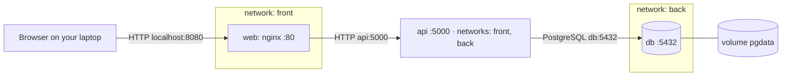

# Lab 4 · Multi-service app with Compose

GitHub user: sachidumaleesha · Reference files used (Lab 2 fallback): no

## 1 · Architecture



Which arrow crosses from your laptop into Docker: Browser → web over `localhost:8080`.

## 2 · Predictions and what happened

| # | I predicted | What I saw (command → the deciding output line) | Match? | If not: why |
|---|-------------|--------------------------------------------------|--------|-------------|
| P1 | b — `web` and `db` will be on different networks, so Docker DNS should not expose `db` to `web`. | ____ | ____ | |
| P2 | b — PostgreSQL will not have a published host port, so the laptop connection should be refused. | ____ | ____ | |
| P3 | a — the todo should remain in the named volume when containers are removed. | ____ | ____ | |
| P4 | c — `down -v` should delete the named volume, including both the table and its rows. | ____ | ____ | |
| P5 | a — the API process health check should remain healthy, but a database request should return 500. | ____ | ____ | |
| P6 | b — the browser is outside Docker and cannot resolve the Compose service name `api`. | ____ | ____ | |

## 3 · Backup and restore

```text
____
```

Why the restore must run before `api` starts: ____

## 4 · Compose clinic

### c1 (worked example)
- Error line (copied): `connect ECONNREFUSED 127.0.0.1:5432`
- Checkpoint: port, inside `api`
- Fix: `DB_HOST: db`
- Why this fix, and not the tempting one: inside `api`, `localhost` is `api` itself, and nothing listens on 5432 there. Docker's DNS answers `db` with the database container's address. Publishing `db`'s port would "work" by opening a door into the database.
- Hints used: 0

## 5 · Run in one command

```bash
git clone https://github.com/sachidumaleesha/turiba-devops-labs.git && cd turiba-devops-labs
____
____
```

## 6 · Answers

### A1

____

### A2

____

### A3

____

### A4

____
